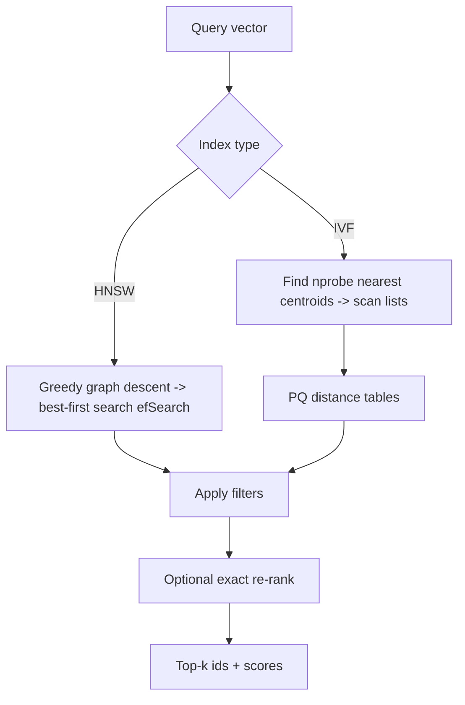

# Vector Databases

Hub: [[AI-Engineering-Index]]

## Core Idea

A vector database stores embeddings and answers "find the k vectors most similar to this query vector", usually combined with metadata filters. Exact search is $O(Nd)$ per query; at scale we use **approximate nearest neighbor (ANN)** indexes that trade a little recall for large gains in latency and memory. The "database" part adds persistence, updates, filtering, replication, and access control.

## How it works

**Similarity metrics**: cosine, dot product, L2. For unit-normalized vectors, ranking by cosine = dot product = L2 (since $\|a-b\|^2 = 2 - 2a\cdot b$). Use the metric the embedding model was trained for.

### Flat (brute force)
Exact; fine up to a moderate number of vectors or as ground truth for measuring ANN recall.

### HNSW (Hierarchical Navigable Small World)
A multi-layer proximity graph. Upper layers are sparse (long jumps), bottom layer contains all points. Search greedily descends from the top, then does a best-first search with a candidate list at layer 0.

- `M`: neighbors per node (graph degree). Higher = better recall, more memory.
- `efConstruction`: candidate list size while building. Higher = better graph, slower build.
- `efSearch`: candidate list size at query time. The main recall/latency knob.
- Strengths: high recall at low latency, incremental inserts. Weaknesses: memory-heavy (vectors + graph), deletes are awkward (tombstones), build is slower.

### IVF (Inverted File index)
Cluster vectors with k-means into `nlist` centroids. Each vector goes into its nearest centroid's list. At query time, probe the `nprobe` nearest centroids and scan only those lists.

- Higher `nprobe` = better recall, slower.
- Needs training on representative data; distribution drift degrades it.

### PQ (Product Quantization)
Split each $d$-dim vector into $m$ subvectors; k-means each subspace into 256 codes; store each vector as $m$ bytes. Distances computed via lookup tables (asymmetric distance). Massive memory reduction with some recall loss; often combined as **IVF-PQ**, with a re-rank on full vectors for top candidates. Scalar quantization (e.g. float32 to int8) and binary quantization are simpler alternatives.



## Python code

Exact baseline and recall measurement in NumPy:

```python
import numpy as np

def normalize(x):
    return x / np.linalg.norm(x, axis=1, keepdims=True)

def exact_topk(db, q, k):
    scores = db @ q
    idx = np.argpartition(-scores, k)[:k]
    return idx[np.argsort(-scores[idx])]

def recall_at_k(approx_ids, exact_ids):
    return len(set(approx_ids) & set(exact_ids)) / len(exact_ids)
```

FAISS HNSW and IVF-PQ (inner product on normalized vectors):

```python
import faiss
import numpy as np

d, n = 384, 100_000
xb = np.random.rand(n, d).astype("float32"); faiss.normalize_L2(xb)
xq = np.random.rand(10, d).astype("float32"); faiss.normalize_L2(xq)

flat = faiss.IndexFlatIP(d); flat.add(xb)
_, gt = flat.search(xq, 10)                         # ground truth

hnsw = faiss.IndexHNSWFlat(d, 32, faiss.METRIC_INNER_PRODUCT)
hnsw.hnsw.efConstruction = 200
hnsw.add(xb)
hnsw.hnsw.efSearch = 64
_, I_h = hnsw.search(xq, 10)

quant = faiss.IndexFlatIP(d)
ivfpq = faiss.IndexIVFPQ(quant, d, 1024, 48, 8, faiss.METRIC_INNER_PRODUCT)  # nlist, m, nbits
ivfpq.train(xb); ivfpq.add(xb)
ivfpq.nprobe = 16
_, I_p = ivfpq.search(xq, 10)

for name, I in [("hnsw", I_h), ("ivfpq", I_p)]:
    r = np.mean([len(set(I[i]) & set(gt[i])) / 10 for i in range(len(xq))])
    print(name, "recall@10", round(r, 3))
```

(`m` must divide `d`; 384 / 48 = 8. Random data is a poor proxy for real embeddings; benchmark on your own vectors.)

## Metadata filtering

Real queries look like "top-k similar where tenant = X and date > Y".

| Approach | How | Problem |
|---|---|---|
| Post-filter | ANN top-k', then filter | selective filters return fewer than k results |
| Pre-filter | filter ids, then exact search on subset | slow if subset is large |
| Filtered ANN (in-traversal) | skip non-matching nodes during graph/list search | very selective filters can disconnect the graph; engines fall back to brute force |
| Partition / namespace | separate index per tenant or shard | many small indexes; good isolation |

For multi-tenant and permissioned data, enforce ACL filters server-side on every query; never rely on the LLM to ignore unauthorized chunks ([[AI-Data-Leakage-and-Privacy]], [[Least-Privilege]]).

## Recall / latency / memory tradeoffs

| Index | Recall | Latency | Memory | Updates | Notes |
|---|---|---|---|---|---|
| Flat | exact | grows linearly | full vectors | trivial | ground truth |
| HNSW | high, tune efSearch | low | vectors + graph | good inserts, weak deletes | common default |
| IVF-Flat | tune nprobe | medium | vectors | needs retrain on drift | simple, disk-friendly |
| IVF-PQ | lower, re-rank helps | low | very small | needs training | billion-scale |
| DiskANN-style | high | low-medium, SSD | small RAM | varies | datasets beyond RAM |

Tune by plotting recall@k vs p95 latency on your data and picking the knee point that meets your SLO.

## Choosing a system

- Already on Postgres and moderate scale: a vector extension (e.g. pgvector) keeps transactions, joins, and ACLs in one place.
- Existing search stack: engines like OpenSearch/Elasticsearch support vectors plus BM25 for [[Hybrid-Search-and-Reranking]].
- Large scale, high QPS, heavy filtering: dedicated vector databases.
- Library only (FAISS, hnswlib) when you manage persistence and serving yourself.

> TODO: add a comparison of specific engines only with verified, dated feature data.

## Failure modes

- Mixing embeddings from different models or versions in one index (vectors are incomparable).
- Wrong metric (L2 on unnormalized vectors when model expects cosine).
- Recall silently drops after data drift (IVF centroids stale) or after many deletes.
- Filtered queries returning too few results with post-filtering.
- Tenant data leakage through missing filters.
- Embedding model upgrade without full re-index.

## Production notes

- Store the embedding model name/version and chunker version with every vector.
- Measure ANN recall against a flat index on a sample regularly, not just end-to-end answer quality.
- Plan re-indexing as a blue/green operation (build new index, dual-read, switch).
- Back up raw text and metadata; vectors are derivable, source data is not.
- Monitor p50/p95 query latency, QPS, index size, and filter selectivity ([[LLM-Observability]]).

## Interview questions

1. **Why ANN instead of exact search?** Exact is linear in N per query; ANN gives sublinear latency with small recall loss.
2. **Explain HNSW and its knobs.** Layered proximity graph; `M` (degree), `efConstruction` (build quality), `efSearch` (query recall vs latency).
3. **Explain IVF-PQ.** Coarse k-means clustering to pick lists (`nprobe`), PQ compresses vectors into codes for fast approximate distances; re-rank top results with full vectors.
4. **Cosine vs dot vs L2?** Equivalent ranking on normalized vectors; otherwise use what the model was trained with.
5. **Why is filtering hard for ANN?** Selective filters remove most candidates; post-filtering under-returns and graph traversal may disconnect.
6. **How do you measure vector index quality?** recall@k against exact search, plus latency percentiles and memory.
7. **How do you upgrade the embedding model?** Re-embed everything into a new index, validate, then switch; never mix.
8. **How do you enforce multi-tenant isolation?** Server-side mandatory filters or per-tenant namespaces/indexes.

## Related

[[Embeddings]] - [[Chunking-Strategies]] - [[Hybrid-Search-and-Reranking]] - [[RAG-Playbook]] - [[RAG-System-Checklist]] - [[Quantization]]
