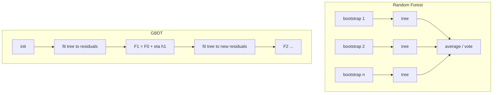

# Classification Algorithms

Hub: [[AI-Engineering-Index]]

## Core Idea

Different classifiers encode different inductive biases: similarity (kNN), conditional independence (Naive Bayes), maximum margin (SVM), axis-aligned splits (trees), and variance/bias reduction by ensembling (random forest, boosting). On tabular data, gradient-boosted trees are the usual strong baseline; logistic regression is the usual simple one.

## How it works

### k-Nearest Neighbors

- Predict the majority label among the $k$ closest training points.
- No training; prediction costs $O(nd)$ naive, sublinear with KD-trees/ANN indexes.
- Requires feature scaling; degrades in high dimensions (distances concentrate).
- Small $k$ = low bias/high variance; large $k$ = smoother.

### Naive Bayes

- $P(y\mid x) \propto P(y)\prod_j P(x_j\mid y)$ -- assumes features independent given class.
- Variants: Gaussian (continuous), Multinomial (counts, text), Bernoulli (binary).
- Laplace smoothing avoids zero probabilities for unseen tokens.
- Very fast, strong on text with little data; probabilities are poorly calibrated.

### Support Vector Machines

- Find hyperplane maximizing margin: minimize $\frac12\|w\|^2 + C\sum_i \max(0, 1 - y_i(w^\top x_i + b))$ (hinge loss).
- Support vectors: points on or inside the margin; only they define the boundary.
- Kernel trick: replace $x_i^\top x_j$ with $K(x_i,x_j)$, e.g. RBF $\exp(-\gamma\|x_i-x_j\|^2)$, for nonlinear boundaries without explicit feature maps.
- $C$ large = less regularization; $\gamma$ large = more local, wigglier boundary.
- Kernel SVM training scales roughly quadratically or worse in $n$; use `LinearSVC` for large sparse data. No native probabilities.

### Decision trees

- Greedy recursive splits maximizing impurity decrease. Gini $= 1 - \sum_k p_k^2$; entropy $= -\sum_k p_k\log p_k$.
- Handle mixed types, no scaling needed, capture interactions, interpretable when shallow.
- Unpruned trees overfit badly; control with `max_depth`, `min_samples_leaf`, cost-complexity pruning.

### Random Forest (bagging)

- Train many deep trees on bootstrap samples, each split considering a random subset of features; average votes.
- Reduces variance by decorrelating trees. Out-of-bag samples give a free validation estimate.
- Robust defaults, parallelizable, hard to badly overfit by adding trees.

### Gradient-Boosted Decision Trees (GBDT)

- Build shallow trees sequentially; each fits the negative gradient (residuals for MSE) of the loss w.r.t. the current ensemble's predictions: $F_m = F_{m-1} + \eta\,h_m$.
- Reduces bias. Key knobs: learning rate $\eta$, number of trees (with early stopping), depth/leaves, subsampling, L1/L2 on leaf weights.
- Libraries: XGBoost, LightGBM, CatBoost, sklearn `HistGradientBoostingClassifier`. Native handling of missing values and (in some) categoricals.



## Python code

```python
from sklearn.datasets import make_classification
from sklearn.model_selection import cross_val_score, StratifiedKFold
from sklearn.pipeline import make_pipeline
from sklearn.preprocessing import StandardScaler
from sklearn.neighbors import KNeighborsClassifier
from sklearn.naive_bayes import GaussianNB
from sklearn.svm import SVC
from sklearn.tree import DecisionTreeClassifier
from sklearn.ensemble import RandomForestClassifier, HistGradientBoostingClassifier
from sklearn.linear_model import LogisticRegression

X, y = make_classification(n_samples=2000, n_features=20, n_informative=8, random_state=0)
cv = StratifiedKFold(n_splits=5, shuffle=True, random_state=0)

models = {
    "logreg": make_pipeline(StandardScaler(), LogisticRegression(max_iter=1000)),
    "knn": make_pipeline(StandardScaler(), KNeighborsClassifier(n_neighbors=15)),
    "nb": GaussianNB(),
    "svm_rbf": make_pipeline(StandardScaler(), SVC(C=1.0, gamma="scale")),
    "tree": DecisionTreeClassifier(max_depth=6, random_state=0),
    "rf": RandomForestClassifier(n_estimators=300, n_jobs=-1, random_state=0),
    "gbdt": HistGradientBoostingClassifier(learning_rate=0.1, early_stopping=True, random_state=0),
}
for name, m in models.items():
    s = cross_val_score(m, X, y, cv=cv, scoring="roc_auc")
    print(f"{name:8s} {s.mean():.3f} +/- {s.std():.3f}")
```

## Comparison

| Model | Scaling needed | Nonlinear | Interpretable | Train cost | Typical niche |
|---|---|---|---|---|---|
| Logistic regression | yes | no (without features) | high | low | baseline, sparse text |
| kNN | yes | yes | medium | none (predict costly) | small low-dim data, retrieval |
| Naive Bayes | no | limited | medium | very low | text, tiny data |
| SVM (RBF) | yes | yes | low | high for large n | medium-size, clean features |
| Decision tree | no | yes | high (shallow) | low | explainable rules |
| Random forest | no | yes | medium (importances) | medium | robust default |
| GBDT | no | yes | medium (SHAP) | medium | tabular SOTA baseline |

## Tradeoffs

- Bagging reduces variance; boosting reduces bias but can overfit noise without early stopping.
- Impurity-based feature importances are biased toward high-cardinality features; prefer permutation importance or SHAP.
- Trees cannot extrapolate beyond the training target range (regression) -- prediction is piecewise constant.

## Failure modes

- kNN/SVM without scaling: one large-unit feature dominates distance.
- GBDT without early stopping or with too high LR: overfits.
- Evaluating on imbalanced data with accuracy -- use PR-AUC, F1, recall at precision; see [[Evaluation-Metrics-ML]].
- Target leakage feature topping importance charts -- investigate before celebrating; see [[Cross-Validation-and-Model-Selection]].

## Production notes

- GBDT models are small and fast on CPU; export via native formats or ONNX.
- kNN inference requires the training set at serving time -- memory and privacy concerns.
- Calibrate probabilities (`CalibratedClassifierCV`) for RF/SVM/NB if scores drive thresholds.

## Interview questions

1. **Bagging vs boosting?** Bagging trains independent models on bootstraps and averages (variance down); boosting trains sequentially on errors (bias down).
2. **Why does RF sample features per split?** To decorrelate trees so averaging reduces variance more.
3. **What is the kernel trick?** Computing inner products in a high-dimensional feature space via a kernel function without explicit mapping.
4. **Why is Naive Bayes good for text despite the independence assumption?** Classification only needs the argmax right, not calibrated probabilities; it is low-variance with few samples.
5. **Role of C in SVM?** Trade-off between margin width and training errors; high C = less regularization.
6. **Gini vs entropy?** Both measure impurity; results are usually similar; Gini is slightly cheaper.
7. **Why might kNN fail in high dimensions?** Distances concentrate so nearest and farthest neighbors look alike.
8. **How does GBDT relate to gradient descent?** It performs gradient descent in function space, each tree approximating the negative gradient.

## Related

- [[Linear-and-Logistic-Regression]]
- [[Evaluation-Metrics-ML]]
- [[Cross-Validation-and-Model-Selection]]
- [[Feature-Engineering]]
- [[Overfitting-and-Regularization]]
