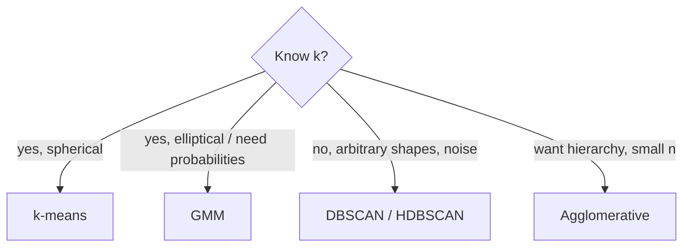

# Clustering

Hub: [[AI-Engineering-Index]]

## Core Idea

Clustering groups unlabeled points so that points in a group are more similar to each other than to other groups. "Similar" is defined by your features and distance metric, so clustering results are only as meaningful as your representation. Each algorithm assumes a different cluster shape.

## How it works

### k-means

Minimize within-cluster sum of squares $\sum_k \sum_{x\in C_k}\|x - \mu_k\|^2$ (Lloyd's algorithm):
1. Initialize $k$ centroids (k-means++ spreads them out).
2. Assign each point to nearest centroid.
3. Recompute centroids as means. Repeat until assignments stop changing.

- Converges to a local optimum; run several inits (`n_init`).
- Assumes roughly spherical, similar-size clusters; sensitive to scale and outliers.
- Cost $O(nkd)$ per iteration; MiniBatchKMeans for large data.

### DBSCAN

- Parameters: `eps` (neighborhood radius), `min_samples`.
- Core point: at least `min_samples` neighbors within `eps`. Clusters = density-connected core points plus their border points; everything else is noise (label -1).
- Finds arbitrary shapes, no $k$ needed, flags outliers.
- Struggles with varying densities (HDBSCAN addresses this) and in high dimensions. Choose `eps` via the k-distance plot elbow.

### Hierarchical (agglomerative)

- Start with each point as a cluster; repeatedly merge the closest pair. Linkage: single (min distance, chaining), complete (max), average, Ward (minimize variance increase).
- Produces a dendrogram; cut at a height or number of clusters.
- $O(n^2)$ memory -- fine for thousands, not millions.

### Gaussian Mixture Models

- $p(x) = \sum_k \pi_k \mathcal{N}(x\mid\mu_k,\Sigma_k)$, fitted with EM:
  - E-step: responsibilities $r_{ik} \propto \pi_k \mathcal{N}(x_i\mid\mu_k,\Sigma_k)$.
  - M-step: update $\pi, \mu, \Sigma$ from weighted points.
- Soft assignments; elliptical clusters (full covariance). k-means is a limiting case (equal spherical covariances, hard assignment).
- Choose $k$ via BIC/AIC.



## Python code

```python
import numpy as np
from sklearn.datasets import make_blobs, make_moons
from sklearn.preprocessing import StandardScaler
from sklearn.cluster import KMeans, DBSCAN, AgglomerativeClustering
from sklearn.mixture import GaussianMixture
from sklearn.metrics import silhouette_score, adjusted_rand_score
from sklearn.neighbors import NearestNeighbors

X, y = make_blobs(n_samples=600, centers=4, cluster_std=1.0, random_state=0)
X = StandardScaler().fit_transform(X)

# Choose k for k-means: inertia elbow + silhouette
for k in range(2, 8):
    km = KMeans(n_clusters=k, n_init=10, random_state=0).fit(X)
    print(k, round(km.inertia_, 1), round(silhouette_score(X, km.labels_), 3))

# GMM with BIC
bics = [GaussianMixture(k, covariance_type="full", random_state=0).fit(X).bic(X) for k in range(1, 8)]
print("best k by BIC:", int(np.argmin(bics)) + 1)

# DBSCAN on non-convex data; pick eps from k-distance curve
Xm, ym = make_moons(n_samples=500, noise=0.06, random_state=0)
Xm = StandardScaler().fit_transform(Xm)
d, _ = NearestNeighbors(n_neighbors=5).fit(Xm).kneighbors(Xm)
print("k-distance 90th pct:", np.quantile(np.sort(d[:, -1]), 0.9).round(3))
db = DBSCAN(eps=0.3, min_samples=5).fit(Xm)
print("clusters:", len(set(db.labels_) - {-1}), "noise:", (db.labels_ == -1).sum())
print("ARI vs truth (only when labels exist):", adjusted_rand_score(ym, db.labels_))

# Agglomerative with Ward linkage
agg = AgglomerativeClustering(n_clusters=4, linkage="ward").fit(X)
```

## Evaluation

| Metric | Needs labels | Notes |
|---|---|---|
| Inertia (WCSS) | no | always decreases with k; use elbow |
| Silhouette | no | in [-1, 1]; favors convex clusters |
| Davies-Bouldin | no | lower is better |
| BIC/AIC | no | for probabilistic models (GMM) |
| ARI / NMI | yes | compare to ground truth when available |

Internal metrics encode shape assumptions; the real test is whether clusters are stable (re-run with different seeds/subsamples) and useful for the downstream decision.

## Tradeoffs

- k-means: fast, scalable, but wrong for non-convex shapes and needs $k$.
- DBSCAN: shapes + noise, but a single density scale and hard parameter tuning.
- GMM: soft, elliptical, probabilistic; more parameters, can collapse on singular covariances (use regularization `reg_covar`).
- Hierarchical: interpretable dendrogram; quadratic cost.

## Failure modes

- Unscaled features: one feature defines all clusters.
- High-dimensional raw features: distances meaningless -- reduce with PCA or use learned [[Embeddings]] first.
- Treating clusters as ground truth categories without validation.
- Categorical data in k-means (means of one-hot vectors are not meaningful; consider k-modes or Gower distance).

## Production notes

- Persist the scaler and centroids; assign new points by nearest centroid (k-means) or `predict` (GMM). DBSCAN and agglomerative have no native `predict` for new points.
- Cluster IDs are arbitrary and change between retrains -- map them via centroid matching before downstream use.
- Common uses: customer segmentation, deduplication, topic grouping of embeddings, anomaly detection (DBSCAN noise, low GMM likelihood).

## Interview questions

1. **Explain k-means and its objective.** Alternating assignment/mean update minimizing within-cluster squared distances; local optimum.
2. **Why k-means++?** Spread-out initialization gives better and more consistent optima.
3. **How do you choose k?** Elbow, silhouette, BIC for GMM, stability analysis, and domain usefulness.
4. **When would k-means fail?** Non-spherical shapes, very different sizes/densities, outliers, unscaled features.
5. **DBSCAN parameters?** `eps` radius and `min_samples`; points not density-reachable are noise.
6. **GMM vs k-means?** GMM gives soft assignments and elliptical clusters via EM; k-means is a hard, spherical special case.
7. **How to evaluate clustering without labels?** Internal metrics plus stability and downstream usefulness.

## Related

- [[Feature-Engineering]]
- [[Embeddings]]
- [[Linear-Algebra-for-ML]]
- [[Classification-Algorithms]]
