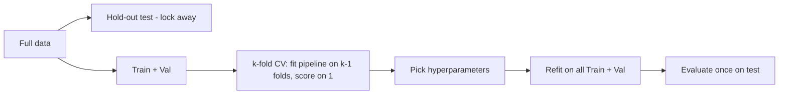

# Cross-Validation and Model Selection

Hub: [[AI-Engineering-Index]]

## Core Idea

The goal is an honest estimate of performance on future data. Every decision made using a dataset (preprocessing statistics, feature selection, hyperparameters, thresholds, early stopping) "spends" that data. If test data influences any decision, the estimate is optimistic. Data leakage is the most common reason a model that looked great offline fails in production.

## How it works

### Splits

- **Train:** fit parameters. **Validation:** choose hyperparameters/models. **Test:** touched once at the end.
- **k-fold CV:** split into $k$ folds; train on $k-1$, validate on 1; average. Reduces variance of the estimate on small data.
- **StratifiedKFold:** preserves class ratios -- default for classification.
- **GroupKFold / StratifiedGroupKFold:** all rows of a group (user, patient, device) stay in one fold.
- **TimeSeriesSplit:** train on past, validate on future; expanding or rolling windows.
- **Nested CV:** outer loop estimates performance, inner loop tunes hyperparameters. Reporting the inner best score as your performance is optimistically biased.



### Hyperparameter search

- Grid search: exhaustive, fine for few params.
- Random search: better coverage per budget when only some params matter.
- Bayesian / successive halving (`HalvingRandomSearchCV`, Optuna): efficient for expensive models.
- Always search over a Pipeline so preprocessing is refit per fold.

## Data leakage (deep dive)

Leakage = information available during training/evaluation that will not be available at prediction time, or that comes from the evaluation set.

### 1. Preprocessing leakage

Fitting a scaler, imputer, PCA, vocabulary, feature selector, or oversampler (SMOTE) on the full dataset before splitting lets validation statistics leak into training.

```python
import numpy as np
from sklearn.datasets import make_classification
from sklearn.feature_selection import SelectKBest, f_classif
from sklearn.linear_model import LogisticRegression
from sklearn.model_selection import cross_val_score, StratifiedKFold
from sklearn.pipeline import Pipeline
from sklearn.preprocessing import StandardScaler

# Pure noise: true achievable accuracy is ~0.5
rng = np.random.default_rng(0)
X = rng.normal(size=(100, 5000)); y = rng.integers(0, 2, 100)
cv = StratifiedKFold(5, shuffle=True, random_state=0)

# WRONG: select features using all labels, then cross-validate
X_sel = SelectKBest(f_classif, k=20).fit_transform(X, y)
print("leaky:", cross_val_score(LogisticRegression(max_iter=1000), X_sel, y, cv=cv).mean())
# typically far above 0.5 -- pure leakage

# RIGHT: selection is a pipeline step, refit inside each fold
pipe = Pipeline([
    ("scale", StandardScaler()),
    ("select", SelectKBest(f_classif, k=20)),
    ("clf", LogisticRegression(max_iter=1000)),
])
print("honest:", cross_val_score(pipe, X, y, cv=cv).mean())  # near 0.5
```

For resampling (SMOTE), use `imblearn.pipeline.Pipeline` so oversampling happens only on training folds.

### 2. Time-series leakage

Random shuffling lets the model train on the future and predict the past. Rolling features computed with centered windows or over the full series also leak.

```python
import pandas as pd
from sklearn.model_selection import TimeSeriesSplit

df = pd.DataFrame({"ts": pd.date_range("2024-01-01", periods=500, freq="D")})
df["y"] = np.sin(np.arange(500) / 20) + rng.normal(0, 0.1, 500)
df = df.sort_values("ts")

# Lag / rolling features must use only past values: shift before rolling
df["lag1"] = df["y"].shift(1)
df["roll7"] = df["y"].shift(1).rolling(7).mean()
df = df.dropna()

# gap leaves a buffer between train end and validation start (e.g., label horizon)
tscv = TimeSeriesSplit(n_splits=5, gap=7)
for tr, va in tscv.split(df):
    assert df["ts"].iloc[tr].max() < df["ts"].iloc[va].min()
```

Also: the final test set should be the most recent period, and labels whose outcome window extends past the cutoff must be excluded.

### 3. Group leakage

Multiple rows from the same entity (patient scans, user sessions, near-duplicate documents, augmented copies of one image) split across train and validation let the model memorize the entity instead of generalizing.

```python
from sklearn.model_selection import GroupKFold, cross_val_score

X, y = make_classification(n_samples=600, random_state=0)
groups = np.repeat(np.arange(100), 6)          # 100 users x 6 rows
gkf = GroupKFold(n_splits=5)
scores = cross_val_score(pipe.set_params(select__k=10), X, y, cv=gkf, groups=groups)
for tr, va in gkf.split(X, y, groups):
    assert set(groups[tr]).isdisjoint(groups[va])
```

Deduplicate (exact and near-duplicate) before splitting.

### 4. Target leakage

A feature that is a consequence or proxy of the label:
- `refund_issued` when predicting fraud (refund happens after fraud is confirmed).
- `days_in_hospital` when predicting admission at triage time.
- Target/mean encoding computed including the row's own label.
- IDs or timestamps correlated with how the dataset was assembled (e.g., positives collected in a later batch).

Detection: suspiciously high scores, a single feature dominating importance, performance collapsing in production. Fix by asking for every feature: "Is this value known at the moment of prediction?" Build training data with point-in-time snapshots.

### 5. Evaluation leakage

- Tuning hyperparameters or the decision threshold on the test set.
- Early stopping on the test set.
- Re-running experiments until the test score looks good (the test set becomes a validation set).

## Full leak-safe pipeline with search

```python
import pandas as pd
from sklearn.compose import ColumnTransformer
from sklearn.impute import SimpleImputer
from sklearn.preprocessing import OneHotEncoder, StandardScaler
from sklearn.ensemble import HistGradientBoostingClassifier
from sklearn.model_selection import RandomizedSearchCV, train_test_split, StratifiedKFold
from scipy.stats import loguniform, randint

n = 2000
data = pd.DataFrame({
    "amount": rng.lognormal(3, 1, n),
    "age": rng.integers(18, 80, n).astype(float),
    "channel": rng.choice(["web", "app", "pos"], n),
})
flip = rng.random(n) < 0.2                      # 20% label noise
target = ((data["amount"] > data["amount"].median()).to_numpy() != flip).astype(int)

X_trval, X_test, y_trval, y_test = train_test_split(
    data, target, test_size=0.2, stratify=target, random_state=0)

pre = ColumnTransformer([
    ("num", Pipeline([("imp", SimpleImputer(strategy="median")), ("sc", StandardScaler())]),
     ["amount", "age"]),
    ("cat", OneHotEncoder(handle_unknown="ignore"), ["channel"]),
])
model = Pipeline([("pre", pre), ("clf", HistGradientBoostingClassifier(random_state=0))])

search = RandomizedSearchCV(
    model,
    {"clf__learning_rate": loguniform(1e-2, 3e-1),
     "clf__max_leaf_nodes": randint(8, 64),
     "clf__l2_regularization": loguniform(1e-4, 1.0)},
    n_iter=20, cv=StratifiedKFold(5, shuffle=True, random_state=0),
    scoring="roc_auc", random_state=0, n_jobs=-1,
)
search.fit(X_trval, y_trval)             # preprocessing refit inside every fold
print("CV AUC:", round(search.best_score_, 3))            # optimistic (selection bias)
print("Test AUC:", round(search.score(X_test, y_test), 3))  # touch once
```

For an unbiased estimate of the whole tuning procedure, wrap the search in an outer `cross_val_score` (nested CV).

## Tradeoffs

- More folds: less bias, more compute, higher variance per fold. 5 or 10 is typical.
- Single hold-out: cheap, fine for large data; noisy on small data.
- Time-series CV uses less training data in early folds; results are more realistic.
- Group CV reduces effective sample size; scores drop but are honest.

## Failure modes

- Any `fit` / `fit_transform` called on data that includes validation or test rows.
- Shuffled K-fold on temporal or grouped data.
- Reporting best-of-search CV score as expected performance.
- Duplicates across splits.
- Selecting among many models on one small validation set (overfitting the validation set).

## Production notes

- Mirror production: if you will predict next week from data up to today, validate exactly that way (backtesting).
- Keep a frozen, versioned test set; periodically refresh with new data and a new frozen set.
- Log the split seed, fold indices, and pipeline config with every experiment.
- A large gap between offline and online metrics is a leakage or skew alarm.

## Interview questions

1. **Why must preprocessing be inside the pipeline?** So statistics are fit only on training folds; otherwise validation information leaks and scores are inflated.
2. **When do you use GroupKFold?** When multiple rows share an entity (user, patient) and you must generalize to unseen entities.
3. **How do you cross-validate time series?** Forward-chaining splits (TimeSeriesSplit) with an optional gap; features computed only from the past.
4. **What is target leakage? Example?** A feature derived from or after the outcome, e.g., "refund issued" for fraud prediction.
5. **Why is `best_score_` optimistic?** It is the max over many configurations evaluated on the same folds -- selection bias. Use nested CV or a held-out test set.
6. **Is SMOTE before CV okay?** No; synthetic points from validation neighbors leak. Oversample only within training folds.
7. **Your model scores 0.99 AUC on a hard problem. What do you check?** Leaky features, duplicates across splits, group/time leakage, preprocessing fit on full data.
8. **Stratified vs plain K-fold?** Stratified keeps class proportions per fold, reducing variance for imbalanced labels.

## Related

- [[Feature-Engineering]]
- [[Evaluation-Metrics-ML]]
- [[Overfitting-and-Regularization]]
- [[Classification-Algorithms]]
- [[Probability-and-Statistics-for-ML]]
