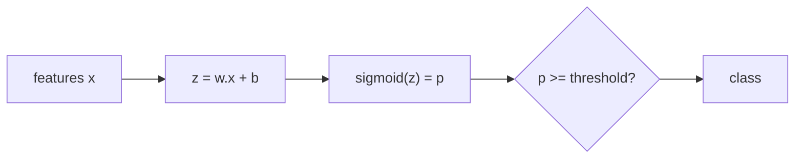

# Linear and Logistic Regression

Hub: [[AI-Engineering-Index]]

## Core Idea

Linear models predict with a weighted sum $w^\top x + b$. Linear regression outputs it directly; logistic regression squashes it through a sigmoid to get a probability. They are fast, interpretable, convex to train, and the baseline every other model must beat.

## How it works

### Linear regression

- Model: $\hat y = Xw + b$. Loss: MSE $\frac1n\|Xw - y\|^2$.
- Closed form (normal equations): $w = (X^\top X)^{-1}X^\top y$ -- in practice solved via QR/SVD (`lstsq`).
- Assumptions for valid inference: linearity, independent errors, constant variance, no severe multicollinearity. Prediction can still work when some fail.

### Regularization

| Model | Penalty | Effect |
|---|---|---|
| Ridge | $\lambda\|w\|_2^2$ | shrinks all weights; handles collinearity |
| Lasso | $\lambda\|w\|_1$ | drives some weights to exactly 0 (feature selection) |
| Elastic Net | mix | lasso sparsity + ridge stability with correlated features |

Regularization requires scaled features, otherwise the penalty hits features unevenly. See [[Overfitting-and-Regularization]].

### Logistic regression

- $p(y=1\mid x) = \sigma(w^\top x + b)$, $\sigma(z) = 1/(1+e^{-z})$.
- Loss (binary cross-entropy): $-\frac1n\sum[y\log p + (1-y)\log(1-p)]$ -- convex, no closed form, solved with L-BFGS/Newton/SGD.
- Gradient: $X^\top(p - y)/n$ -- same form as linear regression.
- Decision boundary $w^\top x + b = 0$ is linear in feature space.
- Coefficient $w_j$: one-unit increase in $x_j$ multiplies odds by $e^{w_j}$, holding others fixed.
- Multiclass: softmax (multinomial) or one-vs-rest.
- Perfectly separable data makes unregularized weights diverge; regularization fixes it.



## Python code

```python
import numpy as np
from sklearn.datasets import make_classification, make_regression
from sklearn.linear_model import LinearRegression, Ridge, Lasso, LogisticRegression
from sklearn.model_selection import train_test_split
from sklearn.pipeline import make_pipeline
from sklearn.preprocessing import StandardScaler
from sklearn.metrics import mean_squared_error, log_loss, roc_auc_score

# Regression
X, y = make_regression(n_samples=500, n_features=20, n_informative=5, noise=10, random_state=0)
Xtr, Xte, ytr, yte = train_test_split(X, y, random_state=0)
for m in [LinearRegression(), Ridge(alpha=1.0), Lasso(alpha=1.0)]:
    pipe = make_pipeline(StandardScaler(), m).fit(Xtr, ytr)
    print(type(m).__name__, mean_squared_error(yte, pipe.predict(Xte)) ** 0.5)
print("lasso nonzero:", (pipe[-1].coef_ != 0).sum())

# Classification
X, y = make_classification(n_samples=1000, n_features=10, weights=[0.8], random_state=0)
Xtr, Xte, ytr, yte = train_test_split(X, y, stratify=y, random_state=0)
clf = make_pipeline(StandardScaler(), LogisticRegression(C=1.0, max_iter=1000)).fit(Xtr, ytr)
p = clf.predict_proba(Xte)[:, 1]
print("log-loss", log_loss(yte, p), "AUC", roc_auc_score(yte, p))

# Logistic regression from scratch (gradient descent)
def fit_logreg(X, y, lr=0.1, steps=2000, l2=1e-3):
    w = np.zeros(X.shape[1]); b = 0.0
    for _ in range(steps):
        p = 1 / (1 + np.exp(-(X @ w + b)))
        w -= lr * (X.T @ (p - y) / len(y) + l2 * w)
        b -= lr * (p - y).mean()
    return w, b
```

Note: sklearn's `C` is the inverse regularization strength (smaller $C$ = stronger penalty).

## Tradeoffs

- Pros: fast, convex, interpretable, well-calibrated probabilities (logistic) with enough data, easy to deploy.
- Cons: only linear boundaries unless you engineer interactions/splines; sensitive to outliers (MSE) and unscaled features.
- Tree ensembles usually win on tabular data with nonlinear interactions; linear models win on high-dimensional sparse data (text bag-of-words) and when interpretability is required.

## Failure modes

- Interpreting coefficients under multicollinearity -- signs and magnitudes become unstable.
- Using linear regression for a binary target (predictions outside [0,1]).
- Not scaling before regularization.
- Choosing threshold 0.5 by default on imbalanced data -- tune the threshold on validation for the business metric.
- Fitting scaler on all data before split (leakage) -- see [[Cross-Validation-and-Model-Selection]].

## Production notes

- Export coefficients and scaler statistics; inference is a dot product, trivially portable.
- Monitor coefficient drift across retrains as a cheap data-shift signal.
- Check calibration with `sklearn.calibration.calibration_curve`.

## Interview questions

1. **Why is logistic regression a linear classifier?** Its decision boundary $w^\top x+b=0$ is a hyperplane.
2. **Why log-loss instead of MSE for logistic?** Log-loss is the Bernoulli negative log-likelihood and is convex in $w$; MSE with sigmoid is non-convex and gives weak gradients.
3. **Ridge vs lasso?** L2 shrinks smoothly; L1 zeroes coefficients, performing selection.
4. **Interpret a logistic coefficient of 0.7.** One-unit increase multiplies the odds by $e^{0.7}\approx 2$.
5. **What happens with perfectly separable data?** Unregularized MLE diverges to infinite weights.
6. **How to handle nonlinearity?** Polynomial/interaction features, splines, or switch model family.
7. **Why scale features?** Faster convergence and fair regularization across features.

## Related

- [[Classification-Algorithms]]
- [[Overfitting-and-Regularization]]
- [[Feature-Engineering]]
- [[Evaluation-Metrics-ML]]
- [[Cross-Validation-and-Model-Selection]]
