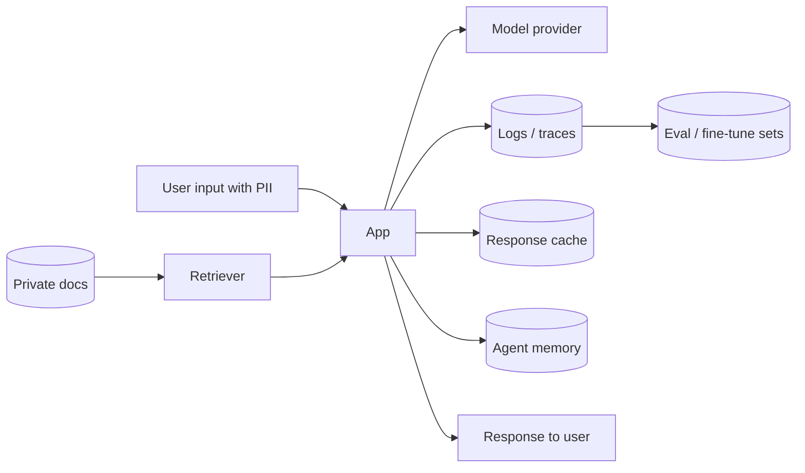

# AI Data Leakage and Privacy

Hub: [[AI-Engineering-Index]]

## Core Idea

An LLM application moves data through many places: user input, retrieved documents, third-party model APIs, logs, traces, caches, eval sets, fine-tuning data, and agent memory. Leakage happens at any of these, usually not through the model "remembering" but through **ordinary data-flow mistakes**. Map the data flow, then minimize, isolate, and control each hop.

## Leakage paths



| Path | Failure | Control |
|---|---|---|
| Retrieval | Missing ACL filter; user retrieves docs they cannot access | Pre-filter by user permissions at query time; per-tenant indexes for strong isolation |
| Output | Model repeats secrets or other users' data from context | Only put authorized data in context; output PII/secret scanning |
| System prompt | Secrets or internal logic in prompt get extracted | Never put secrets in prompts; assume prompts are public |
| Provider | Data sent to a third party under unclear terms | Contract/DPA review, retention and training opt-out settings, regional endpoints |
| Logs/traces | Full prompts stored indefinitely with broad access | Redact, sample, retention limits, RBAC |
| Cache | Shared cache returns one user's answer to another | Key by tenant + auth context |
| Memory | Personal data persisted without consent | User-visible, deletable memory; minimization |
| Training/fine-tuning | Model memorizes and regurgitates sensitive records | Scrub data, dedupe, consider differential privacy, test for extraction |
| Injection | Attacker induces exfiltration via tools/links | See [[Prompt-Injection]] |
| Embeddings | Treated as anonymized, but can leak information about source text | Protect vector stores like the source data |

## Python code: PII redaction before logging or sending

```python
import re

# order matters: more specific patterns first (a card number also looks like a phone number)
PATTERNS = {
    "APIKEY": re.compile(r"\b(?:sk|pk)_[A-Za-z0-9]{16,}\b"),
    "EMAIL": re.compile(r"\b[\w.+-]+@[\w-]+\.[\w.-]+\b"),
    "CARD":  re.compile(r"\b(?:\d[ -]?){13,19}\b"),
    "PHONE": re.compile(r"\+?\d[\d\s().-]{8,}\d"),
}

def luhn_ok(num: str) -> bool:
    digits = [int(d) for d in re.sub(r"\D", "", num)][::-1]
    total = sum(d if i % 2 == 0 else (d * 2 - 9 if d * 2 > 9 else d * 2)
                for i, d in enumerate(digits))
    return total % 10 == 0

def redact(text: str) -> tuple[str, dict]:
    counts = {}
    for label, pat in PATTERNS.items():
        def sub(m, label=label):
            if label == "CARD" and not luhn_ok(m.group()):
                return m.group()
            counts[label] = counts.get(label, 0) + 1
            return f"[{label}]"
        text = pat.sub(sub, text)
    return text, counts

print(redact("Mail a@b.com, card 4111 1111 1111 1111"))
```

Regex catches structured identifiers only. Names, addresses and free-text health data need NER-based detectors, and even those miss things; treat redaction as risk reduction, not a guarantee.

## Tradeoffs

- Redaction before the model can hurt answer quality (the model may need the value). Alternative: reversible tokenization - replace with placeholders, re-insert after generation, server-side only.
- Self-hosted models keep data in your boundary but add operational burden.
- Short log retention limits debugging and forensics; choose deliberately per data class.

## Failure modes

- Post-filtering retrieval results after top-k, which can still leak via ranking or count, or return nothing.
- Eval datasets copied from production traces into a shared repo.
- Debug logging enabled in production with full payloads.
- Model output echoed into analytics tools with third-party access.

## Security implications

Apply [[Least-Privilege]] to data, not only to tools: the model should see the minimum data needed for the current user and task. Include LLM data flows in threat models ([[Threat-Modeling-STRIDE]], information disclosure). Regulatory obligations (consent, purpose limitation, deletion requests, data residency) apply to prompts, logs and memory just as to databases.

> TODO: add the specific regulations (e.g. regional privacy laws) and internal data classification policy that apply to your deployment.

## Interview questions

1. **Most common real-world LLM data leak?** Ordinary data-flow mistakes: missing ACLs in retrieval, logs and caches, not model memorization.
2. **Can you keep secrets in the system prompt?** No; assume the system prompt can be extracted.
3. **How do you enforce document permissions in RAG?** Filter by the requesting user's permissions inside the retrieval query.
4. **Are embeddings anonymous?** No; they can reveal information about the source text and must be protected.
5. **How do you handle deletion requests?** Delete from source, indexes, caches, memory and logs; have a data inventory to find them.
6. **Redaction vs tokenization?** Redaction removes values; reversible tokenization substitutes placeholders so values can be restored after generation.

## Related

[[Prompt-Injection]] · [[Guardrails]] · [[LLM-Observability]] · [[AI-Security-Checklist]]
