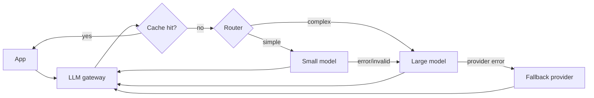

# LLM Cost Optimization

Hub: [[AI-Engineering-Index]]

## Core Idea

For API models, cost per request is roughly:

$C = \sum_{calls} \big(T_{in}^{uncached} p_{in} + T_{in}^{cached} p_{cached} + T_{out} p_{out}\big)$

Output tokens are typically priced higher than input tokens, and agents/RAG multiply the number of calls. Cost optimization is: fewer calls, fewer tokens, cheaper tokens (cache/smaller model), and hard budgets - all verified by evals so quality does not silently regress. Check your provider's current pricing; do not hardcode assumptions.

## Levers

| Lever | Mechanism | Watch out |
|---|---|---|
| Prompt caching | Provider/server reuses computed prefix; cached input tokens billed at reduced rate | Needs byte-identical prefix; put static content first, variable content last; caches expire |
| Exact response cache | Hash(normalized prompt + params + model) -> response | Only for deterministic, non-personalized requests |
| Semantic cache | Embed query; reuse answer if similarity above threshold | False hits return wrong answers; scope by tenant |
| Model routing | Classifier or rules send easy queries to a small model, hard ones to large | Router errors; measure quality per route |
| Cascade / fallback | Try cheap model, escalate on low confidence or validation failure | Double cost on escalated requests |
| Token discipline | Trim context, fewer few-shot examples, concise outputs, `max_tokens` | Too-short context hurts quality |
| Batch APIs | Asynchronous batch endpoints for non-interactive jobs are often discounted | Higher latency |
| Fine-tune/distill | Small model trained on big-model outputs for a narrow task | Maintenance, eval effort ([[Fine-Tuning-vs-Prompting]]) |
| Budgets | Per-request, per-user, per-tenant caps; agent step limits | Needs graceful degradation |

## Gateway with routing, cache and fallback



## Python code

```python
import hashlib, json, time

class TTLCache:
    def __init__(self, ttl_s=3600):
        self.ttl, self.data = ttl_s, {}
    def get(self, k):
        v = self.data.get(k)
        return v[1] if v and time.time() - v[0] < self.ttl else None
    def set(self, k, val):
        self.data[k] = (time.time(), val)

def cache_key(tenant, model, messages, params):
    blob = json.dumps({"t": tenant, "m": model, "msg": messages, "p": params}, sort_keys=True)
    return hashlib.sha256(blob.encode()).hexdigest()

def complete(messages, tenant, providers, route, validate, cache, budget_tokens=4000):
    """providers: dict name -> fn(messages, max_tokens) returning {"text", "usage"}."""
    params = {"max_tokens": min(budget_tokens, 1024), "temperature": 0}
    order = ["small", "large", "fallback"] if route(messages) == "simple" else ["large", "fallback"]
    key = cache_key(tenant, order[0], messages, params)
    if (hit := cache.get(key)) is not None:
        return hit
    last_err = None
    for name in order:
        try:
            resp = providers[name](messages, params["max_tokens"])
            if validate(resp["text"]):
                cache.set(key, resp["text"])
                return resp["text"]
            last_err = "validation failed"
        except Exception as e:          # timeouts, 5xx, rate limits
            last_err = repr(e)
    raise RuntimeError(f"all providers failed: {last_err}")
```

Prompt-caching layout: `[static system prompt][tool definitions][static reference docs] ... [conversation history][new user message]` - anything that changes per request goes at the end.

## Tradeoffs

- Every cost cut is a potential quality cut; gate it with [[LLM-Evaluation-Pipelines]].
- Self-hosting trades per-token fees for fixed GPU cost; it pays off only with high, steady utilization and ops capacity ([[LLM-Inference-and-Serving]]).
- Fallback providers differ in behavior; prompts may need per-model variants.

## Failure modes

- Timestamps or request IDs at the start of the prompt break prefix cache hits.
- Semantic cache threshold too loose -> confidently wrong reused answers.
- Retry storms on rate limits multiply cost; use backoff with jitter and circuit breakers.
- Agents with no step cap produce unbounded bills.
- Cost not attributed per feature, so nobody knows what to optimize.

## Security implications

- Cache keys must include tenant and authorization context; otherwise caches leak data across users.
- Budgets and rate limits double as abuse protection (denial-of-wallet attacks).
- Fallback to a different provider changes where data goes; confirm data-processing terms before adding it ([[AI-Data-Leakage-and-Privacy]]).

## Interview questions

1. **Where does LLM cost come from?** Input and output tokens across all calls; output tokens usually cost more per token.
2. **How does prompt caching work and how do you maximize hits?** The provider reuses processed prefixes; keep a stable, identical prefix with dynamic content at the end.
3. **Routing vs cascade?** Routing decides up front; a cascade tries cheap first and escalates on failure/low confidence.
4. **Risk of semantic caching?** Returning an answer to a similar-but-different question; scope and threshold carefully.
5. **How do you prevent runaway agent cost?** Step, token and spend budgets per task and per tenant.
6. **What is denial-of-wallet?** Abuse that drives up usage cost; mitigated by auth, quotas and rate limits.

## Related

[[LLM-Latency-Optimization]] · [[LLM-Observability]] · [[LLM-Inference-and-Serving]] · [[AI-Architecture-Reference]]
