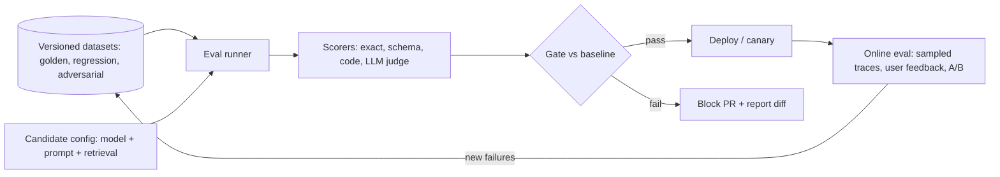

# LLM Evaluation Pipelines

Hub: [[AI-Engineering-Index]]

## Core Idea

[[LLM-Evaluation-Framework]] defines **what** to measure (metrics, rubrics, judges, golden sets). This note is about **how** to run evaluation continuously so that every prompt, model, retrieval, or guardrail change is tested before and after it ships. Treat prompts and configs as code, and evals as their test suite.

## Pipeline



## Stages

1. **Datasets (versioned):**
   - Golden set: representative inputs with references or rubrics.
   - Regression set: every production bug becomes a test case.
   - Adversarial set: injection, jailbreak, PII, edge cases ([[Prompt-Injection]]).
   - Store with IDs, source, and date; never tune on the held-out portion.
2. **Offline CI gate:** run on every change touching prompts/models/retrieval. Compare against the current production baseline, not an absolute number.
3. **Scoring:** cheapest reliable scorer first - exact match, schema validation, code execution, regex; then LLM judges for open-ended quality (calibrated against human labels).
4. **Nondeterminism handling:** multiple samples per case for stochastic settings; report mean and variance; use paired comparison on the same cases.
5. **Online evaluation:** sample production traces, run judges asynchronously, collect explicit/implicit user feedback, canary or A/B new versions.
6. **Feedback loop:** triage failures, label them, add to regression set.

## Python code: minimal regression gate

```python
import json, statistics, sys

def run_suite(cases, generate, scorers, samples=1):
    rows = []
    for case in cases:
        for _ in range(samples):
            out = generate(case["input"])
            rows.append({"id": case["id"],
                         **{name: fn(out, case) for name, fn in scorers.items()}})
    return rows

def summarize(rows, metric):
    return statistics.mean(r[metric] for r in rows)

def gate(candidate, baseline, metric, max_drop=0.0, critical_ids=()):
    """Fail if the mean drops beyond tolerance or any critical case regresses."""
    c, b = summarize(candidate, metric), summarize(baseline, metric)
    base_by_id = {r["id"]: r[metric] for r in baseline}
    broken = [r["id"] for r in candidate
              if r["id"] in critical_ids and r[metric] < base_by_id.get(r["id"], 0)]
    ok = (c >= b - max_drop) and not broken
    print(json.dumps({"metric": metric, "candidate": c, "baseline": b, "broken_critical": broken}))
    return ok

scorers = {
    "valid_json": lambda out, case: float(_is_json(out)),
    "contains_ref": lambda out, case: float(case["expected"].lower() in out.lower()),
}

def _is_json(s):
    try:
        json.loads(s); return True
    except json.JSONDecodeError:
        return False

# In CI:
# if not gate(cand_rows, base_rows, "contains_ref", max_drop=0.01, critical_ids={"bug-142"}):
#     sys.exit(1)
```

## Tradeoffs

- Larger suites = more confidence, more cost and CI time. Tier them: fast smoke set on every PR, full suite nightly or pre-release.
- LLM judges scale but drift and have biases (position, verbosity, self-preference). Pin judge model/prompt versions.
- Absolute thresholds are brittle; relative-to-baseline gates plus critical-case checks are more robust.

## Failure modes

- Test set leaks into prompts/few-shot examples (overfitting to the eval).
- Baseline re-run with a different judge version, making comparisons meaningless.
- Small suite + noise: passing/failing flips randomly. Estimate variance first.
- Offline set no longer matches production traffic (distribution drift).

## Security implications

Eval datasets built from production traces can contain PII and secrets; redact before storing and restrict access ([[AI-Data-Leakage-and-Privacy]]). Include a security regression set so guardrail changes cannot silently weaken defenses.

## Interview questions

1. **Framework vs pipeline?** The framework defines metrics and rubrics; the pipeline runs them automatically on changes and in production.
2. **What goes in a regression set?** Every production failure, minimized and labeled, plus critical must-pass cases.
3. **How do you gate a PR?** Compare against the baseline on the same cases; fail on meaningful drops or any critical-case regression.
4. **How do you handle nondeterminism?** Multiple samples, paired comparisons, variance estimates, pinned versions.
5. **What is online eval?** Scoring sampled live traffic and user feedback, plus canary/A-B tests.
6. **Why pin judge versions?** A judge change shifts scores independent of the system under test.

## Related

[[LLM-Evaluation-Framework]] · [[LLM-Observability]] · [[AI-Evaluation-Template]] · [[AI-App-Launch-Checklist]]
