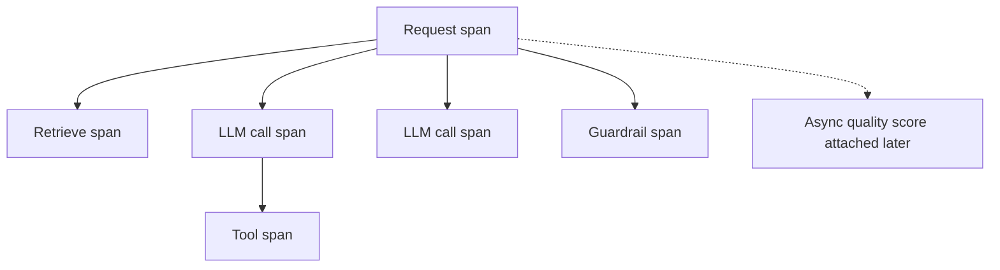

# LLM Observability

Hub: [[AI-Engineering-Index]]

## Core Idea

LLM apps fail in ways that return HTTP 200: wrong answer, bad retrieval, looping agent, runaway cost. Classic metrics (latency, errors) are necessary but not enough. You need **traces** that show each step (retrieval, prompt, model call, tool call, guardrail) with inputs, outputs, tokens, and timing, linked to quality signals.

## What to capture

| Level | Fields |
|---|---|
| Request (root span) | trace id, user/tenant (pseudonymous), route, app version, prompt version, total latency, total cost, outcome |
| LLM call span | model id, parameters (temperature, max tokens), input/output tokens, cached tokens, TTFT, finish reason, error/retry count |
| Retrieval span | query, top-k ids + scores, filters applied, index version |
| Tool span | tool name, validated args, result size, status, side-effect flag |
| Guardrail span | check name, decision, reason code |
| Quality | user feedback, online judge scores, eval labels |



Standards: OpenTelemetry for transport; there are emerging semantic conventions for generative AI spans.
> TODO: pin the OpenTelemetry GenAI semantic convention version you adopt; it is still evolving.

## Python code: lightweight span tracing

```python
import contextvars, json, time, uuid
from contextlib import contextmanager

_trace = contextvars.ContextVar("trace", default=None)

@contextmanager
def span(name, **attrs):
    parent = _trace.get()
    rec = {"trace_id": parent["trace_id"] if parent else uuid.uuid4().hex,
           "span_id": uuid.uuid4().hex[:16],
           "parent": parent["span_id"] if parent else None,
           "name": name, "attrs": dict(attrs), "start": time.time()}
    token = _trace.set(rec)
    try:
        yield rec
        rec["status"] = "ok"
    except Exception as e:
        rec["status"], rec["error"] = "error", type(e).__name__
        raise
    finally:
        rec["duration_ms"] = round((time.time() - rec["start"]) * 1000, 1)
        _trace.reset(token)
        print(json.dumps(rec))          # ship to your collector instead

def call_llm(client, prompt, model):
    with span("llm.call", model=model) as s:
        resp = client(prompt=prompt, model=model)   # returns dict with usage
        s["attrs"].update(input_tokens=resp["usage"]["input"],
                          output_tokens=resp["usage"]["output"],
                          finish_reason=resp["finish_reason"])
        return resp["text"]
```

## Key dashboards and alerts

- Latency p50/p95/p99 by route and model; TTFT separately.
- Tokens and cost per request, per tenant, per feature ([[LLM-Cost-Optimization]]).
- Error, timeout, retry, and fallback rates by provider.
- Finish reason distribution (e.g. spikes in length-truncated outputs).
- Guardrail block rate; tool error rate; agent steps per task.
- Quality: judge score trends, thumbs-down rate, abstention rate.

## Tradeoffs

- Full prompt/response logging is invaluable for debugging and dangerous for privacy. Options: redact, sample, hash, store separately with short retention and strict access.
- High-cardinality attributes (user ids, prompts) are expensive in metrics systems; keep them in traces/logs, not metric labels.

## Failure modes

- Logs without prompt version -> cannot attribute regressions.
- Sampling that drops exactly the rare failing traces (use tail-based sampling that keeps errors/slow traces).
- Trace context lost across async tasks or agent handoffs.
- Nobody reviews the data; add a weekly trace review ritual.

## Security implications

Traces contain user input, retrieved documents, and possibly secrets. Apply redaction before export, role-based access, retention limits, and treat the observability store as a sensitive data system ([[AI-Data-Leakage-and-Privacy]]). Logs are also forensic evidence for injection incidents; keep tool-call audit logs immutable.

## Interview questions

1. **Why are traces more useful than logs for LLM apps?** They show causal structure across retrieval, model, and tool steps for one request.
2. **Minimum fields for an LLM call?** Model, prompt version, tokens in/out, latency, finish reason, errors, cost.
3. **How do you connect observability to quality?** Attach feedback and async judge scores to traces; feed failures into eval sets ([[LLM-Evaluation-Pipelines]]).
4. **How do you log prompts safely?** Redact PII/secrets, restrict access, set retention, sample.
5. **What signals an agent problem?** Rising steps per task, repeated identical tool calls, rising tool errors.

## Related

[[LLM-Evaluation-Pipelines]] · [[LLM-Cost-Optimization]] · [[LLM-Latency-Optimization]] · [[AI-Data-Leakage-and-Privacy]]
