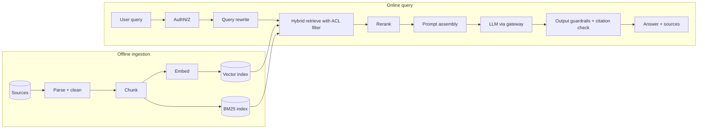
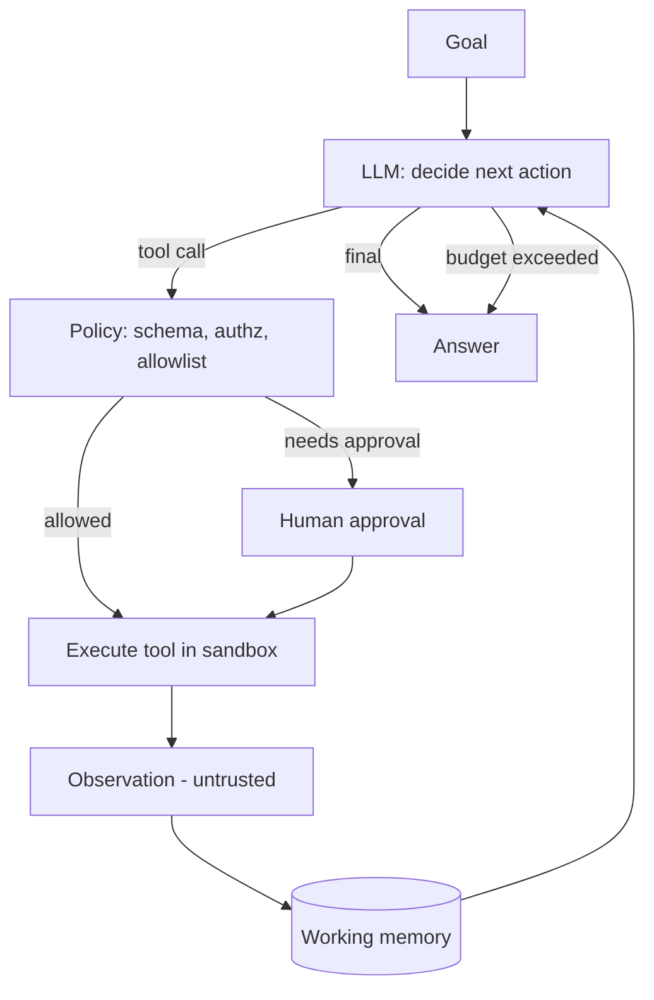
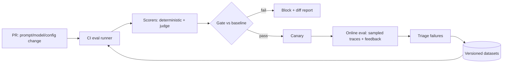
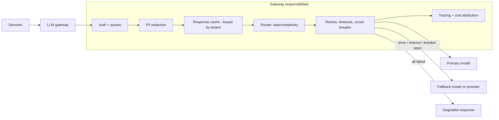

# AI Architecture Reference

Hub: [[AI-Engineering-Index]]

Copy a diagram into your design doc ([[AI-Project-Template]]) and replace `<placeholders>` with your components.

## 1. RAG pipeline

Notes: [[RAG-Playbook]], [[Chunking-Strategies]], [[Hybrid-Search-and-Reranking]], [[Hallucination-Mitigation]].

## 2. Agent loop

Notes: [[AI-Agents]], [[Agent-Memory]], [[MCP-Tool-Integration]], [[Agent-Design-Checklist]].

## 3. Evaluation pipeline

Notes: [[LLM-Evaluation-Pipelines]], [[LLM-Evaluation-Framework]].

## 4. LLM gateway with fallback

Notes: [[LLM-Cost-Optimization]], [[LLM-Latency-Optimization]], [[LLM-Observability]], [[Guardrails]].

## Component checklist per diagram

| Component | Owner | Technology | SLO | Notes |
|---|---|---|---|---|
| `<component>` | `<team>` | `<choice>` | `<latency/availability>` | `<>` |
