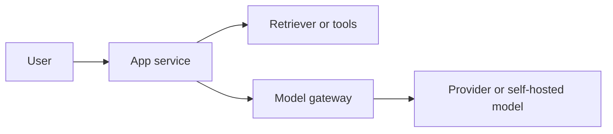

# AI Project Template

Hub: [[AI-Engineering-Index]]

Copy this note, rename it, and replace every `<placeholder>`.

## 1. Summary

- **Project name:** `<name>`
- **Owner(s):** `<names>`
- **Status:** `<proposed | in progress | launched>`
- **One-line pitch:** `<what it does for whom>`

## 2. Problem

- **User and pain:** `<who, what task, what is hard today>`
- **Why AI:** `<why rules/search/DB query are insufficient>`
- **Non-goals:** `<explicitly out of scope>`

## 3. Success metrics

| Metric | Type | Target | How measured |
|---|---|---|---|
| `<task success rate>` | quality | `<target>` | `<eval set / human review>` |
| `<p95 latency>` | performance | `<target>` | `<traces>` |
| `<cost per request>` | cost | `<target>` | `<token logs>` |
| `<business metric>` | outcome | `<target>` | `<analytics>` |

## 4. Data

- **Sources:** `<docs, DBs, APIs, user input>`
- **Sensitivity:** `<public | internal | confidential | PII>`
- **Access control:** `<how per-user permissions apply>`
- **Freshness:** `<update cadence>`
- **Eval data:** `<golden set size, source, labeling process>`

## 5. Approach

- **Option chosen:** `<prompting | RAG | agent | fine-tuning | classic ML>` - see [[Fine-Tuning-vs-Prompting]]
- **Alternatives considered:** `<options + why rejected>`
- **Model(s):** `<model class, why, fallback>` - compare with [[Model-Comparison-Template]]
- **Prompt(s):** `<link to versioned prompt files>`
- **Tools / integrations:** `<tool list with permissions>`

## 6. Architecture

Reference patterns: [[AI-Architecture-Reference]].

## 7. Evaluation plan

- Offline: `<datasets, metrics, thresholds>` - use [[AI-Evaluation-Template]]
- CI gate: `<what blocks merge>`
- Online: `<sampling rate, judges, feedback>`

## 8. Risks

| Risk | Likelihood | Impact | Mitigation |
|---|---|---|---|
| Hallucination | `<L/M/H>` | `<L/M/H>` | `<grounding, citations, abstention>` |
| Prompt injection | `<>` | `<>` | `<see AI-Security-Checklist>` |
| Data leakage | `<>` | `<>` | `<ACLs, redaction>` |
| Cost overrun | `<>` | `<>` | `<quotas, routing>` |
| Provider outage | `<>` | `<>` | `<fallback>` |

## 9. Rollout

- Milestones: `<M1 prototype, M2 eval-passing, M3 beta, M4 GA>`
- Launch checklist: [[AI-App-Launch-Checklist]]
- Rollback plan: `<how>`

## 10. Open questions

- `<question>`
