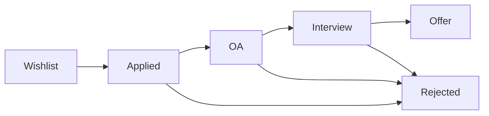

# Application Tracker Guide

Treat applications as a pipeline. Every active application must have a **next action and a date**; an application without one is effectively dead.

## Where to track

- **Primary:** the web app tracker at `/career`.
- **Offline fallback:** `Internship-Application-Tracker.csv` in this toolkit (see [[Career-Toolkit-README]]). Use the same stage names in both.

## Stages

| Stage | Meaning | Record | Next action |
|---|---|---|---|
| Wishlist | Target identified, not applied | Company, role, link, deadline, referral contact | Tailor resume, request referral |
| Applied | Submitted | Date, resume variant, referral (y/n), channel | Follow up after ~7 days if a contact exists |
| OA | Online assessment received/done | Platform, deadline, topics, result | Prep topics seen; wait for result |
| Interview | One or more rounds scheduled/done | Round names, dates, interviewers, questions asked | Prep for next round, thank-you note |
| Offer | Offer received | Terms, deadline | Compare, negotiate, decide ([[HR-Round-Guide]]) |
| Rejected | Closed | Stage reached, any feedback | Log lessons; reapply window if any |

## Follow-up cadence

| Situation | When | How |
|---|---|---|
| After applying with a referral / contact | 5-7 days | One short note ([[Cold-Email-Templates]]) |
| After an interview | Same day or within 24 hours | Thank-you note |
| No response after interview | After the timeline they gave, or ~1 week | One polite status check |
| After one unanswered follow-up | -- | Stop; mark stale and move on |

## Weekly review (15 minutes)

1. Sort by next action date; clear everything overdue.
2. Move stale applications (no response for several weeks) to rejected or a "stale" note.
3. Count by stage. Many applied but few OAs means the resume/targeting needs work ([[Resume-Tailoring-Template]]); many interviews but no offers means interview prep ([[Interview-Engine-Index]]).
4. Add new wishlist targets to keep the pipeline full.
