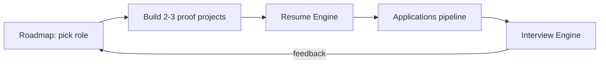

# Career OS

Career work is a pipeline: **skills -> proof (projects) -> resume -> applications -> interviews -> offer**. Each section below owns one stage.

## Resume engine

- [[Resume-Engine]] -- master inventory + bullet formula
- [[Resume-Tailoring-Template]] -- JD keyword mapping, per-role variants
- [[Project-Description-Bank-Template]] -- reusable project write-ups
- [[Resume-Review-Checklist]] -- pre-submit checklist

## Interview engine

- [[Interview-Engine-Index]] -- all interview material
- [[Technical-Interview-Roadmap]] -- 12-week plan
- [[Interview-Prep-Checklist]] · [[Mock-Interview-Log-Template]]

## Applications

- [[Application-Tracker-Guide]] -- pipeline stages, follow-up cadence, `/career` tracker
- [[Cold-Email-Templates]] -- outreach
- [[Career-Toolkit-README]] -- CSV offline fallback

## Role roadmaps

| Role | Roadmap |
|---|---|
| Software Engineer | [[Roadmap-Software-Engineer]] |
| Cybersecurity Engineer (generalist) | [[Roadmap-Cybersecurity-Engineer]] |
| Security Engineer (product / infra) | [[Roadmap-Security-Engineer]] |
| SOC Analyst | [[Roadmap-SOC-Analyst]] |
| Application Security Engineer | [[Roadmap-Application-Security-Engineer]] |
| Cloud Security Engineer | [[Roadmap-Cloud-Security-Engineer]] |
| DevSecOps Engineer | [[Roadmap-DevSecOps-Engineer]] |
| AI Engineer | [[Roadmap-AI-Engineer]] |
| ML Engineer | [[Roadmap-ML-Engineer]] |
| AI Security Engineer | [[Roadmap-AI-Security-Engineer]] |
| Research Engineer | [[Roadmap-Research-Engineer]] |

Broader security career context: [[Cybersecurity-Career-Roadmap]].

## Operating rules

1. Never fabricate metrics, titles or experience. If you have no number, describe the before/after honestly.
2. Every resume line must survive a 5-minute interview probe ([[Project-Defense-Guide]]).
3. One primary role target at a time; one secondary at most.
