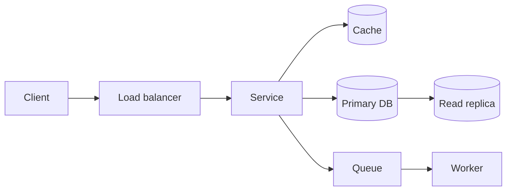

# Interview System Design Strategy

At intern/new-grad level, interviewers mostly look for structured thinking, sensible defaults and awareness of tradeoffs -- not memorized architectures of famous companies.

## Framework (45 minutes)

| Minutes | Step | Output |
|---|---|---|
| 0-5 | Requirements | Functional (3-5 core features), non-functional (latency, availability, consistency, scale). Explicitly list what is out of scope |
| 5-10 | Estimates | Rough QPS, storage, read/write ratio. State assumptions; round aggressively |
| 10-15 | API + data model | Endpoints with request/response; main entities and keys |
| 15-25 | High-level design | Boxes: clients, load balancer, services, cache, DB, queue, object store. Walk one request end to end |
| 25-40 | Deep dive | Interviewer picks or you propose the hardest part: scaling reads (cache, replicas), writes (sharding, queues), consistency, hot keys |
| 40-45 | Wrap-up | Bottlenecks, failure modes, monitoring, security, what you would do next |

## Tradeoffs to be ready to argue

- SQL vs NoSQL for this access pattern
- Cache-aside vs write-through; TTL and invalidation
- Strong vs eventual consistency (CAP in the presence of partitions)
- Sync call vs async queue
- Sharding key choice and hot partitions
- Pull vs push (feeds, notifications)

## Security and ops (bonus signal)

Authentication/authorization at the gateway ([[Authentication-vs-Authorization]]), rate limiting, TLS, secrets management, logging and metrics, idempotent retries.

## Common traps

- Drawing boxes before agreeing on requirements.
- Naming technologies without saying why.
- Ignoring the interviewer's hints about which part to deep-dive.
- No numbers at all, or spending 15 minutes on arithmetic.

## Study

[[System-Design-Basics]], [[System-Design-Index]], [[Distributed-Systems]], [[DBMS]]. Topics to cover (plain text until notes exist): System Design: Rate-Limiting, Caching, Load-Balancing, Consistent-Hashing, Message-Queues, Case Study: URL-Shortener.
