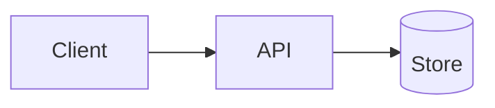

# Project Description Bank Template

Write each project once at three lengths and reuse everywhere (resume, application forms, LinkedIn, interview openers). Copy the block below per project.

## {{Project Name}}

- **Repo / demo:** {{link}}
- **Context and dates:** {{course, internship, personal, hackathon}}
- **Team and my role:** {{solo / N people; what I owned}}
- **Stack:** {{languages, frameworks, infra}}

### One-liner

> {{What it is}} that {{what it does}} for {{who}}.

### Resume bullets (2-3, using the formula)

- {{Action}} {{what}} using {{how}}, {{measured result}}.
- 

### 60-second pitch

> Problem -> why it mattered -> what I built -> one hard decision -> result -> what I would change.

### Architecture sketch

### Evidence

| Claim | How measured | Where to verify |
|---|---|---|
| | | |

### Defense prep

Tradeoffs, failure story, what I would change -- fill in using [[Project-Defense-Guide]].
