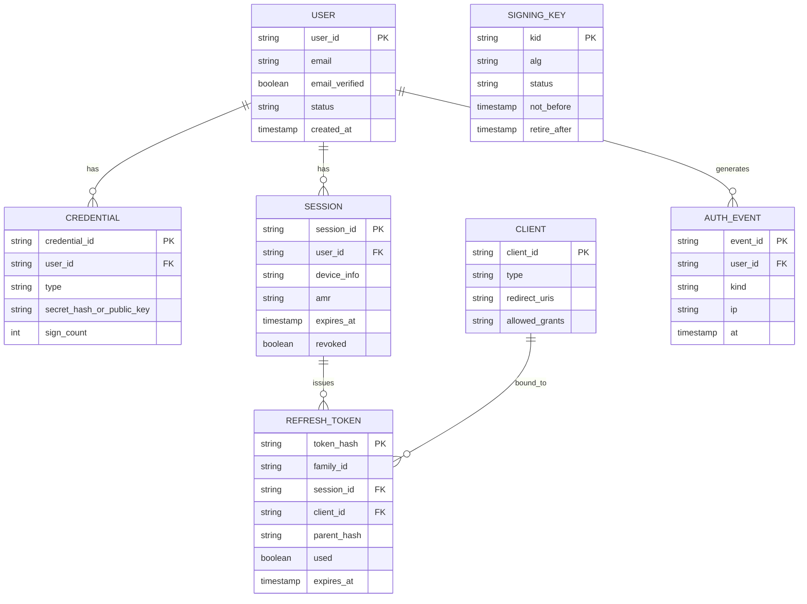
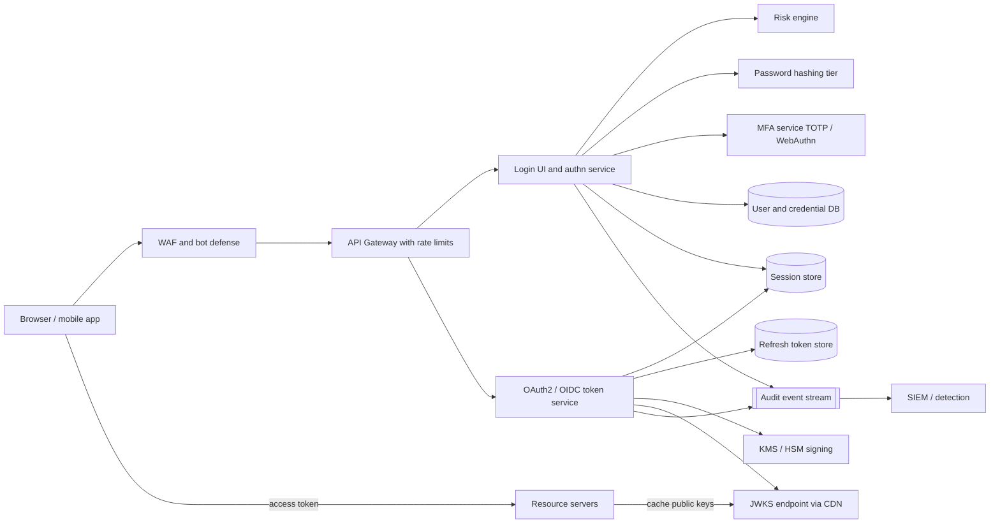
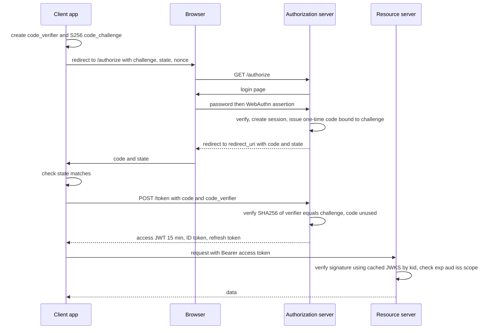

# Case Study: Authentication Platform

A central identity provider (IdP) that authenticates users and issues tokens to first-party web/mobile apps and third-party clients. It is a high-value target: design security first, then scale.

## 1. Requirements (clarifying questions)

- Consumers or workforce? *Consumers, plus internal admin users.*
- Protocols? *OAuth 2.0 authorization server + OpenID Connect provider.*
- Client types? *Web SPA, server-side web apps, mobile apps, machine-to-machine.*
- Factors? *Password, TOTP, WebAuthn/passkeys; social login federation.*
- Token strategy for APIs? *Short-lived JWT access tokens validated locally by services; opaque rotating refresh tokens.*
- Revocation latency requirement? *Minutes acceptable for access tokens; immediate for sessions/refresh tokens.*

## 2. Functional requirements

- Sign up, login, logout, password reset, email verification.
- OAuth2 Authorization Code flow with PKCE; Client Credentials for services.
- OIDC ID tokens, `/userinfo`, discovery document, JWKS endpoint.
- MFA enrollment and challenge (TOTP, WebAuthn).
- Session management: list devices, revoke sessions.
- Token refresh with rotation; revocation and introspection endpoints.

## 3. Non-functional requirements

- Very high availability: if auth is down, every product is down.
- Login latency low enough to feel instant (password hashing is deliberately slow; budget for it).
- Strong security: resistance to credential stuffing, phishing, token theft.
- Auditability of every auth event.
- Compliance with privacy requirements for PII.

## 4. Capacity estimation

Assumptions:

- 100M users, 20M DAU.
- Each DAU performs 1 interactive login every 2 days and refreshes tokens every 15 minutes while active for ~2 hours.
- Access token lifetime 15 min; login peak = 5x average.

Arithmetic:

- Logins/day = 20M / 2 = 10M ≈ 116/s avg, ~580/s peak. Password hashing (e.g. Argon2id tuned to tens of ms and tens of MB of memory per hash) -> at 580/s this needs a dedicated, horizontally scaled hashing tier. Tune parameters by benchmark, not by guess.
- Refreshes/day = 20M x (120 / 15) = 160M ≈ 1,850/s avg, ~9,000/s peak.
- Token validation: done locally by resource servers with cached JWKS, so it adds no load to the IdP.
- Storage: users 100M x 2 KB = 200 GB; sessions/refresh tokens ~ 40M active x 500 B = 20 GB.

## 5. API design

Standard endpoints (per OAuth2/OIDC specs):

```http
GET  /authorize?response_type=code&client_id=app&redirect_uri=...&scope=openid%20profile
     &state=xyz&nonce=n1&code_challenge=BASE64URL(SHA256(verifier))&code_challenge_method=S256
POST /token     grant_type=authorization_code&code=...&code_verifier=...&redirect_uri=...
POST /token     grant_type=refresh_token&refresh_token=...
POST /token     grant_type=client_credentials   (client auth: private_key_jwt or mTLS)
POST /revoke
POST /introspect
GET  /userinfo
GET  /.well-known/openid-configuration
GET  /.well-known/jwks.json
POST /mfa/webauthn/register/options | /mfa/webauthn/register/verify
POST /mfa/webauthn/authenticate/options | /mfa/webauthn/authenticate/verify
GET  /sessions      DELETE /sessions/{id}
```

Deprecated flows not offered: Implicit grant and Resource Owner Password Credentials.

## 6. Data model



- Passwords stored with a memory-hard KDF (Argon2id / scrypt / bcrypt) and per-user salt; never reversible ([[Hashing-vs-Encryption]]).
- Refresh tokens stored **hashed**; `family_id` enables reuse detection.
- **DB choice:** relational, strongly consistent primary for users/credentials/clients (correctness, uniqueness of email). Sessions and refresh tokens in a replicated store with low-latency reads and TTL (could be the same RDBMS or a KV store with strong per-key consistency). Signing private keys in an HSM/KMS, not the DB.

## 7. Architecture



## 8. Component responsibilities

| Component | Responsibility |
|---|---|
| WAF / bot defense | Block known bad traffic, challenge automation |
| Authn service | Password verification, MFA orchestration, session cookie issuance, account lockout policy |
| Risk engine | Score login (new device, impossible travel, IP reputation, breached password) -> step-up MFA or block |
| Token service | Authorization codes (single use, short TTL, bound to PKCE challenge), access/ID token minting, refresh rotation, revocation |
| KMS/HSM | Holds private signing keys; signs JWTs; keys never exported |
| JWKS endpoint | Publishes current and next public keys with `kid` |
| Session store | Server-side sessions for the IdP's own cookie; revocation is a delete |
| Audit stream | Every login, failure, MFA change, token reuse to [[Security-Logging-and-Detection]] |

## 9. Data flow

Authorization Code + PKCE for a public client (SPA / mobile):



**Refresh token rotation:** each refresh returns a new refresh token and marks the old one used. If a used token is presented again, the whole `family_id` is revoked (likely theft) and the user must re-authenticate.

## 10. Scaling strategy

- Stateless token validation at resource servers (JWT + cached JWKS) removes the IdP from the hot path of every API call.
- Scale hashing tier independently (CPU/memory bound).
- Read replicas and caching for client metadata and JWKS ([[Caching]]); JWKS served via [[CDN]].
- Multi-region active-active for login with a strongly consistent home region per user for credential writes, or a globally consistent DB; sessions replicated ([[Replication]], [[Availability-and-Reliability]]).
- Rate limits per IP, per account, per client ([[Rate-Limiting]]).

## 11. Failure modes

| Failure | Impact | Mitigation |
|---|---|---|
| IdP outage | All logins fail; existing access tokens keep working until expiry | Multi-region, graceful degradation, longer-lived sessions at the IdP |
| Signing key compromise | Forged tokens | Keys in HSM; rotate: publish new key in JWKS, start signing with it, remove old after max token lifetime; emergency revoke removes old `kid` immediately |
| JWKS fetch fails at resource server | Cannot validate new `kid` | Cache keys with TTL; pre-publish next key before use; refetch on unknown `kid` with rate limit |
| Refresh token stolen | Account takeover | Rotation + reuse detection; sender-constrained tokens (DPoP or mTLS) |
| Credential stuffing | Account takeovers | Rate limits, breached-password checks, risk-based MFA, bot detection |
| Lockout abused for DoS | Legit user locked | Prefer progressive delays and CAPTCHA over hard lockout; per-IP + per-account counters |
| Session store loss | Mass logout | Replication; tolerate re-login rather than lose security |

## 12. Security

- **PKCE (S256)** for all public clients, recommended for confidential ones too; prevents authorization code interception.
- **Exact redirect URI matching**; `state` for CSRF; `nonce` in ID token for replay.
- **Session vs JWT:** IdP uses server-side sessions (instant revocation). APIs use short-lived JWTs (no lookup, but cannot be revoked before `exp`). Use opaque tokens + introspection where immediate revocation matters.
- Validate JWTs strictly: pin allowed `alg`, reject `none`, check `iss`, `aud`, `exp`, `nbf`.
- **MFA/WebAuthn:** phishing-resistant because the credential is scoped to the origin (RP ID); TOTP is phishable. Check sign counters for cloned authenticators.
- **Brute-force protection:** per-account and per-IP throttling, exponential backoff, CAPTCHA after threshold, breached password screening, alerting on distributed low-and-slow attempts.
- Cookies: `HttpOnly`, `Secure`, `SameSite`. TLS everywhere ([[TLS-Handshake]]).
- Uniform error messages to avoid user enumeration. Map threats with [[Threat-Modeling-STRIDE]] and [[OWASP-Top-10]].

## 13. Observability

- **SLIs:** login success rate (excluding wrong-password), `/token` availability and p99 latency, JWKS availability, MFA challenge success rate, refresh reuse detections.
- **SLOs (examples):** `/token` and `/authorize` availability at a very high target (auth is a dependency of everything); login p99 within an agreed budget.
- **Security alerts:** spike in failed logins per IP/ASN, many accounts from one IP, refresh-token reuse events, MFA method changes followed by password change, admin logins from new locations. Feed audit events to SIEM ([[Case-Study-SIEM]]).

## 14. Tradeoffs

- **JWT vs opaque access tokens:** JWT = no lookup, scale, but revocation lag; opaque = instant revocation, introspection load.
- **Access token lifetime:** short limits damage of theft but increases refresh load.
- **Hard lockout vs throttling:** lockout stops guessing but enables DoS.
- **Build vs buy:** identity is subtle and security critical; managed IdPs reduce risk, custom gives control.

## 15. Interview follow-ups

**Q: Why PKCE if we already have `state`?**
A: `state` prevents CSRF; PKCE binds the code to the client instance that started the flow, so an intercepted code is useless without the verifier.

**Q: How do you revoke a JWT?**
A: You mostly cannot before expiry; keep it short-lived, revoke the refresh token/session, and for high-risk cases keep a small deny-list of `jti` checked by gateways.

**Q: How does key rotation work without breaking clients?**
A: Publish the new public key in JWKS ahead of use, switch signing to the new `kid`, keep the old key published until all tokens signed with it have expired, then remove it.

**Q: What is refresh token reuse detection?**
A: Rotating tokens form a chain; presenting an already-used token means two parties hold the chain, so revoke the whole family.

**Q: Why is WebAuthn more phishing resistant than OTP?**
A: The browser binds the signed challenge to the origin; a phishing domain cannot get a valid assertion for the real site, while a user can type an OTP into any page.
