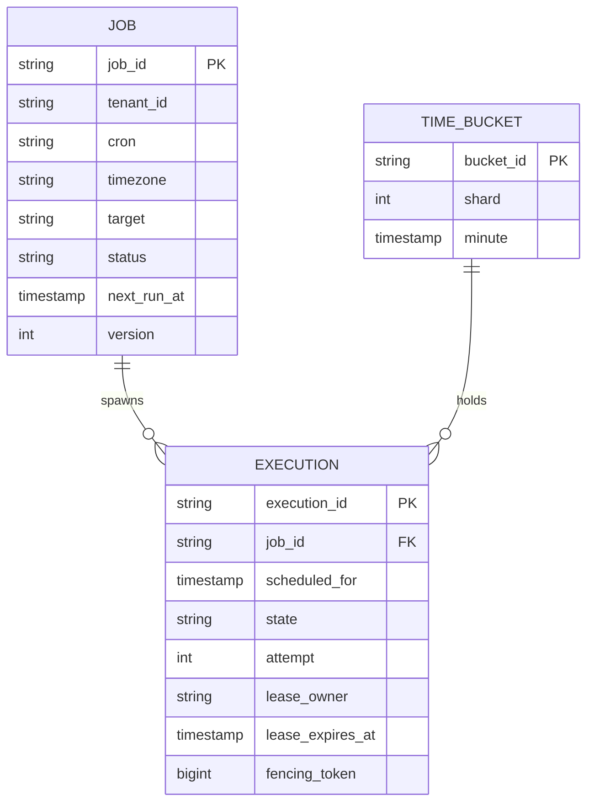
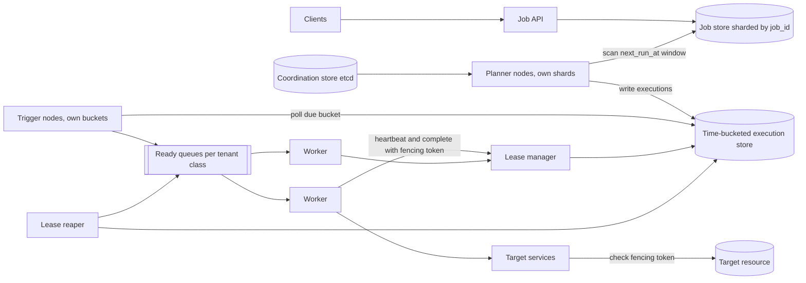
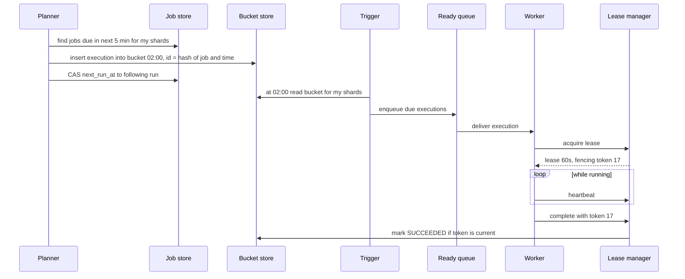

# Case Study: Distributed Job Scheduler

Tenants register jobs ("run this HTTP call / container every 5 minutes", "run once at 09:00 tomorrow"). The system must fire each job on time, run it on some worker, retry failures, and survive node crashes without losing or massively duplicating runs.

## 1. Requirements (clarifying questions)

- One-off, recurring (cron), or both? *Both.*
- What is a "job"? *A payload dispatched to a worker pool (HTTP callback or queue message); the scheduler does not run arbitrary code itself.*
- Timing precision? *Within seconds of the scheduled time is acceptable.*
- Delivery semantics? *At-least-once; jobs must be idempotent.*
- Missed runs during outage? *Configurable per job: catch up, or skip to next.*
- Dependencies/DAGs? *Out of scope (that is a workflow engine).*

## 2. Functional requirements

- Create, update, pause, delete jobs with cron expression or timestamp.
- Fire jobs at scheduled time; hand them to workers.
- Retries with backoff and max attempts; timeouts.
- Execution history and status.
- Per-tenant concurrency limits.

## 3. Non-functional requirements

- No lost triggers (durability).
- Duplicates rare and safe (idempotency + fencing).
- Horizontal scale in number of jobs and firing rate.
- Highly available: node failures reassign work automatically.
- Fairness between tenants.

## 4. Capacity estimation

Assumptions:

- 100M registered jobs.
- Average job fires once per hour; some fire every minute. Assume average 24 executions/job/day.
- Top-of-the-minute/hour skew: peak = 20x average (many crons use `0 * * * *`).
- Execution record ~300 B; keep 7 days hot.

Arithmetic:

- Executions/day = 100M x 24 = 2.4B. Average ≈ 27,800/s. Peak ≈ 20x ≈ 556,000/s at top of hour for a few seconds, which is why we spread the load (jitter, pre-enqueue, see scaling).
- History: 2.4B x 300 B = 720 GB/day; 7 days ≈ 5 TB hot.
- Job definitions: 100M x 1 KB = 100 GB.

## 5. API design

```http
POST /v1/jobs
Idempotency-Key: create-report-job-42
{
  "name": "nightly-report",
  "schedule": {"cron": "0 2 * * *", "timezone": "Asia/Kolkata"},
  "target": {"type": "http", "url": "https://svc.internal/run", "method": "POST"},
  "payload": {"report": "sales"},
  "retry": {"max_attempts": 5, "backoff": "exponential"},
  "timeout_seconds": 300,
  "misfire_policy": "run_once"
}
-> 201 { "job_id": "j_1", "next_run_at": "2026-09-30T20:30:00Z" }

PATCH  /v1/jobs/{id}           (pause, update schedule)
DELETE /v1/jobs/{id}
GET    /v1/jobs/{id}/executions?cursor=...

# Worker protocol (internal)
POST /internal/leases/acquire   -> { execution_id, fencing_token, lease_expires_at, payload }
POST /internal/leases/{id}/heartbeat
POST /internal/leases/{id}/complete { fencing_token, result }
```

## 6. Data model



- `execution_id = hash(job_id, scheduled_for)`: deterministic, so creating the same execution twice is a no-op (unique key). This is the scheduler's own idempotency.
- **DB choice:** job definitions in a sharded relational or strongly consistent KV store (conditional updates for `next_run_at` and lease CAS). Executions in a store with TTL and range scans by `(shard, minute)`, e.g. a wide-column store or partitioned SQL table. Coordination (shard ownership) in a consensus-backed store such as etcd/ZooKeeper ([[Consensus-Raft-Paxos]]).

## 7. Architecture



## 8. Component responsibilities

| Component | Responsibility |
|---|---|
| Job API | CRUD, cron validation, compute first `next_run_at` |
| Planner | For owned shards, scan jobs with `next_run_at` in the next few minutes; create execution rows in the right minute bucket; advance `next_run_at` with CAS |
| Time-bucketed store | Executions grouped by `(shard, minute)` so triggering reads a small bucket instead of scanning all jobs |
| Trigger | At minute T, read bucket T for owned shards and push due executions to ready queues |
| Ready queues | Buffer, per-tenant fairness, backpressure ([[Message-Queues]]) |
| Lease manager | Grant leases with monotonically increasing fencing tokens; accept heartbeats; reject stale completions |
| Lease reaper | Re-queue executions whose lease expired (worker died) |
| Coordination store | Assign shards to planner/trigger nodes; leader election |

## 9. Data flow



If the worker dies, heartbeats stop, the lease expires, the reaper re-queues with `attempt+1`, and the next lease gets token 18. A slow "zombie" worker that later completes with token 17 is rejected.

## 10. Scaling strategy

- Shard jobs by `hash(job_id)`; assign shards to planner/trigger nodes via coordination store; rebalance on membership change.
- Time buckets turn "find due jobs" into a point lookup per minute per shard.
- Pre-enqueue a few seconds before fire time to absorb top-of-minute spikes; optionally add small per-job jitter where tenants allow.
- Separate ready queues per tenant class; weighted fair consumption and per-tenant concurrency caps ([[Rate-Limiting]]).
- Workers autoscale on queue depth.

## 11. Failure modes

| Failure | Impact | Mitigation |
|---|---|---|
| Planner node dies | Shard not planned | Coordination store reassigns shard; new owner scans from last checkpoint |
| Two planners think they own a shard | Duplicate executions | Deterministic `execution_id` + unique constraint makes second insert a no-op |
| Worker dies mid-job | Job stuck | Lease expiry and reaper re-queue |
| Worker paused (GC), lease expired, then resumes | Two workers act | **Fencing token** checked by lease manager and ideally by the target resource ([[Distributed-Locks]]) |
| Clock skew between nodes | Early or late fire | Use coordination/DB time for leases; NTP; tolerate seconds |
| Scheduler outage for 1 hour | Missed runs | Misfire policy: run all, run once, or skip |
| Job always fails | Retry storm | Max attempts, exponential backoff, DLQ, auto-pause job |
| Thundering herd at :00 | Overload | Pre-enqueue, jitter, queue buffering |

## 12. Security

- Tenants can only manage their own jobs (authz on `tenant_id`).
- Job targets: allowlist internal endpoints to prevent SSRF from user-supplied URLs.
- Payloads may contain secrets: store references to a secret manager instead of raw secrets.
- Workers authenticate to targets with short-lived credentials; least privilege per tenant ([[Least-Privilege]]).
- Audit log of job changes (who changed a schedule).

## 13. Observability

- **SLIs:** fire delay = actual dispatch time - scheduled time (p50/p99); execution success rate; lease expiry rate; duplicate execution rate (same job and time with >1 successful completion); queue lag.
- **SLOs (examples):** 99% of executions dispatched within a few seconds of schedule; zero lost executions (every due execution reaches a terminal state).
- **Alerts:** fire delay p99 above threshold; unowned shards; reaper re-queue spike (worker health); DLQ growth.

## 14. Tradeoffs

- **At-least-once vs at-most-once:** at-least-once plus idempotent jobs is the practical choice; at-most-once loses runs on crash.
- **Lease length:** short leases detect death fast but cause false expiry under GC pauses; long leases delay recovery. Heartbeats let leases stay short.
- **Polling buckets vs a timer wheel in memory:** buckets are durable and simple; in-memory wheels are faster but need recovery from the store anyway.
- **Central DB vs per-shard ownership:** shard ownership scales but needs a coordination service and rebalancing logic.

## 15. Interview follow-ups

**Q: Why not just a cron on one big machine?**
A: Single point of failure and bounded capacity. Distribution adds sharding, leases, and duplicate handling.

**Q: What is a fencing token and why is a lock not enough?**
A: A lease/lock can expire while the holder is paused; it then acts believing it still holds it. A monotonically increasing token sent with every write lets the resource reject writes from older holders.

**Q: How do you guarantee a job is not run twice?**
A: You cannot fully guarantee it. Deterministic execution ids dedupe scheduling; fencing blocks stale completions; the job itself must be idempotent (e.g. keyed by `execution_id`). See [[Idempotency]].

**Q: How do you handle the top-of-hour spike?**
A: Plan ahead into buckets, pre-enqueue slightly early, buffer in queues, autoscale workers, and encourage jitter.

**Q: How do you handle time zones and DST?**
A: Store cron with time zone; compute next run in that zone with a well-tested library; define behavior for skipped/repeated local hours.
