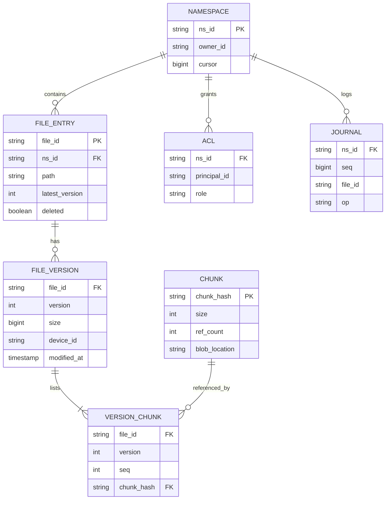
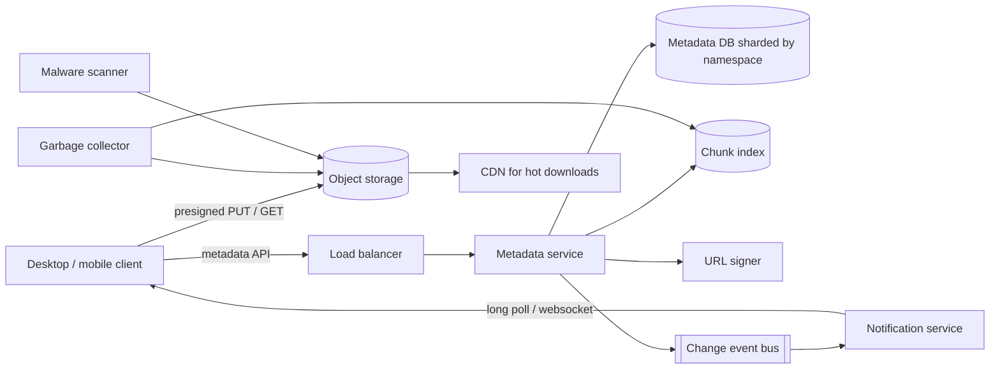
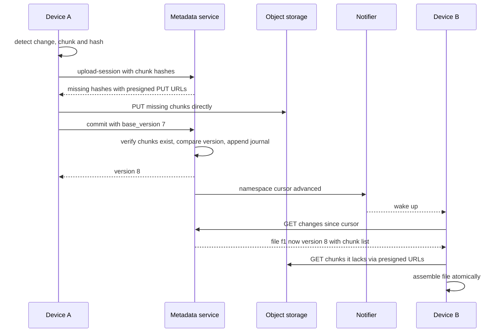

# Case Study: File Storage and Sync (Dropbox-like)

Users keep a folder in sync across devices and share files. The core ideas: **split files into chunks**, **address chunks by content hash**, keep **metadata separate from bytes**, and let clients upload/download **directly to blob storage** with presigned URLs.

## 1. Requirements (clarifying questions)

- Max file size? *Assume up to tens of GB.*
- Sync across devices, or just upload/download? *Full sync with offline edits.*
- Sharing and permissions? *Share files/folders with users, read or write.*
- Versioning? *Keep file history for a retention window.*
- Real-time collaborative editing? *Out of scope (that is a different system).*
- Dedup across users? *Discuss; privacy implications.*

## 2. Functional requirements

- Upload, download, delete, rename, move files and folders.
- Automatic sync across a user's devices; offline changes sync later.
- File versioning and restore.
- Share with other users; shared folders sync to them too.
- Conflict detection and resolution.

## 3. Non-functional requirements

- **Durability** is paramount: never lose a committed file.
- Efficient bandwidth: upload only changed chunks; resume interrupted uploads.
- Metadata strongly consistent per namespace (a folder tree must not corrupt).
- Change propagation to other devices within seconds.
- Scale to billions of files.

## 4. Capacity estimation

Assumptions:

- 500M users, 50M DAU.
- Average user stores 2 GB; 10% of logical bytes deduplicated away.
- Each DAU modifies 5 files/day of average 2 MB, files are split into 4 MB chunks, so a typical 2 MB file is one chunk and an edit to a large file re-uploads only the ~1-2 changed chunks.
- Metadata per file ~1 KB; per chunk reference ~100 B.

Arithmetic:

- Logical storage = 500M x 2 GB = 1 EB; after 10% dedup ≈ 0.9 EB, times replication/erasure coding overhead in the blob store.
- Upload volume/day = 50M x 5 x 2 MB = 500 TB/day ≈ 5.8 GB/s average.
- File-change events/day = 250M ≈ 2,900/s average; peak (x3) ≈ 8,700/s metadata commits.
- Files: assume 1,000 files/user -> 500B files x 1 KB ≈ 500 TB metadata: needs sharding.

## 5. API design

```http
POST /v1/files/upload-session
{ "path": "/docs/a.pdf", "size": 10485760, "chunk_hashes": ["h1","h2","h3"] }
-> 200 {
  "session_id": "s1",
  "missing_chunks": [
    {"hash": "h2", "put_url": "https://blob/...signed..."}
  ]
}

POST /v1/files/commit
{ "session_id": "s1", "base_version": 7 }
-> 200 { "file_id": "f1", "version": 8 }
-> 409 { "conflict": true, "server_version": 9 }

GET  /v1/files/{file_id}/download   -> list of chunk hashes + presigned GET URLs
GET  /v1/changes?cursor=...          -> long-poll / delta feed per namespace
POST /v1/shares  { "path": "/team", "grantee": "u_2", "role": "editor" }
```

Presigned URLs are short-lived, scoped to one object and one method, so bytes bypass the app servers.

## 6. Data model



- **Content addressing:** `chunk_hash = SHA-256(chunk bytes)`. Same bytes -> same key -> stored once. Upload asks "which hashes are missing?"
- **Metadata DB:** relational (e.g. sharded MySQL/PostgreSQL) sharded by `ns_id`, because a namespace commit must atomically update entries, versions, and the journal. Per-namespace `JOURNAL` sequence is the sync cursor.
- **Blob store:** object storage for chunks (see [[Storage-Blob-vs-Block-vs-File]]); chunk index is a large KV table.

## 7. Architecture



## 8. Component responsibilities

| Component | Responsibility |
|---|---|
| Client sync engine | Watch local FS, chunk files (fixed or content-defined chunking), hash, diff against last synced state, upload missing chunks, apply remote changes |
| Metadata service | Upload sessions, dedup check, commit with optimistic concurrency, ACL checks, journal append |
| URL signer | Mint short-lived presigned URLs per chunk |
| Object storage | Durable chunk bytes (replication or erasure coding) |
| Change bus + notification | Tell subscribed devices a namespace cursor advanced |
| Garbage collector | Delete chunks whose ref count reached zero after version retention expires |
| CDN | Cache popular shared downloads ([[CDN]]) |

## 9. Data flow



## 10. Scaling strategy

- Shard metadata by namespace; very large team namespaces may need sub-sharding by folder.
- Chunk index sharded by hash prefix (uniform distribution).
- Bytes never pass through app servers; object storage scales independently.
- Content-defined chunking (rolling hash) makes insertions in the middle of a file change few chunks.
- Delta sync: only changed chunks move. Compression before upload where beneficial.
- Notification fan-out via long-lived connections on dedicated gateway nodes.

## 11. Failure modes

| Failure | Impact | Mitigation |
|---|---|---|
| Upload interrupted | Partial file | Chunks are independent; resume by asking for missing hashes; commit only when all present |
| Two devices edit same file offline | Lost update | Optimistic concurrency on `base_version`; loser saved as "conflicted copy" |
| Commit references chunk not yet uploaded | Corrupt file | Commit verifies chunk existence (and size) first |
| GC deletes chunk still referenced | Data loss | Ref counting plus grace period; mark-and-sweep audit before delete |
| Metadata shard failover | Sync paused for that shard | Synchronous replicas, automated failover ([[Replication]]) |
| Notification missed | Device stale | Clients also poll with cursor periodically; cursor makes catch-up exact |
| Region loss | Unavailable bytes | Cross-region replication of blobs and metadata ([[Disaster-Recovery]]) |

**Conflict resolution:** the server does not merge binary files. First commit wins; the second receives `409`, keeps its local copy as `name (conflicted copy from Device B).ext`, and uploads it as a new file. Folder-level conflicts (rename vs delete) are resolved with deterministic rules and surfaced to the user.

## 12. Security

- Presigned URLs: short TTL, single object, single method; optionally bind content hash/length.
- Encrypt chunks at rest (per-tenant keys in a KMS) and TLS in transit ([[Applied-Cryptography]]).
- **Cross-user dedup leaks information:** an attacker can learn whether someone already has a file (upload is instant). Mitigations: dedup only within a user/tenant, or always require upload proof. This is a real tradeoff.
- Authorization on every metadata call against namespace ACL; share links unguessable and revocable.
- Malware scanning of shared content; rate limits on public link downloads.
- Client-side end-to-end encryption defeats server dedup and server-side search; offer as an option.

## 13. Observability

- **SLIs:** commit success rate; commit latency p99; time from commit to other device seeing change; upload/download throughput; chunk-missing errors; GC backlog.
- **SLOs (examples):** 99.9% of commits succeed (excluding conflicts); 99% of changes propagated to online devices within a few seconds.
- **Alerts:** any durability audit mismatch (referenced chunk missing in blob) pages immediately; conflict rate spike (client bug); notification gateway connection drops.

## 14. Tradeoffs

- **Fixed vs content-defined chunking:** fixed is simple but a single inserted byte shifts all later chunks; CDC is robust to shifts at CPU cost.
- **Chunk size:** small chunks = better dedup and resume, more metadata; large chunks = fewer rows, worse delta.
- **Global vs per-tenant dedup:** storage savings vs privacy side channel.
- **Strong consistency on metadata** costs cross-shard complexity for moves between namespaces; bytes can be eventually consistent because they are immutable and content-addressed.

## 15. Interview follow-ups

**Q: Why separate metadata from blob storage?**
A: Different access patterns: metadata needs transactions and small random reads; bytes need cheap durable bulk storage. Immutable content-addressed chunks never need updates, which makes caching and replication simple.

**Q: How do you upload a 20 GB file reliably?**
A: Chunk it, upload chunks in parallel with presigned URLs, retry individual chunks, and commit once all hashes exist.

**Q: How do clients learn about changes?**
A: Per-namespace journal with monotonically increasing sequence; client keeps a cursor; a notification tells it to pull deltas.

**Q: How do you delete data safely with dedup?**
A: Reference counts from version-chunk links, retention window for versions, then GC with grace period and audit.

**Q: How do you handle a move of a folder with 1M files?**
A: Store paths as parent-id tree so a move updates one row; clients receive a single move op.
