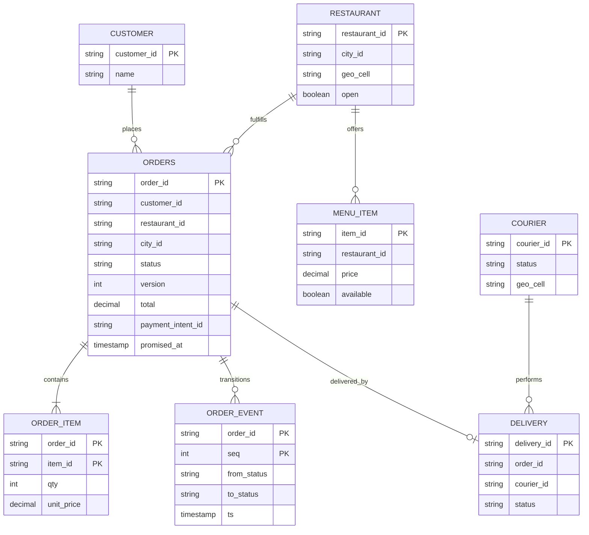
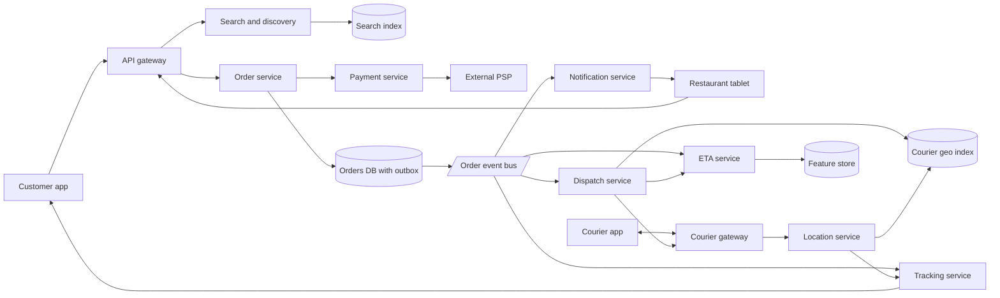
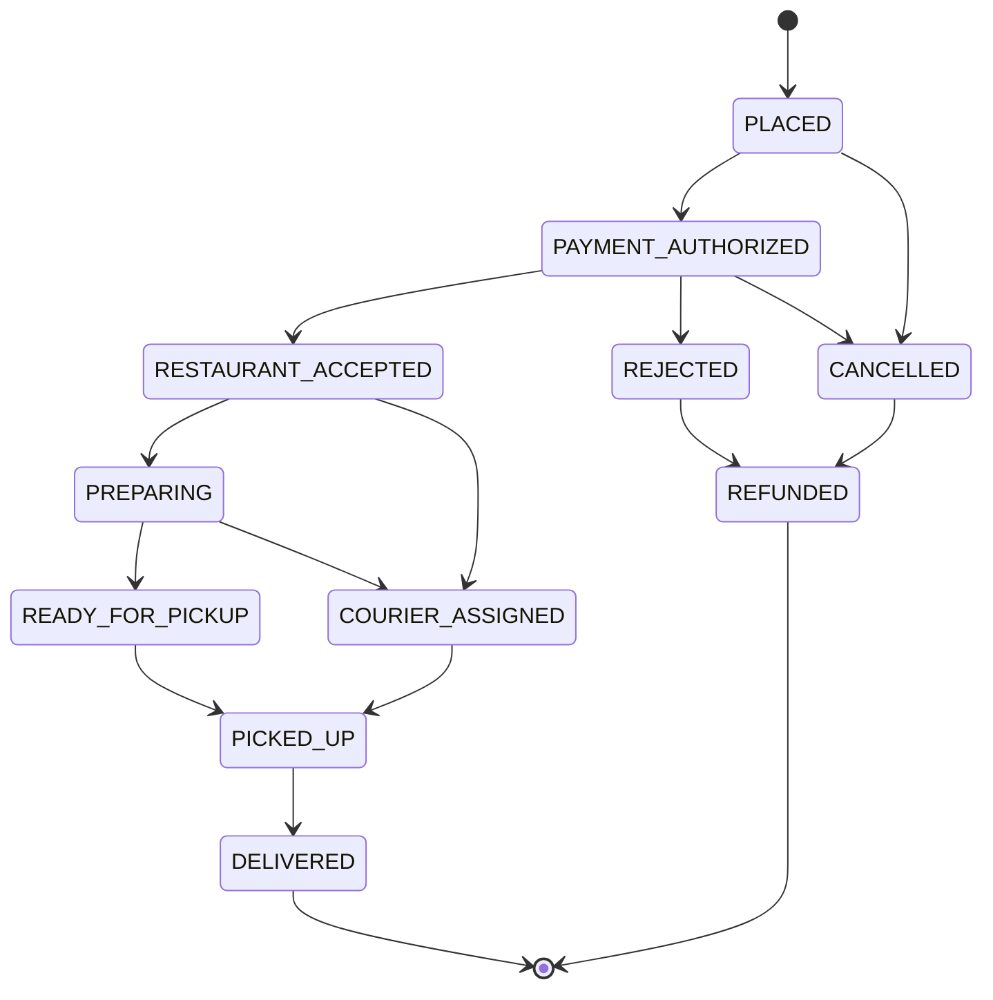
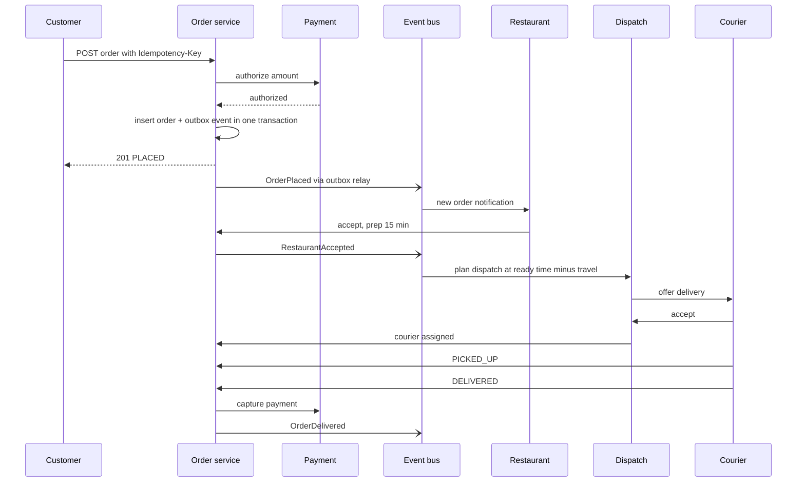

# Case Study: Food Delivery

A three-sided marketplace (customer, restaurant, courier). Compared with [[Case-Study-Uber]], the extra difficulty is the **restaurant in the loop** (food prep time), a long **order state machine** with money involved, **dispatch timing** (don't send the courier too early or too late), and **multi-leg ETA**. Back to [[System-Design-Index]].

## 1. Requirements (clarifying questions)

- Scope: browse restaurants, cart, checkout, order tracking, courier dispatch? (Yes.) Grocery, scheduled orders, subscriptions? (Out of scope.)
- Can a courier carry multiple orders (batching)? (Yes, up to 2-3 from nearby restaurants.)
- Payment: charge at order or at delivery? (Authorize at order, capture on delivery/acceptance.)
- Cancellation rules? (Customer can cancel before restaurant accepts; after that, policy-based.)
- Scale and geography? (Many cities; city is a natural partition.)

## 2. Functional requirements

- Customer: search/browse restaurants and menus by location, cart, checkout, live tracking, cancel, rate.
- Restaurant: receive orders, accept/reject, set prep time, mark ready, manage menu/availability.
- Courier: go online, receive/accept delivery offers, pick up, deliver, stream location.
- System: dispatch couriers, compute ETAs, notifications, refunds.

## 3. Non-functional requirements

- Checkout must be correct and idempotent (no double charges, no lost orders).
- Order state transitions strongly consistent; tracking updates within a few seconds.
- Browse/search highly available and fast (p99 < 200 ms); stale menu data for seconds is acceptable.
- Lunch/dinner peaks ~3-5x average; handle spikes in specific cities.
- ETA accuracy is a product metric (promise vs actual).

## 4. Capacity estimation

Assumptions: 10M orders/day, 70% within 4 peak hours, 20 browse requests per order, 500K couriers online at peak with location every 5 s, 300K restaurants, order record 5 KB including items and events.

- Orders avg: 10M / 86,400 = **~116 orders/s**. Peak: 7M / (4 x 3,600) = **~486 orders/s**; with spikes ~1,000/s.
- Browse/search: 10M x 20 = 200M/day; peak share 70% over 4h -> 140M / 14,400 = **~9.7K req/s**.
- Courier locations: 500K / 5 s = **100K updates/s** x 100 B = 10 MB/s.
- Order storage: 10M x 5 KB = 50 GB/day -> **~18 TB/yr**.
- Order events (state transitions ~10 per order): 100M events/day -> ~1.2K/s avg.
- Menus: 300K restaurants x 200 items x 1 KB = **60 GB** - fits in cache/search index; images on CDN.

## 5. API design

```http
GET /v1/restaurants?lat=12.97&lng=77.59&q=biryani&cursor=...
200 { "items": [ { "restaurant_id": "r1", "name": "...", "eta_min": 30, "open": true, "rating": 4.3 } ], "next_cursor": "..." }

GET /v1/restaurants/r1/menu  -> 200 { "items": [ {"item_id":"i1","name":"...","price":250,"available":true} ] }

POST /v1/orders
Idempotency-Key: c-123-abc
{ "restaurant_id": "r1", "items": [{"item_id":"i1","qty":2}], "address_id": "a1", "payment_method_id": "pm1", "quoted_total": 540 }
201 { "order_id": "o1", "status": "PLACED", "eta": "2026-09-29T13:40:00Z" }
409 { "error": "PRICE_CHANGED" }  422 { "error": "ITEM_UNAVAILABLE" }

POST /v1/restaurant/orders/o1/accept { "prep_minutes": 15 }   -> 200
POST /v1/restaurant/orders/o1/ready                             -> 200
POST /v1/courier/offers/f1/accept                               -> 200 | 409
POST /v1/courier/deliveries/o1/events { "type": "PICKED_UP" | "DELIVERED", "proof": "..." }
POST /v1/orders/o1/cancel                                       -> 200 | 409 (not cancellable)
GET  /v1/orders/o1  (or subscribe via WebSocket/SSE for tracking)
```

## 6. Data model



- **Orders:** relational DB sharded by `city_id` (or order_id) - ACID transitions with optimistic concurrency on `version`, joins for support tooling ([[Database-Selection]]). Order events appended for audit and published via an **outbox table** to the event bus (avoids dual-write inconsistency).
- **Restaurant search:** search index with geo filter + text ([[Search-Systems-Inverted-Index]]), fed by CDC from the menu DB.
- **Courier locations:** in-memory geo index as in [[Case-Study-Uber]].
- **Payments:** external PSP; store only tokens and intent IDs.

## 7. Architecture



## 8. Component responsibilities

| Component | Responsibility |
|---|---|
| Search/discovery | Restaurants deliverable to an address, open now, ranked; menus cached |
| Order service | Validates cart/prices, owns order state machine, idempotent creation, outbox events |
| Payment service | Authorize on place, capture on delivery, refunds; idempotent PSP calls |
| Dispatch service | Decide when and to whom to offer a delivery; batching; reassignment |
| ETA service | Predict prep time, courier-to-restaurant travel, wait, restaurant-to-customer travel |
| Location service | Courier location ingest -> geo index + tracking |
| Tracking service | Push live status and courier position to customer (WebSocket/SSE) |
| Notification service | Push/SMS to customer, restaurant, courier |

### Deep dive: order state machine



- Courier assignment is a **parallel sub-state** (tracked on DELIVERY) - it can happen before or after food is ready; `PICKED_UP` requires both assigned courier and ready food (or courier waits).
- Each transition: `UPDATE orders SET status=:new, version=version+1 WHERE order_id=:id AND status=:expected AND version=:v` - rejects illegal/concurrent transitions.
- Side effects (charge, notify, dispatch) are driven by events from the outbox, consumed idempotently ([[Idempotency]], [[Event-Driven-Architecture]]).
- Timeouts: restaurant doesn't accept in N minutes -> auto-reject + refund; saga compensations for failures ([[Message-Queues]]).

### Deep dive: dispatch

- **Timing:** target courier arrival ~= food ready time. Dispatch trigger time = predicted ready time - predicted courier travel time - buffer. Too early wastes courier time; too late makes food cold.
- **Candidates:** couriers in nearby geo cells, available or finishing a delivery soon, with vehicle suitability.
- **Batch optimization:** every few seconds per zone, solve an assignment problem over pending deliveries x couriers (cost = total lateness + courier idle + distance), allowing stacking of 2 orders from the same/nearby restaurant with compatible drop-offs.
- **Reservation:** offer with expiry; CAS on courier state to avoid double assignment; decline/timeout -> redispatch.
- **Reassignment:** if courier goes offline or stalls, re-dispatch automatically.

### Deep dive: ETA

- Total ETA = order acceptance delay + **prep time** + max(0, courier arrival - ready) wait + **pickup handling** + **drop-off travel** + handoff time.
- Prep time model: features like restaurant, items, current open-order load, time of day; learned from historical "accepted -> ready" (noisy since restaurants mark ready late).
- Travel: routing engine with traffic + historical segment speeds.
- Promise shown at checkout uses a conservative quantile (e.g., p70-p80) to avoid broken promises; live ETA updates as events arrive.
- Feedback loop: log predicted vs actual per leg to retrain.

## 9. Data flow



## 10. Scaling strategy

- Partition by **city/zone**: dispatch, geo index, and orders DB shards per city; peaks are local ([[Sharding-and-Partitioning]]).
- Search/menu reads served from index + cache; menus cached with short TTL and invalidated on edits ([[Caching]]).
- Order service stateless; DB write load modest (~1K orders/s peak) but spiky - connection pooling and queue-based smoothing for non-critical side effects.
- Event bus partitioned by `order_id` so each order's events are ordered.
- Tracking fanout via WebSocket gateways; courier position updates throttled to customers (e.g., every 5-10 s).
- Pre-scale before known peaks (lunch/dinner, festivals, promotions).

## 11. Failure modes

| Failure | Impact | Mitigation |
|---|---|---|
| Double submit at checkout | Duplicate orders/charges | Idempotency-Key on order + PSP idempotency |
| DB commit succeeds, event publish fails | Downstream never learns of order | Transactional outbox + relay; consumers idempotent |
| Restaurant tablet offline | Order never accepted | Timeout -> phone call fallback / auto-reject and refund |
| Courier no-show / goes offline | Late delivery | Heartbeat monitoring, auto-reassign, ETA update to customer |
| Payment capture fails | Revenue loss | Retries, reconciliation job, fraud review |
| Dispatch service down in a zone | Orders not assigned | Replicated per-zone workers, leader election ([[Consensus-Raft-Paxos]]), fallback greedy dispatch |
| Menu price changed during checkout | Price mismatch | `quoted_total` check -> 409 PRICE_CHANGED |
| Search index stale | Shows closed restaurant | Validate availability at checkout; short TTL on open/closed |

## 12. Security

- **AuthN:** customers (OTP/password + tokens), restaurants (staff accounts on managed devices), couriers (KYC-verified onboarding).
- **AuthZ:** restaurants only see their orders; couriers see customer address/phone only after accepting and only until delivery; support agents with scoped, audited access.
- **Abuse/fraud:** promo/referral abuse (device fingerprinting, velocity limits), fake "not delivered" refund claims (photo proof of delivery, courier GPS trail), courier GPS spoofing, restaurant fake orders to game rankings, card testing on checkout ([[Rate-Limiting]]).
- **Data protection:** PCI scope minimized via PSP tokenization; addresses and phone numbers masked (proxy calling); location data retention limits; encryption at rest and in transit.
- **Threats:** IDOR on order IDs, account takeover for stored cards, scraping menus/prices, insider misuse of customer data.

## 13. Observability

- **SLIs:** checkout success rate, order placement latency, restaurant acceptance time, dispatch latency (ready to courier assigned), ETA error (actual - promised), on-time delivery rate, tracking update freshness, outbox relay lag.
- **SLOs:** checkout success 99.95%; p95 of orders assigned a courier before food ready; outbox lag p99 < 5 s.
- **Alerts:** per-city spike in unassigned orders, restaurant acceptance timeouts, PSP error rate, ETA bias drift. See [[Observability]].

## 14. Tradeoffs

| Decision | Chosen | Rejected | Why |
|---|---|---|---|
| Order consistency | Relational + optimistic concurrency + outbox | Event-sourced-only / NoSQL | Money + strict transitions; simpler reasoning |
| Cross-service flow | Choreographed events + saga compensations | Distributed 2PC | Availability, loose coupling |
| Dispatch | Batched optimization with just-in-time timing | Immediate greedy nearest courier | Lower courier idle and food wait |
| ETA promise | Conservative quantile | Mean | Broken promises hurt more than slightly long estimates |
| Tracking | Push over WebSocket/SSE | Client polling | Fewer requests, fresher updates |

## 15. Interview follow-up questions

- **How is this different from ride hailing?** Restaurant prep time adds uncertainty; dispatch timing matters; orders can be batched; three parties to notify.
- **How do you guarantee the restaurant sees the order exactly once?** At-least-once delivery + dedupe by order_id on the tablet; acknowledgement with retry.
- **What if the customer cancels after the courier picked up?** Policy: no refund or partial; state machine forbids `PICKED_UP -> CANCELLED` without support override.
- **How do you handle a restaurant overwhelmed at peak?** Throttle: increase prep ETA, temporarily hide/pause restaurant in search based on open-order load.
- **Why outbox instead of publishing directly?** Avoids dual-write where DB commits but publish fails (or vice versa).
- **How do you batch two orders?** Same or nearby restaurants, compatible drop-off direction, ready times close, and first customer's delay under a threshold.
