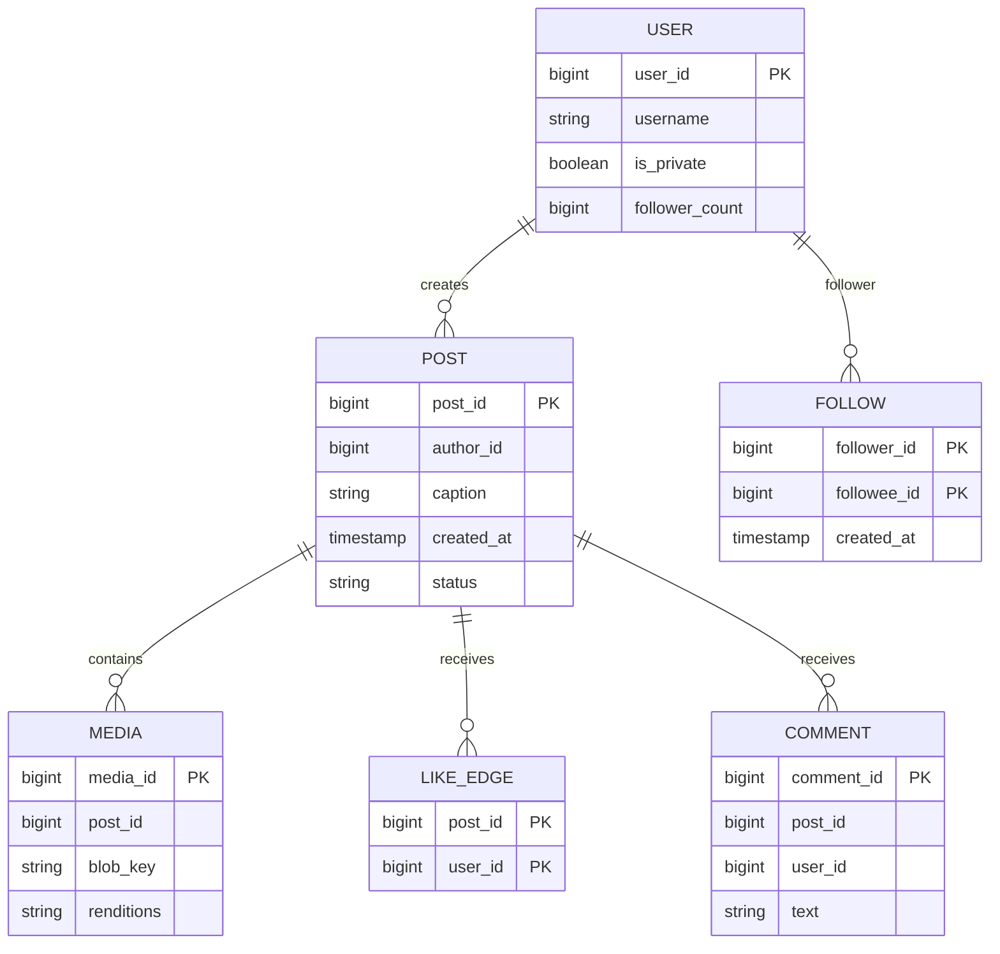
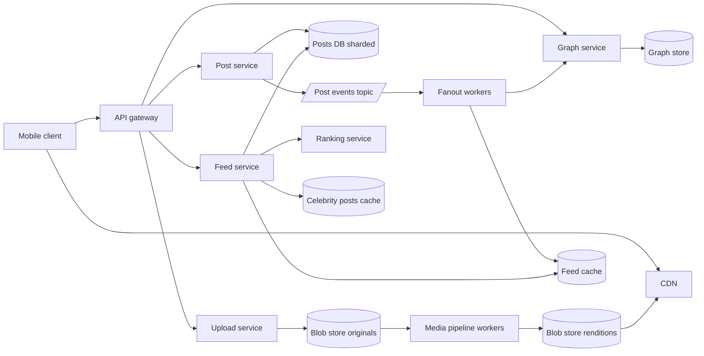
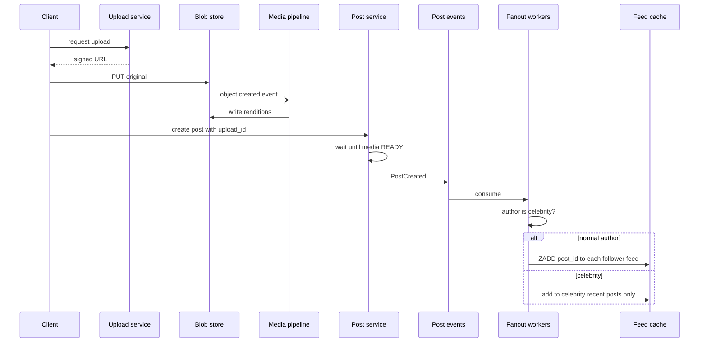

# Case Study: Instagram (Photo Feed)

Core challenges: **home feed generation** (fanout on write vs read), the **celebrity problem**, and a **media pipeline** that turns uploads into CDN-served renditions. Back to [[System-Design-Index]].

## 1. Requirements (clarifying questions)

- Photos only or video too? (Both; short video included.)
- Feed ranking: chronological or ranked? (Ranked, but candidate generation is the core design; ranking model is a boundary.)
- Follow model: asymmetric (follow without approval)? (Yes; private accounts need approval.)
- Features in scope: post, follow, feed, like, comment. Out of scope: stories, DMs, reels recommendations, ads.
- Max followers? (Unbounded - some accounts have hundreds of millions.)

## 2. Functional requirements

- Upload a post (1-10 photos/videos + caption).
- Follow/unfollow users.
- Home feed of posts from followed accounts, paginated.
- Like and comment; view counts.
- User profile grid.

## 3. Non-functional requirements

- Feed load p99 < 300 ms server-side.
- Highly available reads (99.99%); posting can tolerate brief delay.
- Eventual consistency: a new post may take seconds to appear in followers' feeds.
- Durable media storage; fast global delivery via [[CDN]].
- Read-heavy (read:write very high).

## 4. Capacity estimation

Assumptions: 500M DAU, 2 posts/day per 10 users (100M posts/day), 1 media item avg 2 MB original, 4 stored renditions totaling 1.5 MB extra, each user opens feed 10 times/day, 20 posts per feed page, avg 200 followers per poster.

- Post writes: 100M / 86,400 = **~1,160 posts/s** avg, peak x3 ~3,500/s.
- Feed reads: 500M x 10 = 5B/day / 86,400 = **~58K feed req/s** avg, peak ~175K/s.
- Fanout writes (push model): 1,160 x 200 = **~232K feed-inserts/s** avg.
- Media storage: 100M x 3.5 MB = 350 TB/day -> **~128 PB/yr**.
- Metadata: 100M x 1 KB = 100 GB/day -> ~36 TB/yr.
- Feed cache: store top 500 post IDs (8 B each) per active user: 500M x 4 KB = **~2 TB** of RAM across a cache cluster.
- Egress: each feed page loads 20 images at ~200 KB (display rendition): 58K x 20 x 200 KB = **~232 GB/s** avg -> must be served by CDN.

## 5. API design

```http
POST /v1/media/uploads            -> 200 { "upload_id": "u1", "urls": ["https://blob/...signed"] }
POST /v1/posts
{ "upload_ids": ["u1"], "caption": "sunset", "location_id": "123" }
202 Accepted { "post_id": "p9", "status": "processing" }

GET /v1/feed?cursor=eyJ0Ijo...&limit=20
200 { "items": [ { "post_id": "p9", "author": {...}, "media": [{"url": "https://cdn/.../1080.jpg", "w":1080,"h":1350}], "like_count": 12, "caption": "..." } ], "next_cursor": "..." }

POST   /v1/users/{id}/follow       -> 204
DELETE /v1/users/{id}/follow       -> 204
POST   /v1/posts/{id}/likes        -> 204   (idempotent)
POST   /v1/posts/{id}/comments { "text": "nice" } -> 201
GET    /v1/users/{id}/posts?cursor=...
```

Cursor-based pagination (not offset) because the feed changes constantly.

## 6. Data model



- **Users/posts metadata:** sharded relational DB (e.g., Postgres sharded by `user_id`, post IDs embed shard + time, Snowflake-style) - relational fits profile/post consistency and secondary indexes. Instagram has publicly described sharding PostgreSQL with IDs that encode the shard.
- **Follow graph:** two tables - `followers(followee_id, follower_id)` and `following(follower_id, followee_id)` - both partitioned by the first column so both directions are single-partition reads.
- **Feed:** precomputed list of post IDs per user in an in-memory store (Redis sorted set by time/score) with a persistent backing store (wide-column).
- **Counters:** likes via sharded counters / async aggregation to avoid hot rows.
- **Media:** blob storage ([[Storage-Blob-vs-Block-vs-File]]) + CDN.

## 7. Architecture



## 8. Component responsibilities

| Component | Responsibility |
|---|---|
| API gateway | Auth, rate limiting, routing ([[API-Gateway]]) |
| Upload service | Issue signed URLs for direct-to-blob upload; resumable chunks |
| Media pipeline | Validate, strip EXIF location, transcode/resize to renditions, generate thumbnails, content moderation hooks |
| Post service | Create post metadata once media is ready; emit `PostCreated` |
| Fanout workers | Push post ID into followers' feed lists (non-celebrity authors only) |
| Graph service | Follow/unfollow, follower lists, "is celebrity" flag |
| Feed service | Merge precomputed feed + celebrity posts, hydrate, call ranking, paginate |
| Ranking service | Boundary: scores candidates using ML features; feed service falls back to chronological if unavailable |
| CDN | Serve images/video close to users |

### Deep dive: fanout on write vs fanout on read

| | Fanout on write (push) | Fanout on read (pull) |
|---|---|---|
| Write cost | O(followers) per post | O(1) |
| Read cost | O(1) - read precomputed list | O(followees) queries + merge |
| Freshness | Precomputed; small delay | Always fresh |
| Waste | Writes to inactive users' feeds | None |
| Problem | Celebrities: 100M inserts per post | Slow reads for users following many |

**Hybrid (chosen):**
- Normal authors: push into followers' feeds.
- Authors above a follower threshold (e.g., 100K+, tunable) are **celebrities**: not fanned out. Their recent posts are kept in a hot cache.
- On feed read: fetch precomputed list + recent posts of the celebrities this user follows, merge by score, rank.
- Skip fanout to inactive users (no login in N days); rebuild their feed on next login (pull).

### Deep dive: media pipeline

1. Client requests upload -> gets signed URL -> uploads directly to blob store (resumable).
2. Blob-created event triggers pipeline via [[Message-Queues]].
3. Workers: verify type/size, decode safely, strip metadata, generate renditions (e.g., 150px, 320px, 640px, 1080px; WebP/AVIF + JPEG fallback), video to multiple bitrates.
4. Moderation classifiers (nudity/violence/CSAM hash match) run in parallel.
5. Mark media READY -> post service publishes post -> fanout.
6. Clients pick rendition by screen size; CDN caches with long TTL (immutable content-addressed URLs).

## 9. Data flow



Feed read: Feed service -> read user feed list (IDs) -> fetch celebrity recent posts for followed celebrities -> merge -> rank -> batch hydrate post metadata (cache, then DB) -> return with CDN URLs.

## 10. Scaling strategy

- Stateless services autoscale; feed cache sharded by `user_id` ([[Sharding-and-Partitioning]]).
- Fanout workers scale with topic partitions; prioritize fanout to recently active users first.
- Cap feed list length (e.g., 500-1000 IDs); older posts paged from DB via pull.
- Post metadata cache (read-through) with high hit rate; hot posts replicated.
- Like counts: write-behind aggregation; show approximate counts.
- Multi-region read replicas; media fully on CDN ([[CDN]], [[Caching]]).

## 11. Failure modes

| Failure | Impact | Mitigation |
|---|---|---|
| Fanout backlog | New posts appear late | Autoscale workers, prioritize active users, pull fallback for fresh posts of followees |
| Feed cache node lost | Users see empty feed | Rebuild on demand via pull from graph + posts; replicas |
| Ranking service down | No ranking | Fall back to reverse-chronological ([[Fault-Tolerance]]) |
| Media pipeline failure | Post stuck processing | Retries with DLQ, idempotent workers, client shows status |
| Celebrity post spike | Hot key on post metadata | Replicate hot keys, local caches, CDN |
| Unfollow not reflected | Posts from unfollowed user visible | Filter at read time against graph |
| Blob region outage | Images fail | Cross-region replication, CDN serves cached copies |

## 12. Security

- **AuthN:** OAuth2 tokens, device-bound refresh tokens, 2FA.
- **AuthZ:** private accounts - feed/profile reads check follow approval; media URLs signed or unguessable with expiry for private content.
- **Abuse:** spam follows/likes (rate limits, bot detection), scraping (rate limit + anomaly detection), harmful content (moderation pipeline, hash-matching of known illegal content), impersonation reporting.
- **Data protection:** strip EXIF GPS on upload; encrypt at rest; deletion propagates to CDN purge and backups per retention policy.
- **Threats:** malicious image files exploiting decoders (sandboxed transcoders), account takeover (2FA, login anomaly detection), IDOR on post IDs (authz checks every read), fake engagement farms.

## 13. Observability

- **SLIs:** feed latency p50/p99, feed error rate, fanout lag (post created to in follower feed), media processing time, CDN hit ratio, upload success rate.
- **SLOs:** feed p99 < 300 ms; 99% of posts visible to followers within 10 s; media ready p95 < 30 s.
- **Alerts:** fanout consumer lag, pipeline DLQ growth, CDN hit ratio drop, ranking fallback rate. See [[Observability]].

## 14. Tradeoffs

| Decision | Chosen | Rejected | Why |
|---|---|---|---|
| Feed generation | Hybrid push/pull | Pure push or pure pull | Push is cheap for normal users; pull avoids celebrity write storms |
| Consistency | Eventual feed | Strong | Seconds of delay is acceptable |
| Upload | Direct-to-blob signed URLs | Through app servers | Offloads bandwidth from API tier |
| Pagination | Cursor | Offset | Stable under inserts |
| Counts | Approximate, async | Exact synchronous | Avoid hot row contention |

## 15. Interview follow-up questions

- **How do you pick the celebrity threshold?** Based on fanout cost vs read merge cost; tune empirically, make it a flag per user.
- **User follows 5,000 accounts incl. 200 celebrities?** Cap merged celebrity candidates (recent N per celebrity), cache per-celebrity recent lists.
- **Deleting a post?** Tombstone in post DB; feed read filters deleted IDs; lazy cleanup of feed lists; CDN purge.
- **How to add ranking?** Candidate generation (this design) -> feature fetch -> model scoring -> diversity rules. Ranking is a separate service boundary.
- **New user with empty feed?** Cold start: suggested accounts, popular content.
- **Why not store feed in the DB?** It is regenerable derived data; memory gives latency, a backing store gives recovery.
