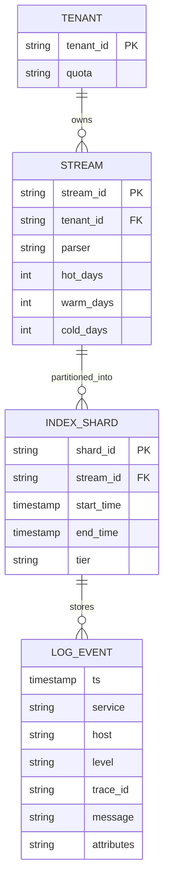
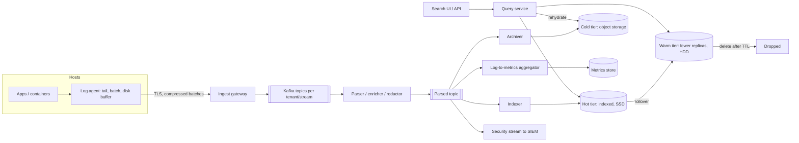
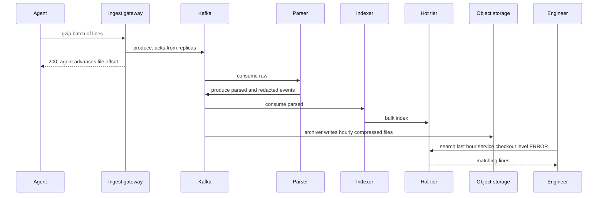

# Case Study: Log Aggregation

Thousands of services on many hosts emit logs. Engineers need to search them during incidents, dashboards need aggregates, and security needs them retained. The central tension: **full-text indexing everything is fast to query but expensive; storing raw is cheap but slow to search.**

## 1. Requirements (clarifying questions)

- Sources? *Application logs (JSON and plain text), container stdout, system logs, load balancer access logs.*
- Query patterns? *Recent (last hours) interactive search by service, level, trace id, free text; occasional historical investigations.*
- Freshness? *Searchable within seconds to tens of seconds.*
- Retention? *Hot 7 days, warm 30 days, cold archive 1 year (assumption; compliance may require more).*
- Loss tolerance? *Some loss acceptable for debug logs; audit logs must not be lost.*
- Multi-tenant? *Yes, many teams, with access control.*

## 2. Functional requirements

- Collect logs from hosts/containers.
- Parse into structured fields; enrich (service, host, region, k8s metadata).
- Search by fields and full text over a time range; live tail.
- Aggregations for dashboards and alerts (count of errors per service).
- Retention policies per tenant/stream; archive and rehydrate.
- Redaction of sensitive data.

## 3. Non-functional requirements

- Ingest must not back-pressure applications (logging must never take production down).
- Durable buffer to absorb spikes and downstream outages.
- Cost-efficient at high volume.
- Query p99 for recent data in seconds.
- Tenant isolation: one noisy service cannot starve others.

## 4. Capacity estimation

Assumptions:

- 20,000 hosts; average 30 GB/day/host of raw logs -> but assume 50 TB/day total after agent-side filtering.
- Average log line 500 B.
- Peak = 3x average.
- Compression ratio for logs typically high; assume 5:1 for columnar/compressed blocks (measure yours).
- Index overhead for full-text index: assume index + source ≈ 1.2x raw after compression tricks (varies widely by engine and mapping).

Arithmetic:

- Lines/day = 50 TB / 500 B = 100B lines ≈ 1.16M lines/s avg, ~3.5M/s peak.
- Ingest bandwidth ≈ 50 TB / 86,400 ≈ 580 MB/s avg, ~1.7 GB/s peak.
- Kafka buffer for 24h at replication factor 3 (compressed 5:1): 50 TB / 5 x 3 = 30 TB.
- Hot tier (7 days, fully indexed, 1 replica): 50 x 7 x 1.2 x 2 ≈ 840 TB on fast disks.
- Cold tier (365 days compressed in object storage): 50 / 5 x 365 ≈ 3.65 PB.

The hot index dominates cost per byte; the lever is what (and how long) you index.

## 5. API design

```http
POST /v1/ingest       (agents; batched, compressed, authenticated per tenant)
Content-Encoding: gzip
[ {"ts":"...","service":"checkout","level":"ERROR","msg":"...","trace_id":"..."} ]

POST /v1/search
{
  "query": "service:checkout AND level:ERROR AND \"timeout\"",
  "from": "2026-09-29T10:00:00Z",
  "to":   "2026-09-29T11:00:00Z",
  "limit": 200,
  "cursor": null
}

GET  /v1/tail?query=service:checkout      (server-sent events / websocket)
POST /v1/aggregations  { "query": "...", "group_by": ["service"], "interval": "1m" }
POST /v1/rehydrate     { "stream": "...", "from": "...", "to": "..." }   (cold -> searchable)
```

## 6. Data model

Logs are not relational. The logical record:



- **Time-partitioned indices** (e.g. per stream per day/hour) so retention is "drop the old index", not delete-by-query.
- **Storage choice:** hot tier = search engine with inverted index ([[Search-Systems-Inverted-Index]]) for full text; alternative = label/field-indexed store that indexes only metadata and brute-force scans compressed chunks (cheaper, slower for free text). Cold = compressed files (e.g. columnar) in object storage ([[Storage-Blob-vs-Block-vs-File]]). Stream/tenant config in a small relational DB.

## 7. Architecture



## 8. Component responsibilities

| Component | Responsibility |
|---|---|
| Agent | Tail files/stdout, multiline join, batch, compress, local disk buffer, drop/sample debug logs by policy, never block the app |
| Ingest gateway | Authn per tenant, quota enforcement ([[Rate-Limiting]]), write to Kafka |
| Kafka | Durable buffer decoupling producers from indexers; replay after indexer bugs ([[Message-Queues]]) |
| Parser/enricher | Grok/regex/JSON parsing, timestamp normalization, add metadata, redact PII/secrets |
| Indexer | Bulk-write to hot tier, manage index rollover |
| Archiver | Write compressed, time-partitioned files to object storage |
| Query service | Fan out across shards/tiers, merge, paginate, enforce tenant ACL |
| Log-to-metrics | Pre-aggregate counts so dashboards do not scan raw logs |

## 9. Data flow



## 10. Scaling strategy

- Kafka partitions by `(tenant, stream)` with hashing; scale consumers per partition.
- Indexer bulk writes; tune refresh interval (freshness vs throughput).
- Shard hot indices by time and size; avoid oversharding (many tiny shards waste memory).
- Tiering: rollover hot -> warm (fewer replicas, merged segments) -> cold (object storage, no index or a sparse index).
- Reduce volume at the source: log levels, sampling of repetitive debug logs, drop health-check noise, convert high-volume patterns to metrics.
- Per-tenant quotas and separate pipelines for heavy tenants.

## 11. Failure modes

| Failure | Impact | Mitigation |
|---|---|---|
| Indexer cluster down | Search stale | Kafka retains data; indexers catch up on recovery |
| Kafka unavailable | Ingest failures | Agent disk buffer; drop lowest-priority logs first when full |
| Log storm from one service | Lag for everyone | Per-tenant quotas, separate partitions, sampling |
| Parser bug | Bad fields | Keep raw message; replay from Kafka after fix |
| Mapping explosion (unbounded field names) | Index memory blowup | Limit dynamic fields; store unknown attributes as a flattened blob |
| Clock skew on hosts | Wrong ordering | Record both event time and ingest time |
| Cold data needed urgently | Slow rehydration | Sparse index/partition pruning; keep summary indexes |

## 12. Security

- Logs contain secrets and PII by accident: redact at agent or parser; scan for tokens/keys patterns ([[Security-Logging-and-Detection]]).
- TLS + per-tenant credentials from agents; reject unauthenticated writes.
- RBAC on queries per tenant/stream; audit who searched what.
- Integrity for audit logs: write-once object storage (object lock) and hash chaining where tamper evidence matters.
- Log injection: escape control characters, never interpret log content as commands in UIs.

## 13. Observability

(Observability of the observability system.)

- **SLIs:** end-to-end ingest latency (event time to searchable); Kafka consumer lag; dropped-event count by reason; query p99 for last-1h queries; indexing error rate.
- **SLOs (examples):** 99% of events searchable within tens of seconds; zero loss for audit streams.
- **Alerts:** consumer lag growing; agent buffer near full; disk watermark on hot nodes; sudden drop in volume from a service (could mean the agent died, not that the service is healthy).
- Monitor the pipeline with a separate, minimal system so it is not blind when itself failing ([[Observability]]).

## 14. Tradeoffs

- **Index everything vs index labels only:** full-text index = fast ad-hoc search, highest cost; label-only + scan = cheaper storage and ingest, slower free-text search.
- **Freshness vs throughput:** faster index refresh means more small segments and CPU.
- **Schema-on-write vs schema-on-read:** parsing at ingest gives fast typed queries but is brittle; schema-on-read is flexible but slow.
- **Retention:** longer hot retention helps investigations but multiplies the most expensive tier.
- **Sampling:** saves money, loses rare events; never sample errors or audit logs.

## 15. Interview follow-ups

**Q: Why put Kafka between agents and the index?**
A: Absorbs spikes, decouples indexer outages from producers, enables replay after parser bugs, and allows multiple consumers (index, archive, SIEM, metrics).

**Q: How do you cut the bill in half?**
A: Reduce volume at source, shorten hot retention, move to warm/cold sooner, index fewer fields, convert frequent log patterns into metrics, compress better.

**Q: How do you search one year back?**
A: Partition-pruned scan of cold files by time and stream, or rehydrate the range into a temporary index.

**Q: How do you ensure logging does not hurt the app?**
A: Asynchronous non-blocking logging, agent with bounded memory and disk buffer, drop policy rather than blocking writes.

**Q: How do you correlate logs across services?**
A: Propagate a trace id in every request and log it as an indexed field; link logs to traces.
