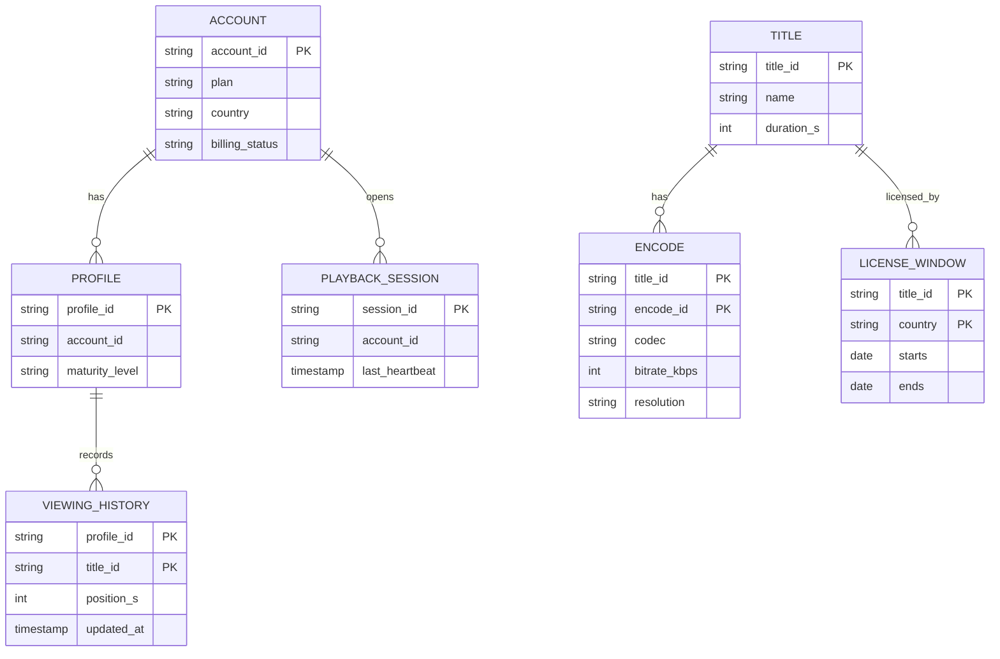
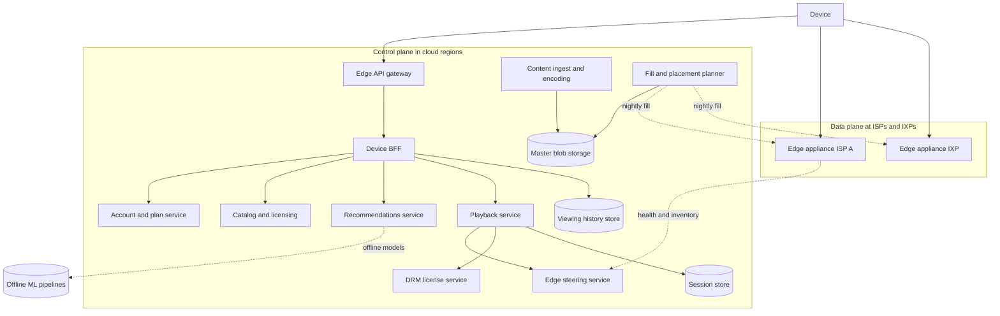
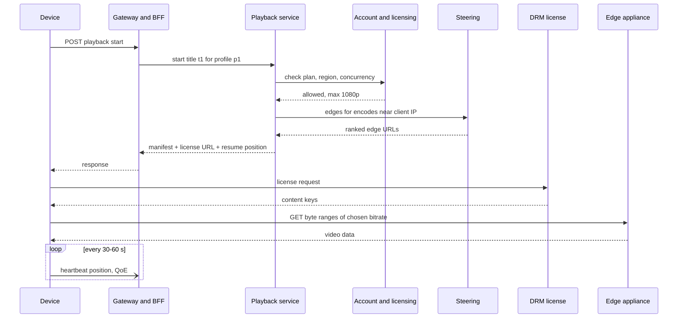

# Case Study: Netflix (Streaming Service)

Differs from [[Case-Study-YouTube]]: a **curated, bounded catalog** (thousands of titles, not billions of uploads), **subscription/licensing rules**, and predictable popularity - which makes **proactive edge caching** inside ISP networks possible. Back to [[System-Design-Index]].

## 1. Requirements (clarifying questions)

- Scope: browse, play, resume, profiles? (Yes.) Content ingestion/encoding? (High level.) Recommendations? (As a boundary/service contract only.)
- Catalog size? (Assume ~20K titles, each with many encodes.)
- Regional licensing? (Yes - catalog varies by country.)
- Offline downloads, live events? (Out of scope.)
- Concurrent stream limits per plan? (Yes.)

## 2. Functional requirements

- Sign up, subscription, profiles.
- Browse personalized home page (rows of titles).
- Play a title with ABR, resume where left off, subtitles/audio tracks.
- Enforce plan limits (concurrent streams, max resolution) and regional availability.
- Continue-watching and viewing history.

## 3. Non-functional requirements

- Playback start success > 99.9%, low rebuffering.
- Control plane (browse/auth/playback-authorization) highly available across regions (99.99%).
- Data plane (bytes) served mostly from edge caches close to users.
- Graceful degradation: if personalization fails, still show a (non-personalized) home page and allow playback.
- Resilience verified continuously (chaos engineering).

## 4. Capacity estimation

Assumptions: 100M daily streamers, 2 h/day avg, avg delivered bitrate 5 Mbps, peak concurrency 20% of daily streamers, 20K titles x avg 1.5 h, and **~150 GB stored per title** across all bitrates, codecs, audio and subtitle files.

- Peak concurrent streams: 100M x 0.2 = **20M streams**.
- Peak egress: 20M x 5 Mbps = **100 Tbps**. Impossible from a few data centers -> must come from edge appliances inside/near ISPs.
- Catalog storage: 20K x 150 GB = **3 PB** total (master copy, then replicated to edges partially).
- Edge appliance: if one appliance serves ~tens of Gbps, need thousands of appliances globally (order-of-magnitude reasoning only).
- Control-plane QPS: home page loads 100M x 3/day = 300M/day = **~3.5K/s** avg, peak ~15K/s; playback starts 100M x 3 = ~3.5K/s avg; heartbeats every 30-60 s per stream -> 20M / 30 s = **~670K heartbeats/s** peak.
- Viewing history: 300M events/day x 200 B = 60 GB/day -> ~22 TB/yr.

## 5. API design

```http
GET /v1/home?profile_id=p1
200 { "rows": [ { "title": "Continue Watching", "items": [ {"title_id":"t1","artwork":"https://img.cdn/...","progress_s":1200} ] }, { "title": "Top picks", "items": [...] } ] }

POST /v1/playback/start
{ "profile_id": "p1", "title_id": "t1", "device": {"type":"tv","codecs":["hevc","av1"],"drm":"widevine","max_res":"2160p"} }
200 { "session_id": "s9", "manifest": { "video": [{"bitrate":3000,"res":"1080p","urls":["https://edge-a.isp1.example/...","https://edge-b.ix.example/..."]}], "audio": [...], "subs": [...] }, "license_url": "https://license.example/...", "resume_at_s": 1200 }
403 { "error": "STREAM_LIMIT_REACHED" }   451 { "error": "NOT_AVAILABLE_IN_REGION" }

POST /v1/playback/heartbeat { "session_id": "s9", "position_s": 1260, "bitrate": 3000, "rebuffer_ms": 0 }  -> 204
POST /v1/playback/stop      { "session_id": "s9", "position_s": 3100 } -> 204
```

A device-specific backend-for-frontend (BFF) layer aggregates many microservice calls into these responses ([[API-Gateway]]).

## 6. Data model



- **Account/billing:** relational DB (transactions, correctness).
- **Viewing history / bookmarks:** write-heavy, keyed by profile, multi-region -> wide-column store (Cassandra-style, which Netflix has publicly described using extensively). See [[Database-Selection]].
- **Catalog/metadata:** read-heavy, small -> replicated and cached in-memory in services.
- **Active sessions for stream limits:** in-memory KV with TTL refreshed by heartbeats.

## 7. Architecture



## 8. Component responsibilities

| Component | Responsibility |
|---|---|
| Edge API gateway | AuthN, routing, rate limiting, per-device BFF scripts |
| Account/plan | Subscription status, plan limits, country |
| Catalog/licensing | Which titles are playable where and when |
| Recommendations | Boundary: given profile + context, return ranked rows; computed largely offline with online re-ranking |
| Playback service | Authorize play (plan, region, concurrency), choose encodes for device, ask steering for edge URLs, issue DRM license URL |
| Edge steering | Pick best edge(s) for this client by network proximity, health, and whether the file is present |
| Edge appliances | Serve video bytes; storage-heavy caches deployed inside ISPs or at internet exchange points |
| Fill/placement planner | Predict popularity per region and pre-position files to edges off-peak |
| DRM license | Issue decryption keys to authorized devices |

### Deep dive: ISP-embedded edge caching (generic)

Netflix has publicly described **Open Connect**, its own CDN of appliances placed in ISP networks and IXPs. Generic design:
- **Proactive fill:** because catalog and popularity are predictable, a planner decides per-cluster which files to store and pushes them during off-peak hours. Cache hit ratio is driven by prediction, not by reactive misses.
- **Tiering:** small, embedded appliances hold the most popular content; larger IXP clusters hold a wider catalog; misses fall back to a higher tier.
- **Steering:** the control plane returns a ranked list of edge URLs per file; clients fail over between them.
- **Benefits:** ISP saves transit costs, users get lower latency; the provider cuts egress costs.
- Control plane (cloud) and data plane (edges) are separate failure domains: a cloud issue can block new plays, but active streams keep flowing from edges.

### Deep dive: recommendations boundary

- Home page = rows x titles x artwork chosen per profile. Heavy lifting (model training, candidate generation) happens **offline/nearline** and results are precomputed into a store.
- Online: lightweight re-ranking with context (time, device), then filtered by licensing/maturity.
- **Contract:** `GET rows(profile, context) -> ranked rows` with strict latency budget. **Fallback:** cached last-known rows or popular-in-country rows ([[Fault-Tolerance]]). Streaming must never depend on recommendations being healthy.

### Deep dive: chaos engineering

Netflix has publicly described **Chaos Monkey** (randomly terminating instances in production) and broader chaos tooling.
- Hypothesis-driven experiments: define steady state (e.g., stream starts per second), inject failure (kill instances, add latency, fail a dependency, evacuate a region), verify steady state holds.
- Limit blast radius (small percentage of traffic), automated abort on SLI regression.
- Resilience patterns it validates: timeouts, retries with budgets, circuit breakers, bulkheads, fallbacks, regional failover.

## 9. Data flow



## 10. Scaling strategy

- Data plane scales by adding edge appliances where demand is; fill is computed from regional popularity.
- Control plane: stateless microservices autoscaled per region ([[Microservices]]); caches in front of every read-mostly dependency ([[Caching]]).
- Active-active multi-region control plane; users can be shifted between regions ([[Availability-and-Reliability]], [[Disaster-Recovery]]).
- Heartbeats/history writes go through streams and a write-optimized store.
- Precompute expensive work (recommendations, artwork selection) offline.

## 11. Failure modes

| Failure | Impact | Mitigation |
|---|---|---|
| Cloud region outage | New plays/browsing fail for its users | Active-active regions, traffic evacuation, replicated data |
| Recommendations down | Personalization lost | Fallback rows (popular, cached) |
| Edge appliance failure | Streams on it stall | Client fails over to next URL in list; steering excludes unhealthy nodes |
| Unpredicted popularity spike | Edge misses | Upper-tier fill, reactive fill, steering to larger clusters |
| Dependency latency | Thread exhaustion cascades | Timeouts, circuit breakers, bulkheads |
| License service down | Can't start new plays | Redundant, cached/persistent licenses for active sessions |
| Session store loss | Concurrency limits unenforceable | Fail open briefly (business choice), rebuild from heartbeats |

## 12. Security

- **AuthN:** account login, device tokens, MFA optional; device attestation for high-resolution content.
- **AuthZ:** plan entitlements (resolution, streams), regional licensing, profile maturity controls.
- **Content protection:** DRM encryption; resolution tiers tied to device security level; forensic watermarking (conceptually) for leak tracing.
- **Abuse:** account sharing/credential stuffing (rate limits, breached password checks, anomaly detection), VPN/proxy geo-evasion (licensing enforcement), payment fraud.
- **Data protection:** PII and payment data isolated and encrypted; viewing history is sensitive personal data - access controls and retention policies.
- **Threats:** stolen edge appliance (encrypted content, no keys stored at edge), API scraping of catalog, DRM key extraction on compromised devices (revoke device classes).

## 13. Observability

- **SLIs:** stream starts per second (key business health signal), playback start failure rate, rebuffer ratio, TTFF, edge hit ratio, control-plane latency/errors per service.
- **SLOs:** play start success > 99.9%; control-plane availability 99.99%.
- **Alerts:** deviation of stream starts from the predicted curve (anomaly detection), error spikes per device/ISP/region, fallback rates for recommendations. Distributed tracing across microservices ([[Observability]]).

## 14. Tradeoffs

| Decision | Chosen | Rejected | Why |
|---|---|---|---|
| CDN | Own ISP-embedded appliances + proactive fill | Commercial pull CDN only | Predictable catalog, massive egress, cost and quality control |
| Architecture | Microservices + BFF | Monolith | Team autonomy, independent scaling; costs: complexity, needs resilience patterns |
| Consistency | Eventual for history, strong for billing | Global strong | Latency/availability across regions ([[CAP-Theorem]]) |
| Recommendations | Offline precompute + online rerank | Fully online | Latency budget and cost |
| Resilience | Chaos experiments in prod | Only staging tests | Real failures only show at production scale |

## 15. Interview follow-up questions

- **How is Netflix different from YouTube?** Bounded, predictable catalog -> proactive placement; no UGC ingest at scale; licensing/entitlements.
- **What if the whole control plane is down?** Active streams continue from edges (licenses already issued); new plays fail - hence multi-region.
- **How do you enforce "2 screens" plan limit?** Session store with heartbeat TTL; start is rejected if active sessions >= limit.
- **How do you choose which files go to which edge?** Popularity prediction per region x file size; knapsack-like placement under disk capacity.
- **Why per-device BFF?** Devices differ in capabilities and screens; BFF shapes responses and reduces round trips.
- **How to test region failover?** Regular planned evacuation exercises, chaos experiments at region scale.
