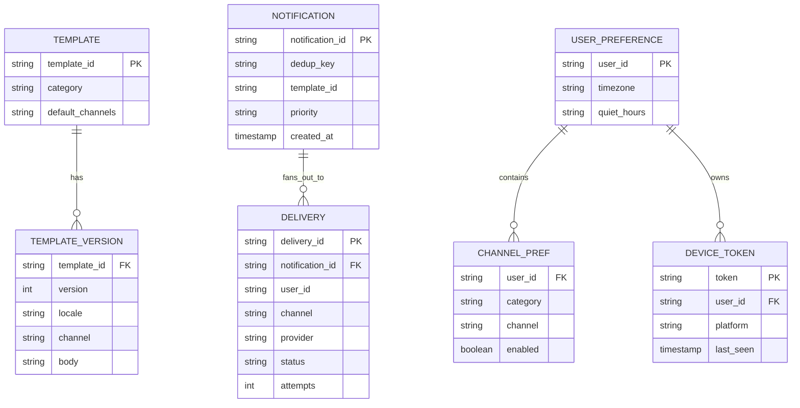
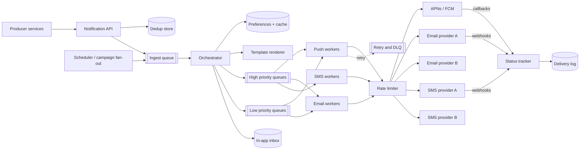
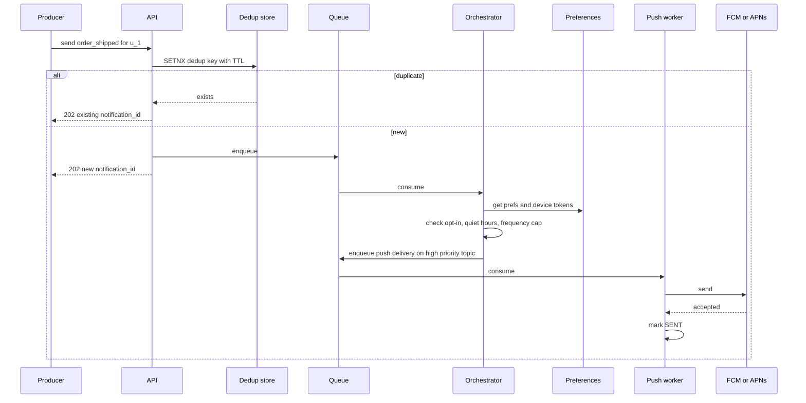

# Case Study: Notification System

Internal services ask the platform to "tell user X about event Y". The platform decides channel(s), renders content, respects preferences and quiet hours, deduplicates, and delivers through third-party providers (APNs, FCM, email and SMS vendors).

## 1. Requirements (clarifying questions)

- Channels? *Push (iOS/Android), email, SMS, in-app inbox.*
- Transactional (OTP, receipts) vs marketing (campaigns)? *Both; transactional must never wait behind marketing.*
- Delivery guarantee? *At-least-once to providers, with dedup to make duplicates rare.*
- Bulk campaigns to all users? *Yes, scheduled campaigns to segments.*
- Tracking? *Delivery, open, click events where the channel supports them.*
- Localization? *Yes, templates per locale.*

## 2. Functional requirements

- Send API accepting user id(s), template id, variables, priority, optional channels.
- Template management with versioning and locales.
- User preferences: per-category opt-in/out per channel, quiet hours, time zone.
- Deduplication of the same logical notification.
- Scheduled and bulk sends.
- In-app inbox with read/unread.
- Delivery status tracking and callbacks.

## 3. Non-functional requirements

- Transactional notifications: low latency (seconds end to end, excluding provider delays).
- High throughput for campaigns without starving transactional traffic.
- Respect provider rate limits and per-user frequency caps.
- Durable: accepted requests are not lost.
- Available: provider outage should not block other channels.

## 4. Capacity estimation

Assumptions:

- 200M users, 1B notifications/day across channels.
- Mix: 70% push, 20% in-app, 8% email, 2% SMS.
- Peak = 10x average (campaigns, events).
- Message record ~500 B; status events ~3 per message.

Arithmetic:

- Average = 1,000,000,000 / 86,400 ≈ 11,600/s. Peak ≈ 116,000/s.
- Push at peak ≈ 81,000/s; SMS at peak ≈ 2,300/s.
- Storage: 1B x 500 B = 500 GB/day for message log; status events 3B x ~100 B = 300 GB/day. Keep detailed logs ~30 days (≈ 24 TB), aggregates longer.
- Preferences: 200M users x ~1 KB = 200 GB; fits a sharded KV store with a cache.

## 5. API design

```http
POST /v1/notifications
Idempotency-Key: order-123-shipped
{
  "user_ids": ["u_1"],
  "template_id": "order_shipped",
  "category": "transactional",
  "priority": "high",
  "variables": {"order_id": "123", "eta": "2026-10-01"},
  "channels": ["push", "email"],        // optional; default from template + prefs
  "send_at": null
}
-> 202 { "notification_id": "n_abc" }

GET  /v1/notifications/{id}/status
PUT  /v1/users/{user_id}/preferences
GET  /v1/users/{user_id}/inbox?cursor=...
POST /v1/campaigns   { "segment_id": "...", "template_id": "...", "send_at": "..." }
```

`202 Accepted`: the API only persists and enqueues. See [[API-Design-REST-gRPC-GraphQL]].

## 6. Data model



**DB choice:** templates in a relational DB (low volume, versioned). Preferences and device tokens in a sharded key-value/wide-column store keyed by `user_id` with a read-through cache (read on every send). Delivery log in a wide-column store partitioned by `(user_id, day)` or a time-series friendly store for high write rates and TTL. In-app inbox keyed by `user_id`, sorted by time. See [[Database-Selection]], [[Caching]].

## 7. Architecture



## 8. Component responsibilities

| Component | Responsibility |
|---|---|
| Notification API | Validate, authenticate caller, dedup by idempotency key, persist, enqueue |
| Scheduler | Delayed sends and campaign expansion of segments into batches |
| Orchestrator | Load prefs, apply opt-outs, quiet hours, frequency caps; choose channels; render template; route by priority |
| Template renderer | Locale fallback, variable substitution, escaping (HTML email) |
| Priority queues | Separate queues/topics per channel x priority so marketing cannot starve OTPs |
| Channel workers | Call providers, handle retries with backoff, mark status |
| Rate limiter | Per-provider quotas and per-user caps ([[Rate-Limiting]]) |
| Provider adapters | Uniform interface; health scoring for failover |
| Status tracker | Ingest provider callbacks, update delivery log, remove invalid device tokens |

## 9. Data flow



## 10. Scaling strategy

- All tiers stateless and horizontally scaled on queue lag ([[Scalability]]).
- Partition queues by channel and priority; partition within a topic by `user_id` to keep per-user order where needed.
- Campaigns: expand segments in batches, throttle injection so they fill spare capacity only.
- Cache preferences and templates aggressively; invalidate on update.
- Batch provider calls where supported (e.g. multicast push, batched email API).

## 11. Failure modes

| Failure | Impact | Mitigation |
|---|---|---|
| Provider outage or high error rate | Channel delivery stalls | Health-scored failover to secondary provider; circuit breaker ([[Fault-Tolerance]]) |
| Provider 429 throttling | Retries amplify load | Token bucket per provider; exponential backoff with jitter |
| Worker crash after send, before ack | Duplicate send | Dedup key per `(notification_id, user, channel)` checked before send; accept rare dupes for push |
| Campaign floods queues | OTP delay | Separate high-priority queues and reserved worker pools |
| Invalid device tokens | Wasted sends | Remove tokens on provider "unregistered" responses |
| Poison message | Worker loop | Max attempts, then DLQ with alert |
| Preference store down | Cannot check opt-out | Fail closed for marketing (do not send), fail open only for critical transactional with cached prefs |

## 12. Security

- Only authenticated internal services may call the send API; per-caller quotas.
- Template injection: escape variables in HTML email; templates reviewed before publish.
- OTP content: never log full message bodies containing codes; mask PII in logs ([[Security-Logging-and-Detection]]).
- Unsubscribe links signed (HMAC) so they cannot be forged for other users.
- Email authentication (SPF, DKIM, DMARC) to prevent spoofing and protect deliverability.
- Provider API keys in a secrets manager, rotated.

## 13. Observability

- **SLIs:** time from accept to provider handoff per priority (p50/p99); provider success rate per channel; queue lag; DLQ size; opt-out violation count (should be zero).
- **SLOs (examples):** 99% of high-priority notifications handed to provider within a few seconds; 99.9% of accepted requests eventually delivered or terminally failed with reason.
- **Alerts:** high-priority lag above threshold; provider error rate spike; DLQ growth; bounce/complaint rate rising (email reputation risk).

## 14. Tradeoffs

- **At-least-once + dedup vs exactly-once:** exactly-once to external providers is not achievable; we minimize dupes and accept rare duplicate pushes, but for SMS OTP we check dedup store before every send because cost and UX matter.
- **Per-channel queues vs one queue:** more topics to operate, but isolation of priorities and failure domains.
- **Render at orchestration vs at worker:** rendering early simplifies workers but stores larger payloads; rendering late picks up template fixes.
- **Fail open vs closed on preferences:** legal risk (sending to opted-out users) vs missing important messages.

## 15. Interview follow-ups

**Q: How do you stop a marketing blast from delaying password reset codes?**
A: Separate queues per priority with dedicated consumers and provider quota reservation; campaign injection is throttled.

**Q: How do you deduplicate?**
A: Caller supplies an idempotency/dedup key; API does atomic set-if-absent with TTL. Workers also check a per-delivery key before calling providers. See [[Idempotency]].

**Q: How do you respect quiet hours across time zones?**
A: Store user time zone; orchestrator computes local time; non-urgent deliveries are rescheduled into a delayed queue for the end of quiet hours.

**Q: How do you fail over between SMS providers?**
A: Adapter layer with health scores from error rate and latency; circuit breaker opens on sustained failure and routes to the next provider; be careful not to double-send an OTP that may have succeeded on the first provider.

**Q: How would you implement frequency caps?**
A: Sliding-window counters per `(user, category)` in a fast KV store; orchestrator drops or defers when over cap.
