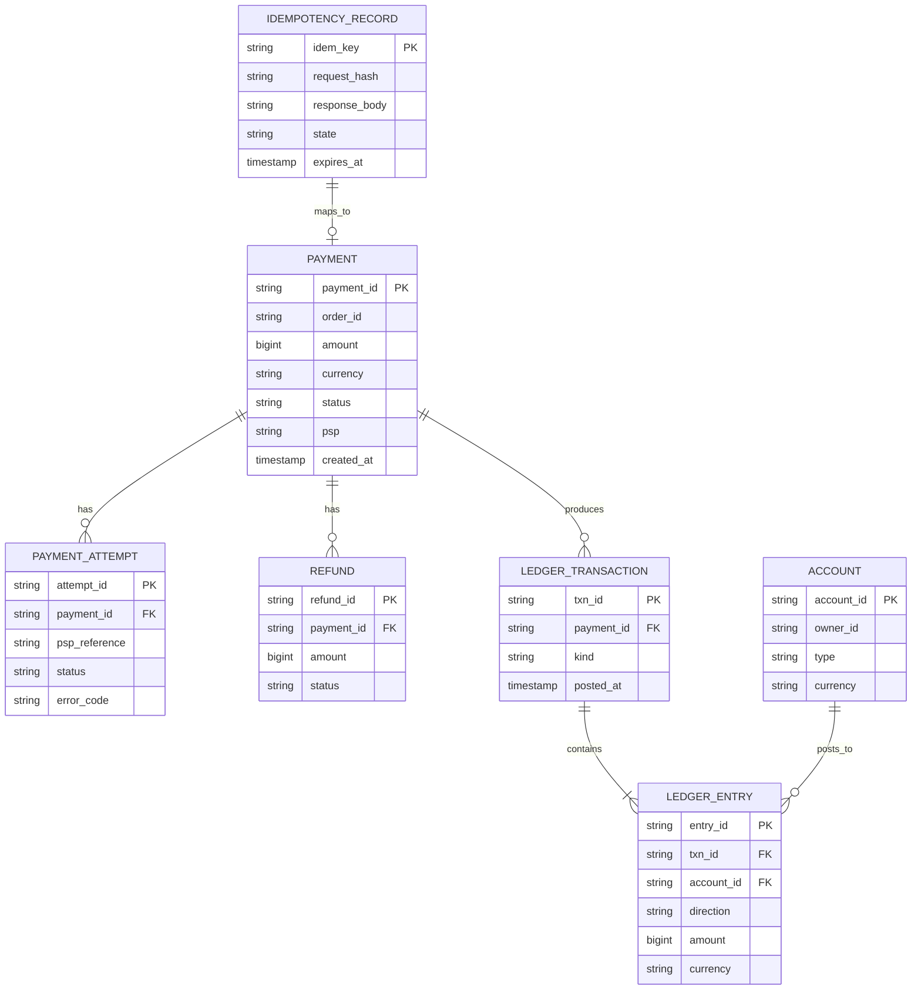
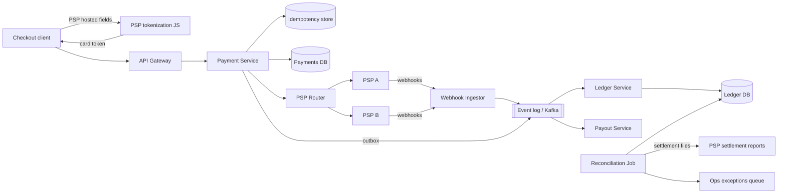
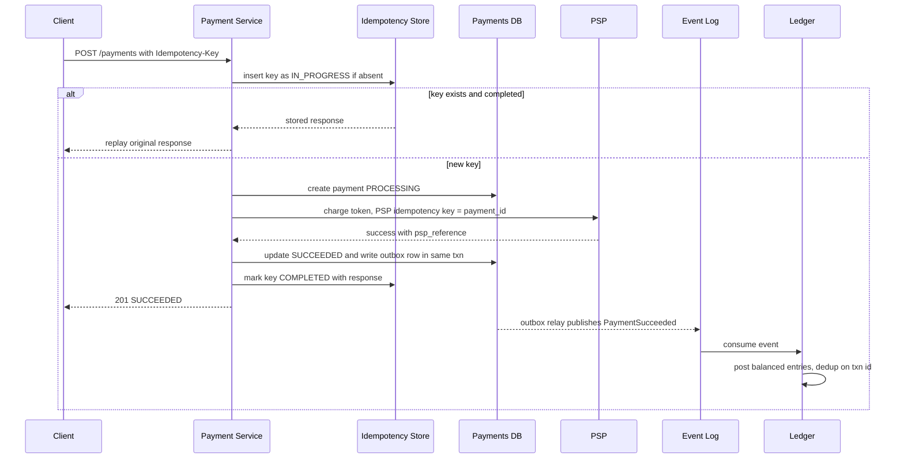

# Case Study: Payment System

A payment system moves money between parties through external Payment Service Providers (PSPs: Stripe, Adyen, a bank gateway). Its hard problems are not throughput but **correctness under failure**: never charge twice, never lose a charge, always be able to explain every cent.

## 1. Requirements (clarifying questions)

- Are we a merchant accepting payments (pay-in), a marketplace paying sellers (pay-out), or both? *Assume both: buyers pay in, sellers are paid out.*
- Do we store card numbers? *No. We use PSP-hosted fields / tokenization to shrink PCI scope.*
- Which payment methods? *Cards and one wallet; design must allow adding methods.*
- Single currency or multi-currency? *Multi-currency storage, no FX engine in scope.*
- Synchronous confirmation needed? *Checkout needs an answer in seconds; PSPs may confirm asynchronously via webhooks.*
- Refunds, chargebacks? *Refunds yes; chargebacks ingested from PSP as events.*

## 2. Functional requirements

- Create a payment for an order (authorize + capture, or direct charge).
- Refund fully or partially.
- Pay out seller balances on a schedule.
- Record every money movement in an immutable double-entry ledger.
- Ingest PSP webhooks (success, failure, dispute).
- Daily reconciliation of internal ledger vs PSP settlement reports.
- Query payment status and balances.

## 3. Non-functional requirements

- **Correctness over availability** for money movement: no double charge, no lost charge.
- **Idempotency** on every mutating API and every PSP call.
- **Auditability:** append-only ledger, full history.
- **Availability:** checkout path highly available; degraded mode may queue payouts.
- **Latency:** the internal overhead should be small compared to the PSP round trip (which dominates).
- **Security/compliance:** PCI-DSS scope minimized; encryption in transit and at rest.

## 4. Capacity estimation

Assumptions (stated, not measured):

- 10M payments/day.
- Peak = 5x average.
- Each payment produces ~4 ledger entries (2 for authorize/capture pair, 2 for fee split) and ~3 state transitions.
- Payment row ~1 KB, ledger entry ~200 B.

Arithmetic:

- Average QPS = 10,000,000 / 86,400 ≈ 116 writes/s. Peak ≈ 580 payments/s.
- Ledger writes: 580 x 4 ≈ 2,320 entries/s at peak.
- Storage per day: payments 10M x 1 KB = 10 GB; ledger 40M x 200 B = 8 GB. ≈ 18 GB/day ≈ 6.6 TB/year before indexes and replicas.
- Retention: financial records often need multi-year retention (> TODO: confirm the jurisdiction's legal retention period), so plan for tiered storage of old partitions.

Conclusion: write volume fits a well-provisioned relational cluster with partitioning; the design focus is correctness, not raw scale.

## 5. API design

```http
POST /v1/payments
Idempotency-Key: 5f1c...-uuid
{
  "order_id": "ord_123",
  "amount": 4999,            // minor units, integer
  "currency": "USD",
  "payment_method_token": "pm_tok_abc",   // token from PSP-hosted fields, never a PAN
  "capture": true
}
-> 201 { "payment_id": "pay_789", "status": "PROCESSING" }

GET  /v1/payments/{payment_id}
POST /v1/payments/{payment_id}/refunds   (Idempotency-Key required)
POST /v1/webhooks/{psp}                  (signature verified)
GET  /v1/accounts/{account_id}/balance
```

Rules:

- Amounts are **integers in minor units**. Never floats.
- `Idempotency-Key` required; the same key with a different body returns `422`.
- A replayed key returns the stored original response.

See [[API-Design-REST-gRPC-GraphQL]] and [[Idempotency]].

## 6. Data model



**Double-entry ledger:** every `LEDGER_TRANSACTION` has entries whose debits equal credits (per currency). Balances are derived from entries (optionally cached in a snapshot table updated in the same DB transaction). Entries are never updated or deleted; corrections are new reversing transactions.

**DB choice:** a relational database (e.g. PostgreSQL) because we need multi-row ACID transactions (payment state + ledger entries + idempotency record in one commit), constraints, and strong consistency. Partition ledger tables by time; shard by `account_id` or merchant if a single primary is outgrown. See [[Database-Selection]] and [[Sharding-and-Partitioning]].

## 7. Architecture



## 8. Component responsibilities

| Component | Responsibility |
|---|---|
| API Gateway | AuthN, rate limiting, TLS termination ([[API-Gateway]], [[Rate-Limiting]]) |
| Payment Service | State machine (`CREATED -> PROCESSING -> SUCCEEDED/FAILED`), idempotency, writes outbox events |
| Idempotency store | Maps key -> request hash + stored response; lock on in-flight keys |
| PSP Router | Chooses PSP by method/region/health; passes our idempotency key to the PSP |
| Webhook Ingestor | Verifies PSP signatures, dedups by PSP event id, publishes to the log |
| Ledger Service | Appends balanced double-entry transactions; the source of truth for balances |
| Payout Service | Aggregates seller balances, initiates payouts with idempotency keys |
| Reconciliation Job | Three-way match: internal payments vs ledger vs PSP settlement file |

## 9. Data flow



If the PSP call times out, the payment stays `PROCESSING`. A recovery worker queries the PSP by our reference (or waits for the webhook) and resolves it. We never blindly retry a charge with a new key.

## 10. Scaling strategy

- Stateless Payment Service behind a load balancer ([[Load-Balancing]]).
- Partition payment and ledger tables by time; shard by merchant/account when needed.
- Hot accounts (the platform's own fee account receives an entry on every payment): split into N sub-accounts and sum on read, or batch postings.
- Async everything that is not on the checkout path (ledger posting, payouts, notifications) via the event log ([[Message-Queues]], [[Event-Driven-Architecture]]).
- Multi-PSP routing gives capacity and failover.

## 11. Failure modes

| Failure | Impact | Mitigation |
|---|---|---|
| Client retries after timeout | Double charge | Idempotency key; PSP idempotency key derived from `payment_id` |
| PSP timeout, unknown outcome | Payment stuck | Keep `PROCESSING`; status polling + webhook; never re-charge with new key |
| Crash between DB commit and event publish | Ledger misses entry | Transactional outbox pattern |
| Duplicate webhook delivery | Double ledger posting | Dedup on PSP event id; ledger unique constraint on `(payment_id, kind)` |
| Out-of-order webhooks | Wrong final status | State machine rejects invalid transitions; use PSP event timestamps/versions |
| PSP outage | Checkout failures | Router fails over to secondary PSP for new payments only |
| Ledger/PSP mismatch | Money unaccounted | Daily reconciliation, exceptions queue, manual review |
| DB primary failure | Writes unavailable | Synchronous replica failover ([[Replication]], [[Disaster-Recovery]]) |

## 12. Security

- **PCI-DSS scope reduction via tokenization:** card data is entered in PSP-hosted fields/iframes and exchanged for a token; our servers never see the PAN, so most of our infrastructure stays out of cardholder data environment scope. > TODO: confirm the exact SAQ level with a QSA; it depends on integration type.
- Verify webhook signatures (HMAC) and timestamps to block replay.
- mTLS between internal services; secrets in a vault; least-privilege DB roles (ledger is append-only for the service role). See [[Least-Privilege]].
- Encrypt at rest; audit log of every admin action.
- Fraud checks (velocity, device signals) before PSP call.
- Threat model with [[Threat-Modeling-STRIDE]]: tampering with amounts, repudiation of refunds, elevation via admin tools.

## 13. Observability

- **SLIs:** checkout API success rate (excluding card declines), p99 internal latency, payments stuck in `PROCESSING` > N minutes, webhook processing lag, reconciliation mismatch count.
- **SLOs (example targets, set by the business):** e.g. 99.95% non-decline success monthly; zero unreconciled items older than 2 days.
- **Alerts:** PSP error rate spike per PSP; stuck-payment count above threshold; ledger imbalance (sum of debits != credits) = page immediately; outbox relay lag.
- Trace each payment by `payment_id` across services ([[Observability]]).

## 14. Tradeoffs

- **Sync vs async ledger posting:** async via outbox keeps checkout fast but balances are eventually consistent; posting in the same DB transaction is simpler but couples services.
- **Exactly-once is an illusion:** networks give at-most-once or at-least-once. We achieve *effectively once* = at-least-once delivery + idempotent consumers + dedup keys.
- **Single vs multi PSP:** multi-PSP adds resilience and negotiating power, but more reconciliation formats and routing logic.
- **Relational vs specialized ledger DB:** relational is well understood; purpose-built ledgers offer higher throughput for hot accounts at the cost of operational novelty.

## 15. Interview follow-ups

**Q: How do you guarantee a user is never charged twice?**
A: Client-generated idempotency key stored with request hash; the payment service creates one `payment_id` per key and passes a PSP idempotency key derived from it. Retries return the stored result. Unknown outcomes are resolved by querying the PSP, not by retrying with a new key.

**Q: Why double-entry?**
A: Every movement is balanced, so money cannot appear or vanish silently; an invariant check (debits = credits) detects bugs. It also gives a complete audit trail and makes balances derivable.

**Q: What happens if the service crashes after the PSP charged but before we saved it?**
A: The payment row was created as `PROCESSING` before the call. A recovery job finds stale `PROCESSING` payments and queries the PSP by reference; the webhook also arrives. Reconciliation is the final safety net.

**Q: How does reconciliation work?**
A: Ingest the PSP settlement report, match each line to internal payments by PSP reference and amount, and compare to ledger postings. Mismatches (missing, amount diff, status diff) go to an exceptions queue for automated fix or human review.

**Q: How do you handle a hot merchant account?**
A: Shard the account into sub-accounts, write to a random one, and sum for reads; or buffer and post batched entries.

**Q: How do you reduce PCI scope?**
A: Tokenization through PSP-hosted fields so raw PANs never touch our systems; we store only tokens and last-4/brand metadata.
