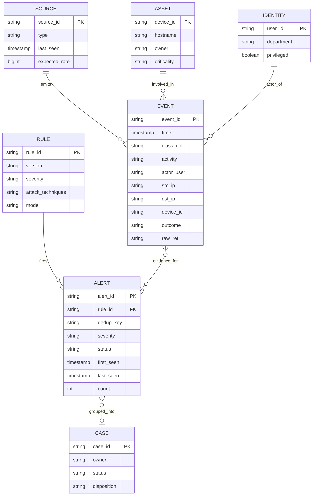
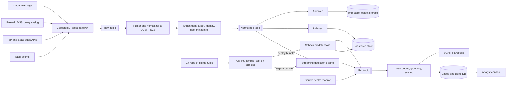
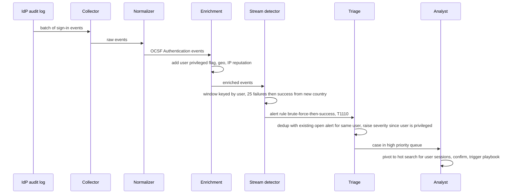

# Case Study: SIEM

A SIEM collects security telemetry (auth logs, endpoint, network, cloud audit, SaaS), normalizes it, runs detections in real time and over history, enriches and deduplicates alerts, and supports analysts investigating incidents. It builds on the pipeline in [[Case-Study-Log-Aggregation]] but adds **a common schema, a detection engine, and an analyst workflow**.

## 1. Requirements (clarifying questions)

- Data sources? *Identity provider, EDR, firewall/DNS/proxy, cloud audit logs (e.g. CloudTrail), SaaS audit, OS logs.*
- Real-time or batch detection? *Both: streaming rules for known-bad patterns, scheduled queries for aggregations and hunts.*
- Who writes detections? *Detection engineers, in Git, reviewed and tested (detection-as-code).*
- Retention? *Searchable hot for weeks, archive for a year or more (compliance-driven; > TODO: confirm per regulation).*
- Response? *Alert to a case queue; optional SOAR playbooks (disable user, isolate host) with human approval.*
- Multi-tenant (MSSP) or single org? *Single org with business units.*

## 2. Functional requirements

- Ingest via agents, syslog, cloud APIs, and webhooks.
- Parse and normalize to a common schema (e.g. OCSF or Elastic Common Schema).
- Enrich with asset inventory, identity context, geo-IP, threat intel.
- Streaming detection rules (single event, threshold, sequence/correlation across sources).
- Scheduled detections and ad-hoc threat hunting queries.
- Alert dedup, grouping, severity, MITRE ATT&CK tagging.
- Case management: triage, assign, comment, close with disposition.
- Retention tiers and immutable archive.

## 3. Non-functional requirements

- Detection latency for critical rules: seconds to low minutes.
- No silent data loss; monitor source health (a silent source is itself a finding).
- Tamper resistance: attackers try to delete logs.
- Scales with bursty telemetry (e.g. a scanning incident).
- Low false-positive rate: analyst attention is the scarcest resource.

## 4. Capacity estimation

Assumptions:

- 50,000 endpoints, 5,000 servers, several cloud accounts.
- 20 TB/day raw security telemetry; average event 1 KB.
- 500 streaming rules, 300 scheduled rules.
- Peak = 3x average.

Arithmetic:

- Events/day = 20 TB / 1 KB = 20B ≈ 231,000 events/s avg, ~700,000/s peak.
- Every event is evaluated against streaming rules; with rule pre-filtering by `class/category` each event touches only a small subset of rules, so rule evaluation cost is manageable. Without pre-filtering: 700K x 500 = 350M rule evaluations/s, which is why indexing rules by event class matters.
- Hot storage 30 days, normalized adds fields (assume 1.3x), compressed 5:1, 1 replica: 20 x 1.3 / 5 x 30 x 2 ≈ 312 TB.
- Archive 1 year compressed: 20 / 5 x 365 ≈ 1.46 PB in object storage.

## 5. API design

```http
POST /v1/ingest/{source_type}          (batched, authenticated per source)
POST /v1/search   { "query": "...", "from": "...", "to": "..." }
GET  /v1/alerts?status=open&severity=high
POST /v1/alerts/{id}/assign  { "analyst": "..." }
POST /v1/cases               { "alert_ids": [...], "title": "..." }
POST /v1/cases/{id}/close    { "disposition": "true_positive|benign|false_positive", "notes": "..." }

# Detection-as-code: rules deployed from CI, not through the UI
POST /v1/rules/deploy        { "bundle_version": "git-sha", "rules": [...] }
```

Example Sigma rule (vendor-neutral, compiled to the backend's query language):

```yaml
title: Multiple Failed Logins Followed By Success
id: 0f4c3a2e-0000-4000-8000-000000000001
status: experimental
logsource:
  category: authentication
detection:
  failed:
    outcome: failure
  success:
    outcome: success
  condition: failed | count() by user > 20   # older Sigma aggregation syntax; newer spec uses correlation rules
level: high
tags:
  - attack.credential_access
  - attack.t1110
```

> Note: Sigma's aggregation/correlation syntax has evolved (correlation rules were added as a separate spec). Check the version your converter supports.

## 6. Data model



- **Common schema:** normalize vendor fields into one model (OCSF classes like Authentication, Network Activity, Process Activity; or ECS fields like `user.name`, `source.ip`, `event.outcome`). Rules are written once against the schema, not per vendor. Keep a pointer to the raw event for forensics.
- **Storage choice:** hot events in a search/analytics engine (inverted index or columnar) for fast filtering and aggregation over time ranges; archive in object storage as compressed columnar files queryable by a SQL engine. Alerts/cases in a relational DB (workflow state, transactions). Enrichment lookups (assets, identities, threat intel) in an in-memory cache/KV fed from the CMDB and IdP.

## 7. Architecture



## 8. Component responsibilities

| Component | Responsibility |
|---|---|
| Collectors | Pull cloud/SaaS APIs with checkpoints, receive syslog/agents, authenticate sources |
| Normalizer | Per-source parsers mapping to the common schema; version parsers; route unparsable events to a quarantine topic |
| Enrichment | Join events with asset criticality, user privilege, geo-IP, threat-intel indicators (cached, versioned) |
| Streaming detection | Stateful stream processing: single-event matches, thresholds in windows, sequences keyed by user/host (e.g. "N failures then success then new MFA device") |
| Scheduled detections | Heavier queries over hot store (rare process across fleet, baselines) |
| Detection-as-code pipeline | Rules in Git, peer review, unit tests with true-positive and benign samples, convert Sigma to backend queries, staged rollout (monitor mode before alerting) |
| Triage | Dedup by `(rule, entity, window)`, group related alerts into incidents, risk scoring, MITRE ATT&CK tags for coverage reporting |
| Case management | Assignment, SLA timers, dispositions that feed back into rule tuning |
| Source health | Alert when an expected source goes silent or drops sharply |

## 9. Data flow



## 10. Scaling strategy

- Kafka partitioned by source and entity key so stateful detections see all events for a key on one worker.
- Rule routing by event class; compile rules into a shared matcher to avoid N x M evaluation.
- Stateful windows in a stream processor with checkpointed state; bound state with TTLs.
- Hot tier sized by retention; cold archive queried on demand ([[Sharding-and-Partitioning]]).
- Filter/aggregate noisy sources at collection (e.g. drop known-benign high-volume events) only after detection engineers agree, because dropping data creates blind spots.

## 11. Failure modes

| Failure | Impact | Mitigation |
|---|---|---|
| Source stops sending (agent killed by attacker, API token expired) | Blind spot | Source health monitor with expected rates; alert on silence |
| Parser breaks after vendor format change | Events unnormalized, rules miss | Quarantine topic, parse-failure rate alert, raw retained for replay |
| Detection engine lag | Late alerts | Autoscale on lag; prioritize critical rules; replay from Kafka |
| Bad rule deployed (too noisy) | Alert flood, analyst fatigue | CI tests, monitor mode, per-rule alert rate limits, fast rollback by bundle version |
| Enrichment cache stale | Wrong severity | TTL + versioned lookups; record enrichment version in alert |
| Attacker deletes local logs | Evidence lost | Forward in near real time; immutable (WORM) archive |
| Event time vs arrival time skew | Windows miss correlations | Watermarks with allowed lateness; late-event re-evaluation for critical rules |

## 12. Security

- The SIEM holds the most sensitive data in the company: strict RBAC, MFA for analysts, audit every query ([[Least-Privilege]]).
- Separate admin plane from the monitored environment so a domain compromise does not grant SIEM admin.
- Integrity: object lock / WORM storage for archive; hash chains for tamper evidence.
- Collector credentials scoped read-only per source; rotated.
- Sanitize event fields in the UI (log data is attacker-controlled; stored XSS in the console is a real risk, see [[XSS]]).
- SOAR actions (disable account, isolate host) require approval for high-impact steps.
- Map detection coverage to MITRE ATT&CK techniques to find gaps; threat model the pipeline itself ([[Threat-Modeling-STRIDE]]).

## 13. Observability

- **Pipeline SLIs:** ingest-to-detect latency per source; parse failure rate; consumer lag; dropped events; silent sources count.
- **Detection SLIs:** alerts per rule per day; false positive rate by disposition; mean time to acknowledge and to resolve; ATT&CK technique coverage.
- **SLOs (examples):** critical rules evaluate within minutes of event time; zero silent critical sources longer than a set window.
- **Alerts:** source silence; parse failure spike; detection lag; alert volume anomalies (spike = noisy rule or real attack; drop = broken pipeline).

## 14. Tradeoffs

- **Normalize at ingest vs at query:** ingest normalization makes rules portable and fast but requires maintaining parsers; query-time is flexible but slow and inconsistent.
- **Streaming vs scheduled detection:** streaming gives low latency but limited lookback and state; scheduled supports complex joins at the cost of latency.
- **Retention vs cost:** investigations often need months of history (dwell time), but hot storage is expensive; keep hot short and archive queryable.
- **Sensitivity vs noise:** broad rules catch more but burn analysts; tune with dispositions and risk-based alerting (accumulate risk per entity, alert on threshold).
- **Build vs buy:** commercial SIEMs provide parsers and content; a custom data lake gives cost control but requires a detection engineering team.

## 15. Interview follow-ups

**Q: Why a common schema?**
A: Rules and hunts work across vendors; swapping a firewall vendor means writing a new parser, not rewriting every detection.

**Q: What is detection-as-code?**
A: Rules live in version control, are reviewed, tested against sample events (true positives and benign), deployed via CI, and rolled back like software.

**Q: How do you detect "login brute force followed by success"?**
A: Stateful window keyed by user (and/or source IP): count failures, then match a success within the window; enrich with privilege and geo to set severity. Partition the stream by the key so state is local.

**Q: How do you reduce alert fatigue?**
A: Dedup and group alerts per entity, risk-based alerting, suppress known benign patterns with expiry, measure per-rule false-positive rates from dispositions, retire noisy rules.

**Q: How do you know you are not blind?**
A: Monitor source health against expected rates, synthetic test events that must trigger canary detections end to end, and ATT&CK coverage mapping.

**Q: How does a SIEM support incident response?**
A: It provides the timeline and scope for the detection and analysis phases of [[Incident-Response-Lifecycle]], and feeds lessons learned back into new rules.
