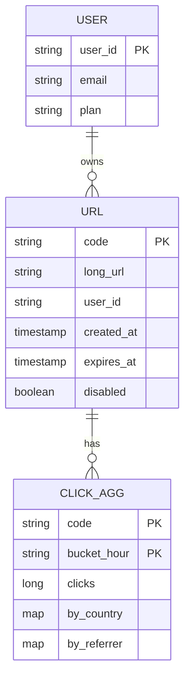
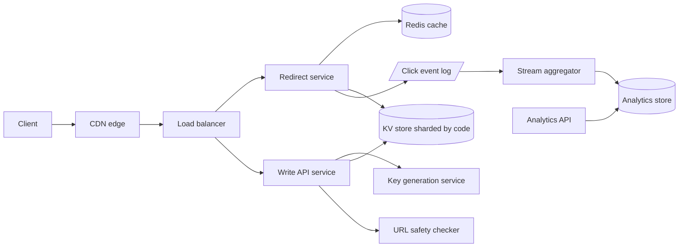
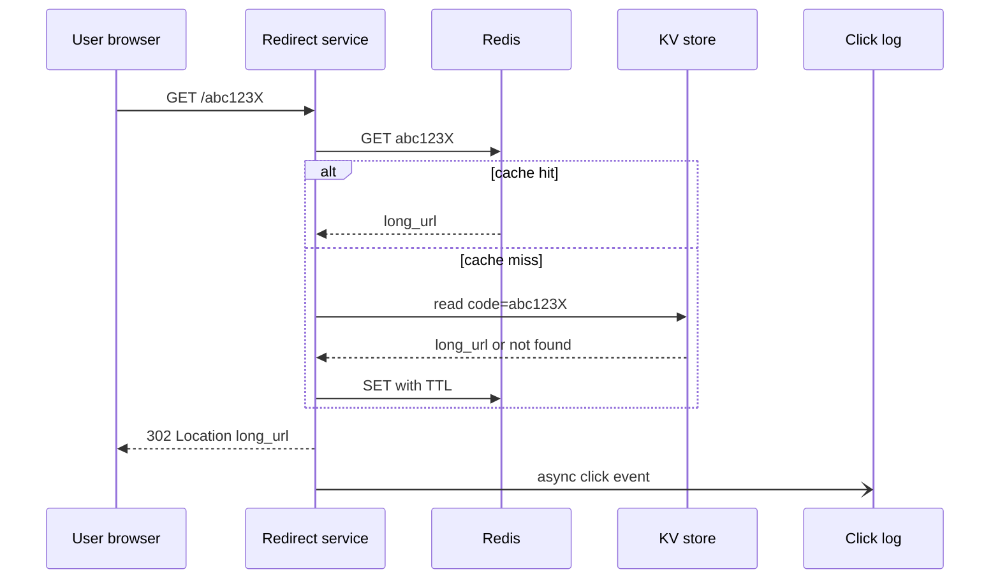

# Case Study: URL Shortener

A read-dominated key-value system. The interesting parts are **key generation**, **redirect latency**, and **analytics without slowing redirects**. Back to [[System-Design-Index]].

## 1. Requirements (clarifying questions)

- Custom aliases allowed? (Yes, optional.)
- Expiration? (Optional TTL; default never.)
- Can a long URL map to multiple short URLs? (Yes; per-user dedupe optional.)
- Analytics needed? (Click counts, referrer, country, device - near real time is fine, minutes of lag OK.)
- Edit/delete short links? (Delete yes; edit destination only for authenticated owners.)
- Short code length / charset? (Base62, 7 chars.)
- Anonymous creation? (Yes, heavily rate limited.)

## 2. Functional requirements

- Create short URL from long URL (optionally custom alias, expiry).
- Redirect `GET /{code}` to the long URL.
- Delete / disable a link (owner or abuse team).
- Per-link analytics: total clicks, time series, top referrers/countries.

## 3. Non-functional requirements

- Redirect p99 < 50 ms server-side (excluding network).
- Availability 99.99% for redirects; creation can be 99.9%.
- Codes must be unique and not trivially enumerable (optional requirement).
- Durability: a created link must never be lost.
- Eventual consistency acceptable for analytics; read-your-writes for creator.

## 4. Capacity estimation

Assumptions: 100M new URLs/month, read:write = 100:1, 5 years retention, 500 bytes per record, 200 bytes per click event.

- Writes: 100M / (30 x 86,400 s) = 100M / 2.59M = **~40 writes/s** avg; peak x5 = 200/s.
- Reads: 40 x 100 = **~4,000 redirects/s** avg; peak ~20,000/s.
- URLs over 5 years: 100M x 12 x 5 = **6B records**.
- Key space: 62^7 = ~3.5 trillion, so 6B uses < 0.2% - 7 chars is enough.
- Storage (URLs): 6B x 500 B = **3 TB** over 5 years (~600 GB/yr).
- Click events: 4,000/s x 86,400 = 345.6M/day x 200 B = ~69 GB/day = **~25 TB/yr** raw (compress/aggregate).
- Bandwidth: redirect response ~500 B -> 4,000 x 500 B = **2 MB/s** egress avg. Trivial.
- Cache: 80/20 rule; cache 20% of daily hot keys: 345.6M reads/day, assume 20% distinct hot = ~70M x 500 B = **~35 GB** - fits in a small Redis cluster.

## 5. API design

```http
POST /api/v1/urls
Authorization: Bearer <token>   (optional)
Idempotency-Key: 6f1c...
{ "long_url": "https://example.com/a/very/long/path", "custom_alias": "promo24", "expires_at": "2027-01-01T00:00:00Z" }

201 Created
{ "code": "promo24", "short_url": "https://sho.rt/promo24", "long_url": "...", "expires_at": "..." }
409 Conflict  (alias taken)   400 (invalid/malicious URL)   429 (rate limited)
```

```http
GET /{code}
301 Moved Permanently | 302 Found
Location: https://example.com/a/very/long/path
404 Not Found | 410 Gone (expired/disabled)
```

```http
DELETE /api/v1/urls/{code}          -> 204
GET /api/v1/urls/{code}/stats?from=2026-09-01&to=2026-09-29&granularity=day
200 { "total": 12345, "series": [{"t":"2026-09-01","clicks":400}], "top_countries": [...], "top_referrers": [...] }
```

See [[API-Design-REST-gRPC-GraphQL]] and [[Idempotency]].

## 6. Data model



- **URL store:** key-value access by `code` only, 6B rows, no joins -> a wide-column/KV store (Cassandra/DynamoDB-style) sharded by `code`. A relational DB also works at this size with sharding, but KV fits the access pattern and scales horizontally with less effort. See [[Database-Selection]], [[Sharding-and-Partitioning]].
- **Owner lookup:** secondary table `user_urls (user_id, created_at, code)` partitioned by `user_id` for "my links".
- **Analytics:** raw events to a log ([[Message-Queues]]), aggregated into an OLAP/columnar store keyed `(code, hour)`.

## 7. Architecture



## 8. Component responsibilities

| Component | Responsibility |
|---|---|
| CDN / edge | Optionally cache 301s for hot codes; absorb DDoS ([[CDN]]) |
| Load balancer | L7 routing, TLS termination ([[Load-Balancing]]) |
| Redirect service | Stateless; cache lookup -> DB fallback -> emit click event async -> respond |
| Write API | Validate URL, safety check, get key, persist, idempotency |
| Key generation service (KGS) | Hand out pre-generated unique codes in batches |
| Redis cache | `code -> long_url` with LRU; negative cache for misses ([[Caching]]) |
| KV store | Durable source of truth, replicated RF=3 ([[Replication]]) |
| Click log + aggregator | Decouple analytics from hot path; windowed counts |
| Safety checker | Blocklists, malware/phishing reputation |

### Deep dive: key generation

| Approach | How | Pros | Cons |
|---|---|---|---|
| **Base62 of counter** | Global auto-increment ID -> base62 | Short, no collisions | Counter is a bottleneck/SPOF; sequential codes are enumerable. Fix: range allocation per node (e.g., ZooKeeper/etcd hands out ranges of 1M), and optionally shuffle bits with a reversible permutation |
| **Hash (MD5/SHA-256) truncated** | Take first 7 base62 chars of hash(long_url + salt) | Stateless, same URL -> same code (dedupe) | Collisions must be detected and retried (check DB / [[Bloom-Filters-and-Probabilistic-Structures]]); extra read per write |
| **KGS (pre-generated keys)** | Offline generate random unique 7-char keys into a "unused" table; servers fetch batches into memory | O(1) write path, no collision checks, non-sequential | Extra service; keys in memory lost on crash (acceptable waste); must mark batch used atomically |

**Choice:** range-based counter + base62 (or KGS) for simplicity and zero collisions. Loss of an in-memory range on crash just wastes keys.

### Deep dive: 301 vs 302

- **301 Permanent:** browsers and intermediaries cache it -> less load, lower latency, but **you lose click analytics** after first visit and can't change destination.
- **302 Found / 307:** every click hits you -> accurate analytics, destination editable, higher load.
- Common choice: **302 when analytics or editability matter**, 301 for anonymous "fire and forget" links. Can set `Cache-Control: private, max-age=N` on 302 as a middle ground.

### Deep dive: analytics

Redirect service writes a click event (code, ts, ip-derived country, UA-derived device, referrer) to a local buffer -> async publish to log. Never block the redirect on analytics. Stream aggregator does tumbling 1-minute windows into `(code, minute)` counters; roll up to hour/day. Unique visitors via HyperLogLog. IPs are truncated/hashed before storage.

## 9. Data flow



## 10. Scaling strategy

- Redirect service is stateless -> horizontal autoscale ([[Scalability]]).
- Cache absorbs >90% of reads (hot-key skew); replicate hot keys across nodes or use local in-process LRU for the top-N.
- KV store sharded by `code` (consistent hashing); random codes spread evenly.
- Read replicas / multi-region replication; redirects served from nearest region.
- Analytics pipeline scales by partitioning the log on `code`.
- Rate limit creation per IP/user ([[Rate-Limiting]]).

## 11. Failure modes

| Failure | Impact | Mitigation |
|---|---|---|
| Cache cluster down | DB read spike, higher latency | Replicated Redis, request coalescing, local LRU, DB sized for degraded mode |
| KGS down | Can't create links | Servers hold prefetched key batches; multiple KGS replicas |
| DB shard unavailable | Some codes 5xx | RF=3, quorum reads, multi-AZ ([[Availability-and-Reliability]]) |
| Click log backlog | Analytics lag | Buffered producer, drop-with-metric if buffer full; redirect unaffected |
| Hot key (viral link) | One shard/cache node hot | Edge caching, local cache, key replication |
| Duplicate create on retry | Two codes for one request | Idempotency-Key stored with result ([[Idempotency]]) |
| Region outage | Redirects fail in region | DNS/GSLB failover to other region ([[Disaster-Recovery]]) |

## 12. Security

- **AuthN/Z:** OAuth/JWT for owners; only owner or admin can delete/edit/see stats.
- **Abuse:** phishing/malware links -> scan at creation and periodically; blocklist domains; interstitial warning page for flagged links; report endpoint.
- **Rate limiting** per IP/API key; CAPTCHA for anonymous bursts.
- **Enumeration:** non-sequential codes; don't expose stats publicly by default.
- **Open-redirect misuse:** only redirect to stored URLs; validate scheme (`http/https` only - reject `javascript:`, `data:`).
- **Data protection:** hash/truncate IPs in analytics; TLS everywhere; encrypt at rest.
- **Threats:** spam link farms, SSRF via safety checker fetching URLs (sandbox it, block internal IP ranges), DDoS on redirect endpoint (CDN/WAF), alias squatting on brand names.

## 13. Observability

- **SLIs:** redirect success rate (non-5xx), redirect p99 latency, cache hit ratio, create success rate, analytics lag.
- **SLOs:** 99.99% redirects succeed; p99 < 50 ms; analytics lag < 5 min at p95.
- **Alerts:** cache hit ratio drop > 10 pts, 5xx burn rate, KGS key pool below threshold, consumer lag growth.
- Tracing on create path; sampled on redirect. See [[Observability]].

## 14. Tradeoffs

| Decision | Chosen | Rejected | Why |
|---|---|---|---|
| Key generation | Range counter + base62 / KGS | Hash + collision check | No collision reads on write path |
| Redirect code | 302 default | 301 | Analytics + editability |
| Store | KV/wide-column | Single RDBMS | Pure key lookups, horizontal scale |
| Analytics | Async log + stream agg | Synchronous DB increment | Keeps redirect path fast; avoids hot row contention |
| Consistency | Eventual for analytics | Strong | Counts can lag minutes |

## 15. Interview follow-up questions

- **How do you prevent the same long URL producing many codes?** Optional per-user dedupe table keyed by hash(long_url, user_id); global dedupe leaks which URLs others shortened.
- **What if two users request the same custom alias simultaneously?** Conditional put (insert-if-not-exists); loser gets 409.
- **How to expire links?** Store `expires_at`; check on read (return 410); lazy cleanup job; cache TTL <= remaining lifetime.
- **Why not use the DB auto-increment?** Single writer bottleneck and enumerable; range allocation fixes both partially.
- **How to count unique visitors cheaply?** HyperLogLog per code per day.
- **How do you handle a viral link?** Edge cache, in-process cache, and pre-warming.
- **How to support 10x traffic?** More stateless redirect nodes and cache shards; storage growth is small.
