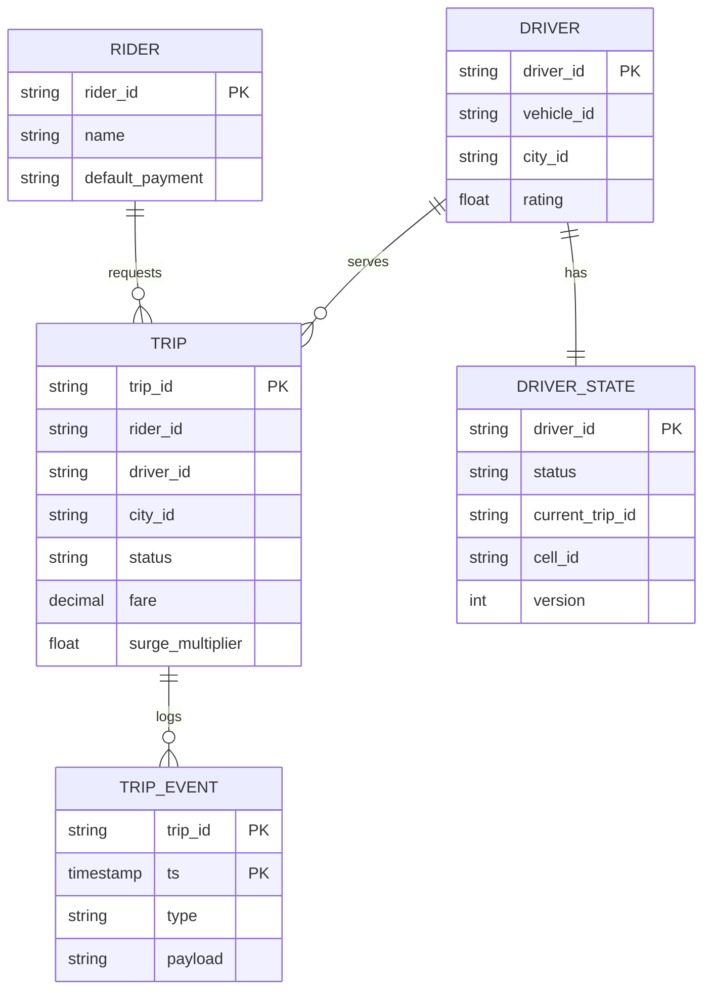
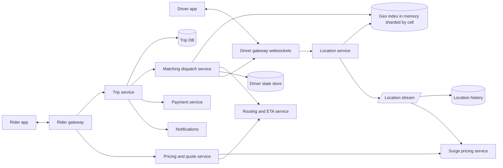
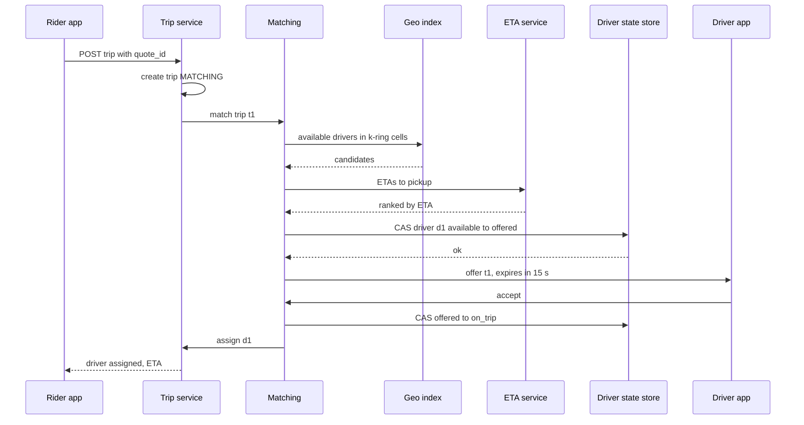

# Case Study: Uber (Ride Hailing)

Core challenges: ingesting **frequent location updates**, answering **"nearest available drivers"** fast via a **geospatial index**, **matching** without double-booking a driver, and **surge pricing** from real-time supply/demand. Back to [[System-Design-Index]].

## 1. Requirements (clarifying questions)

- Ride types? (Standard only; pooling out of scope but mention.)
- Global or single city? (Global, but each city is mostly independent - a natural shard.)
- Payments in scope? (Trigger payment at trip end; payment internals out of scope.)
- ETA and routing? (Use a routing/ETA service as a dependency.)
- Driver location update frequency? (Every ~4 s while online - an assumption to validate.)

## 2. Functional requirements

- Rider: see nearby cars, get fare estimate, request ride, track driver, pay, rate.
- Driver: go online/offline, stream location, receive/accept/decline offers, navigate, complete trip.
- Match rider with a nearby available driver.
- Dynamic (surge) pricing per area.
- Trip history and receipts.

## 3. Non-functional requirements

- Match latency: request -> offer sent in < 2 s p95.
- Location freshness: driver position on rider map < 5 s stale.
- A driver must never be assigned two trips at once (strong consistency on driver state).
- High availability (99.99%) for request/match; degrade gracefully (e.g., no surge -> base price).
- Trip state durable (billing depends on it).

## 4. Capacity estimation

Assumptions: 5M drivers online at peak globally, location update every 4 s, 100 B per update, 20M trips/day, riders open app 5x per trip request (browsing), trip avg 20 min.

- Location updates: 5M / 4 s = **1.25M updates/s** peak. Bytes: 1.25M x 100 B = **125 MB/s** ingest.
- Location history (for trip replay/fraud/ETA training): only during trips? If all: 1.25M x 86,400 x 100 B = ~10.8 TB/day (at peak rate; real avg lower) -> ~4 PB/yr; store compressed/sampled, keep full resolution only for trip segments.
- Trip requests: 20M / 86,400 = **~230/s** avg, peak x5 = ~1,200/s.
- Nearby-driver queries (rider app map): 20M x 5 = 100M/day -> ~1.2K/s avg, plus refreshes every few seconds while open: assume 5M riders with app open at peak x 1 query / 5 s = **1M queries/s** - cache per geo cell.
- Trip records: 20M x 2 KB = 40 GB/day -> ~15 TB/yr.
- Concurrent trips: 20M x 20 min / 1,440 min = ~280K avg concurrent.

## 5. API design

```http
POST /v1/drivers/me/location           (or over a persistent socket, batched)
{ "lat": 37.7749, "lng": -122.4194, "heading": 90, "speed": 8.2, "ts": 1727600000, "status": "available" }
204

GET /v1/estimates?pickup_lat=..&pickup_lng=..&drop_lat=..&drop_lng=..
200 { "fare_min": 12.40, "fare_max": 15.10, "surge_multiplier": 1.3, "quote_id": "q1", "quote_expires_at": "...", "eta_pickup_s": 240 }

POST /v1/trips
Idempotency-Key: r-77
{ "quote_id": "q1", "pickup": {...}, "dropoff": {...}, "payment_method_id": "pm_1" }
202 { "trip_id": "t1", "status": "MATCHING" }

POST /v1/offers/{offer_id}/accept      (driver)  -> 200 { "trip_id": "t1", "rider": {...}, "pickup": {...} }  | 409 offer expired
POST /v1/trips/{id}/events { "type": "ARRIVED" | "STARTED" | "COMPLETED", "ts": ... }
GET  /v1/trips/{id}  -> status, driver location, ETA  (rider polls or subscribes via socket)
```

## 6. Data model



- **Live locations:** in-memory geo index (sharded by city/cell), not a database - ephemeral and overwritten every few seconds.
- **Driver state:** strongly consistent KV with compare-and-set on `version` (prevents double assignment).
- **Trips:** relational/NewSQL sharded by `city_id` or `trip_id` - transactional state transitions, billing correctness ([[Database-Selection]]).
- **Location history:** time-series / object storage via stream.

## 7. Architecture



## 8. Component responsibilities

| Component | Responsibility |
|---|---|
| Driver gateway | Persistent connections; receive batched location updates; push offers |
| Location service | Validate/smooth GPS, update geo index (move driver between cells), publish to stream |
| Geo index | For each cell: set of available drivers with last position; supports k-nearest / radius queries |
| Matching/dispatch | Find candidates, rank by ETA (not straight-line distance), send offers, reserve driver atomically |
| Driver state store | Authoritative status: offline / available / offered / on_trip, with CAS |
| Pricing/quote | Base fare + surge -> signed, time-limited quote |
| Surge service | Compute supply/demand per cell per window -> multiplier |
| Trip service | Trip state machine, persistence, triggers payment |
| Routing/ETA | Road-graph routing and traffic-aware ETA (dependency) |

### Deep dive: geo-indexing

| Index | Idea | Pros | Cons |
|---|---|---|---|
| **Geohash** | Interleave lat/lng bits -> base32 string; prefix = bigger cell | Simple, works as a KV/DB key, prefix queries | Cells are rectangles of varying real size by latitude; neighbors across boundaries need 8-neighbor lookup |
| **Quadtree** | Recursively split a region into 4 until each leaf has <= N points | Adapts to density (dense downtown = small cells) | In-memory structure, rebalancing on moving points is costly with 1M updates/s |
| **H3 (hexagonal)** | Hierarchical hexagonal grid (open-sourced by Uber, publicly described) | Every neighbor is equidistant; uniform-ish cell areas; clean k-ring neighbor queries; good for surge zones | Hexes don't perfectly nest across resolutions; library dependency |
| **S2 (sphere cells)** | Hilbert-curve cells on a cube-projected sphere | Good range queries, used widely | Square cells, more complex |

**Choice:** hexagonal grid (H3-style) at a resolution where a cell is a few hundred meters across. Driver update = compute cell_id -> if changed, remove from old cell set, add to new. Query = cells within k rings of pickup -> collect available drivers -> filter by exact distance -> rank by ETA.

### Deep dive: location update rate

- ~4 s is a common balance: fresher positions cost linearly more ingest and battery.
- Adaptive: faster during pickup approach / on-trip, slower when idle or stationary; batch several points per upload.
- Server keeps only last position in the index; the stream keeps history.
- Use dead-reckoning/interpolation on rider map between updates.

### Deep dive: matching

1. Trip request -> matching gets candidate drivers in k-ring cells, expanding rings until enough candidates or radius limit.
2. Rank by ETA from routing service (road network, traffic), plus acceptance likelihood, rating, vehicle type.
3. **Reserve atomically:** CAS on driver state `available(v) -> offered(v+1)`. If CAS fails, pick next. This prevents double booking ([[Distributed-Locks]] alternative: short-TTL lock per driver; CAS is simpler).
4. Send offer with timeout (~10-15 s). Accept -> `offered -> on_trip`, trip `MATCHING -> DRIVER_ASSIGNED`. Decline/timeout -> release driver, next candidate.
5. Optimization: **batch matching** - collect requests over a short window (1-2 s) and solve assignment globally (minimize total ETA) instead of greedy per request.

### Deep dive: surge

- Every window (e.g., 1-2 min) per cell: demand = requests/app opens, supply = available drivers.
- Multiplier = f(demand/supply), smoothed over time and across neighboring cells to avoid flapping and boundary gaming; capped.
- Quote locks the multiplier for the rider for a short TTL (quote_id), so price doesn't change between estimate and request.
- If surge service is down: default multiplier 1.0 (fail safe for riders) or last known values.

## 9. Data flow



## 10. Scaling strategy

- **Shard by geography:** cities/regions are independent; geo index and matching partitioned by cell ranges. Hot downtown cells can be split further ([[Sharding-and-Partitioning]]).
- Location ingest: stateless services behind gateways; stream partitioned by driver_id.
- Nearby-cars view for riders: cache per cell for 1-2 s; many riders in the same cell share results ([[Caching]]).
- Trip DB sharded by city; archive old trips.
- Multi-region with per-city home region; failover moves cities.

## 11. Failure modes

| Failure | Impact | Mitigation |
|---|---|---|
| Geo index node crash | Drivers in those cells invisible | Replicas; rebuild within seconds from the next location updates (state is ephemeral) |
| Double assignment race | Two riders, one driver | CAS on driver state with version |
| Driver app loses network | Stale position, missed offer | Offer timeout -> next driver; mark stale drivers unavailable after N missed updates |
| Duplicate trip request (retry) | Two trips | Idempotency-Key on trip creation ([[Idempotency]]) |
| ETA service slow | Match latency rises | Fallback to straight-line distance ranking with timeout |
| Surge service down | No dynamic price | Default/last-known multiplier |
| Payment failure at trip end | Revenue loss | Pre-authorize at request; retry async; trip completes regardless |
| Region outage | City cannot match | Failover to secondary region; in-flight trip state replicated ([[Disaster-Recovery]]) |

## 12. Security

- **AuthN:** rider/driver login, device binding; driver identity and background verification at onboarding; periodic selfie checks (conceptually) against account sharing.
- **AuthZ:** rider sees only assigned driver's live location during trip; drivers see rider pickup only after accept.
- **Abuse/fraud:** GPS spoofing by drivers (sensor consistency checks, speed/teleport detection), fake trips/collusion for incentives, promo abuse, payment fraud, rider harassment.
- **Data protection:** location history is highly sensitive - minimize retention, strict access controls, audit logs, anonymize for analytics; phone number masking via proxy numbers.
- **Safety:** trip sharing, emergency button, route deviation detection.
- **Threats:** scraping driver positions (rate limit + coarse/jittered positions pre-match), account takeover, insider access to location data.

## 13. Observability

- **SLIs:** request-to-offer latency, match success rate, time to match, offer acceptance rate, location ingest lag, geo query latency, ETA accuracy (predicted vs actual).
- **SLOs:** p95 request -> offer < 2 s; 99.9% of requests get a match decision (matched or "no cars") within 60 s.
- **Alerts:** per-city match rate drop, location ingest lag, surge multiplier anomalies, CAS conflict rate spike. See [[Observability]].

## 14. Tradeoffs

| Decision | Chosen | Rejected | Why |
|---|---|---|---|
| Geo index | Hex grid in memory | DB with spatial index (PostGIS) | 1M+ updates/s; ephemeral data; DB fine at small scale |
| Ranking | ETA via road network | Straight-line distance | Rivers/highways make distance misleading |
| Driver reservation | CAS on versioned state | Distributed lock service | Fewer moving parts, single-key atomicity |
| Matching | Batched assignment | Pure greedy | Better global efficiency; small added latency |
| Consistency | Strong for driver state/trips, eventual for positions | Strong everywhere | Positions are overwritten every few seconds ([[Consistency-Models]]) |

## 15. Interview follow-up questions

- **Why hexagons?** Uniform neighbor distances and more uniform areas simplify k-ring search and surge smoothing.
- **How to handle a driver on a cell boundary?** Query k-ring neighbors, not just the pickup cell.
- **What if no drivers within radius?** Expand rings up to a max, then tell the rider "no cars available"; surge naturally rises.
- **How to support pooling?** Matching considers on-trip drivers whose route detour to pick up is under a threshold; much harder optimization.
- **How would you store 4 PB/yr of GPS?** Keep full resolution only for trip segments; downsample idle; compress; tier to object storage.
- **How do you keep the price consistent between estimate and request?** Signed quote with expiry and locked multiplier.
