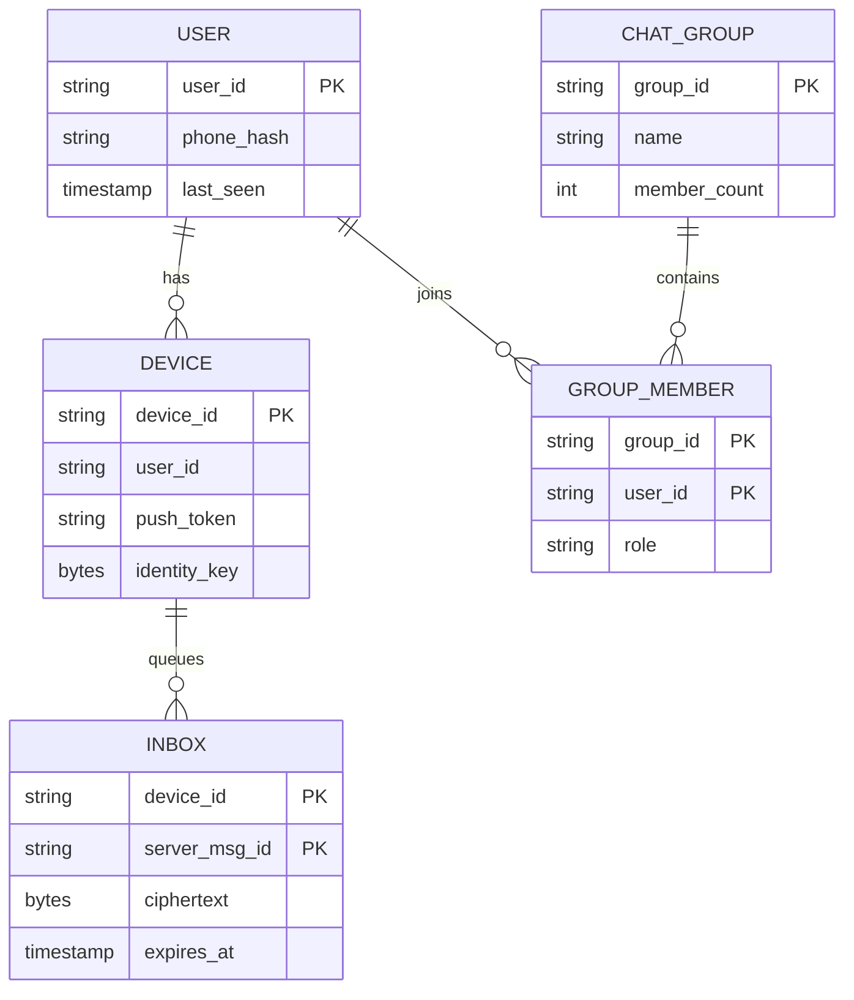
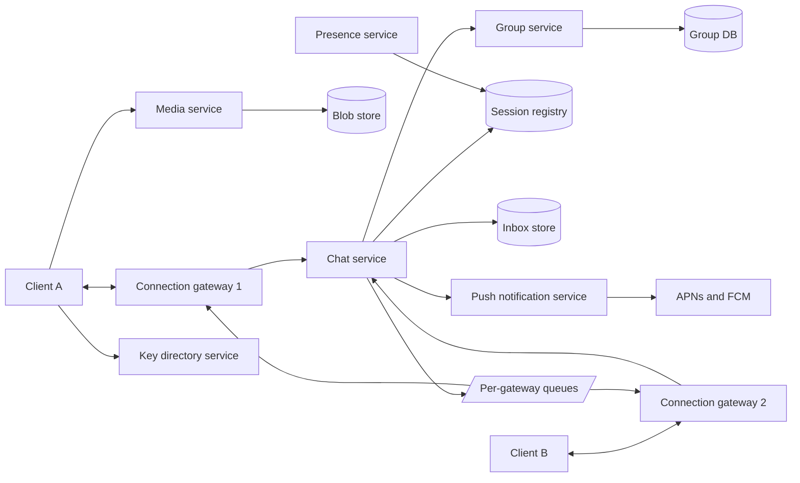
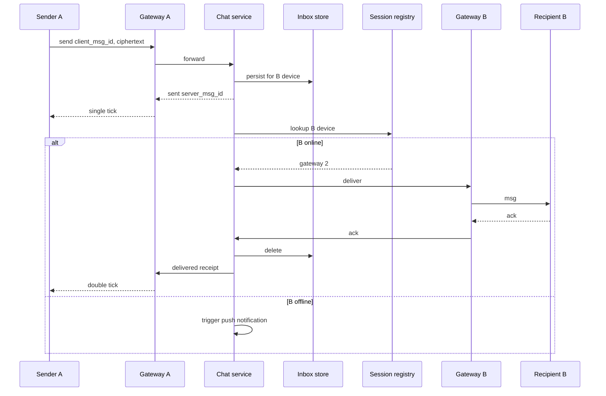

# Case Study: WhatsApp (Chat System)

Core challenges: **millions of long-lived connections**, **exactly-once-looking delivery with receipts**, **offline delivery**, **group fanout**, and **end-to-end encryption** where the server cannot read content. Back to [[System-Design-Index]].

## 1. Requirements (clarifying questions)

- 1:1 and group chat? Max group size? (Both; assume groups up to 1,024.)
- Media (images, video, voice)? (Yes, via separate upload path.)
- Delivery receipts: sent / delivered / read? (Yes, all three.)
- Online/last-seen presence? (Yes, privacy-controlled.)
- Message history stored on server? (Only until delivered - server is a relay; client stores history. Backups are client-driven.)
- Multi-device? (Assume yes, a few linked devices per user.)
- E2E encryption required? (Yes.)

## 2. Functional requirements

- Send/receive 1:1 and group text messages in real time.
- Store-and-forward for offline recipients.
- Sent/delivered/read receipts.
- Media sharing.
- Presence and typing indicators (best-effort).
- Push notification when app is backgrounded.

## 3. Non-functional requirements

- Low latency: p99 end-to-end < 500 ms when both online (same region).
- Per-conversation ordering; no message loss once server acked "sent".
- High availability of the send path (99.99%).
- Server cannot read message content (E2E).
- Efficient on mobile: battery, flaky networks, reconnect storms.

## 4. Capacity estimation

Assumptions: 500M DAU, 40 messages sent/user/day, 100 B avg encrypted text payload + 100 B metadata, 10% of messages are media averaging 200 KB, peak = 3x avg, 50% of DAU concurrently connected at peak.

- Messages/day: 500M x 40 = **20B/day**.
- Send QPS: 20B / 86,400 = **~231K msg/s** avg; peak ~700K/s.
- Group fanout multiplies deliveries; assume avg 2 recipients per message -> ~460K deliveries/s avg.
- Receipts: delivered + read per recipient -> ~2x deliveries = ~920K receipt events/s avg.
- Concurrent connections: 250M. At ~500K connections per gateway host (tuned epoll servers can do more), **~500 gateway hosts** + headroom.
- Transient text storage (undelivered queue): assume 10% undelivered at any moment for up to 30 days worst case; text per day 20B x 200 B = **4 TB/day** throughput through storage; retained backlog much smaller.
- Media: 2B media/day x 200 KB = **400 TB/day** -> ~146 PB/yr if retained. Retain only until downloaded + TTL (e.g., 30 days) -> ~12 PB rolling.
- Bandwidth (text): 700K x 200 B = 140 MB/s peak; media dominates: 400 TB/day / 86,400 = **~4.6 GB/s** avg upload, similar download per recipient.

## 5. API design

Persistent connection (WebSocket or custom TCP/TLS protocol with binary framing). Frames:

```json
// client -> server
{ "type": "send", "client_msg_id": "uuid-1", "to": "user:42" | "group:7", "ciphertext": "base64...", "ts": 1727600000 }
{ "type": "ack", "server_msg_id": "m-9981" }            // I received it (delivered)
{ "type": "read", "conversation": "user:42", "up_to": "m-9981" }

// server -> client
{ "type": "sent", "client_msg_id": "uuid-1", "server_msg_id": "m-9981" }
{ "type": "msg", "server_msg_id": "m-9982", "from": "user:42", "ciphertext": "...", "ts": ... }
{ "type": "receipt", "server_msg_id": "m-9981", "status": "delivered" | "read", "by": "user:42" }
```

REST side APIs:

```http
POST /v1/media           -> 200 { "media_id": "...", "upload_url": "https://blob/...signed" }
GET  /v1/keys/{user_id}  -> 200 { "identity_key": "...", "signed_prekey": "...", "one_time_prekey": "..." }
POST /v1/keys            (upload prekey bundle)
POST /v1/groups          { "name": "...", "members": [...] } -> 201 { "group_id": "..." }
```

## 6. Data model



- **Inbox (undelivered messages):** partition key `device_id`, clustering `server_msg_id` (time-ordered, e.g., Snowflake-style). High write throughput, deletes after ack -> wide-column store (Cassandra/HBase-style) with TTL. See [[Database-Selection]].
- **Session registry** `user_id/device_id -> gateway_id`: in-memory KV (Redis-like), TTL heartbeats.
- **Groups/membership:** relational or KV; read-heavy, cached.
- **Media:** blob store with encrypted objects ([[Storage-Blob-vs-Block-vs-File]]).

## 7. Architecture



## 8. Component responsibilities

| Component | Responsibility |
|---|---|
| Connection gateway | Terminate TLS + WebSocket, auth, heartbeat, hold socket; stateless except connections. Registers `device -> gateway` in session registry |
| Chat service | Assign `server_msg_id`, persist to recipient inbox, route to recipient gateway, handle acks/receipts |
| Session registry | Where is each online device connected ([[Service-Discovery]]-like lookup) |
| Inbox store | Durable store-and-forward queue per device; delete on ack |
| Group service | Membership lookup, fanout list |
| Push service | Wake offline/backgrounded devices via APNs/FCM (no plaintext content) |
| Media service | Signed upload/download URLs; stores encrypted blobs |
| Key directory | Public identity keys and prekeys for E2E session setup |
| Presence | Last seen / online, fanned out to subscribed contacts, best-effort |

### Deep dive: connection gateway

- One long-lived connection per device; gateway uses event loop (epoll/kqueue) to hold hundreds of thousands of sockets.
- Heartbeat every ~30-60 s (tune for mobile NAT timeouts); missed heartbeats -> mark offline.
- L4 load balancer with consistent hashing or least-connections; on gateway death, clients reconnect with jittered exponential backoff to avoid reconnect storms.
- Draining for deploys: stop accepting, send "reconnect" hint, wait.

### Deep dive: delivery receipts

1. Client sends with `client_msg_id` (idempotency key). Server persists to inbox, replies `sent` (single tick). Retries dedup on `client_msg_id` ([[Idempotency]]).
2. Recipient device receives and acks -> server deletes from inbox and sends `delivered` receipt to sender (double tick).
3. Recipient opens chat -> sends `read up_to` -> server forwards `read` receipt (blue ticks). Receipts are themselves messages delivered via the same inbox mechanism if sender is offline.
- Delivery semantic: **at-least-once** delivery + client-side dedupe by `server_msg_id` = effectively-once display.

### Deep dive: offline queue

- If recipient not in session registry: write to inbox, trigger push notification.
- On reconnect: client sends last acked `server_msg_id`; gateway pulls inbox in order, pages through, deletes on ack.
- TTL (e.g., 30 days) on undelivered messages.

### Deep dive: group fanout

- Small groups (<= ~1K): **fanout on write** - chat service looks up members and writes one inbox entry per recipient device.
- With E2E, the sender encrypts per group. Signal-style groups use **Sender Keys**: sender distributes a sender key to each member once via pairwise sessions, then encrypts each group message once; server fans out the same ciphertext to all members.
- Very large broadcast channels would instead use fanout on read (members pull from a channel log).

### Deep dive: E2E encryption (conceptual)

WhatsApp has publicly described using the Signal Protocol.
- **Identity keys** per device; public keys published to key directory with **signed prekeys** and **one-time prekeys**.
- **X3DH** key agreement lets A establish a shared secret with offline B using B's prekey bundle.
- **Double Ratchet** derives a new key per message: forward secrecy (past messages safe if current key leaks) and post-compromise security.
- Server only sees ciphertext + routing metadata. Key change -> "security code changed" notice; users can verify safety numbers out of band.
- Media: encrypted client-side with a random key; the key travels inside the E2E message, blob store holds ciphertext.

## 9. Data flow



## 10. Scaling strategy

- Gateways scale horizontally; connection count is the unit of capacity.
- Chat service stateless; partition work by recipient `user_id`.
- Inbox store sharded by `device_id` ([[Sharding-and-Partitioning]]); ordering per conversation via monotonic IDs per partition.
- Session registry sharded, replicated in-memory; tolerate staleness (fallback to inbox + push).
- Presence is the most chatty - batch, rate-limit, and only fan out to contacts with the chat open.
- Multi-region: user homed to a region; cross-region routing via inter-region queues ([[Message-Queues]]).

## 11. Failure modes

| Failure | Impact | Mitigation |
|---|---|---|
| Gateway crash | Its clients disconnected | Clients reconnect with jitter to other gateways; inbox guarantees no loss |
| Stale session registry entry | Delivery to dead gateway | Delivery timeout -> fall back to inbox + push; TTL heartbeat entries |
| Inbox shard down | Can't accept messages for some users | Replication RF=3, quorum writes, retry with idempotency |
| Duplicate send after timeout | Duplicate message | Dedupe on `client_msg_id` |
| Reconnect storm after outage | Overload auth/gateways | Jittered backoff, admission control, [[Rate-Limiting]] |
| Push provider outage | Offline users not woken | Messages wait in inbox; delivered on next open |
| Region outage | Users homed there offline | Failover rehoming ([[Disaster-Recovery]]) |

## 12. Security

- **AuthN:** phone number verification (SMS/voice OTP) -> device registration with long-term keys; connection auth via device credentials. Optional 2-step PIN.
- **AuthZ:** only group members receive group fanout; admins manage membership.
- **E2E:** content confidentiality from the server; metadata (who talks to whom, when) still visible - minimize logging and retention.
- **Abuse:** spam bulk-messaging -> rate limits per account, new-account throttles, reputation signals from metadata and user reports (reports can include recent messages forwarded by the reporter).
- **Threats:** SIM swap account takeover (mitigate with 2-step PIN, key-change notices), malicious key directory substituting keys (safety-number verification), malformed media exploits on client (sandboxed parsers), push-notification content leakage (no plaintext in push).

## 13. Observability

- **SLIs:** message send ack latency, end-to-end delivery latency (online-to-online), inbox backlog size, connection count per gateway, reconnect rate, push success rate.
- **SLOs:** 99.99% of sends acked; p99 online delivery < 500 ms.
- **Alerts:** spike in reconnects, inbox growth rate anomaly, gateway CPU/memory, receipt lag.
- Content is encrypted, so observability relies on metadata-only metrics. See [[Observability]].

## 14. Tradeoffs

| Decision | Chosen | Rejected | Why |
|---|---|---|---|
| Transport | Persistent WebSocket/TCP | HTTP long polling | Lower overhead and latency at massive scale |
| Server storage | Store-and-forward, delete on ack | Full server-side history | E2E + privacy + cost; history lives on devices |
| Delivery semantics | At-least-once + dedupe | Exactly-once | Exactly-once across networks is impractical |
| Group encryption | Sender keys | Pairwise encrypt per member | O(1) encryption per message |
| Group fanout | On write for small groups | On read | Bounded group size, simpler delivery |

## 15. Interview follow-up questions

- **How is ordering guaranteed?** Per-conversation monotonic IDs from the chat service partition; client sorts by server ID and buffers gaps briefly.
- **How does multi-device work with E2E?** Each device has its own keys; sender encrypts for every device of the recipient (and its own other devices).
- **Why not store messages in a DB forever?** Server can't read them anyway; storage cost and privacy.
- **How to show "online"?** Heartbeat updates presence; subscribers get updates only while viewing the chat.
- **What happens if the recipient is offline for 60 days?** TTL expiry; sender never sees double ticks.
- **How do you scale to 250M concurrent sockets?** Horizontal gateways, kernel tuning (file descriptors, memory per socket), efficient runtime.
