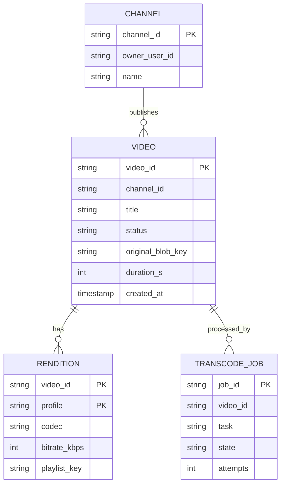
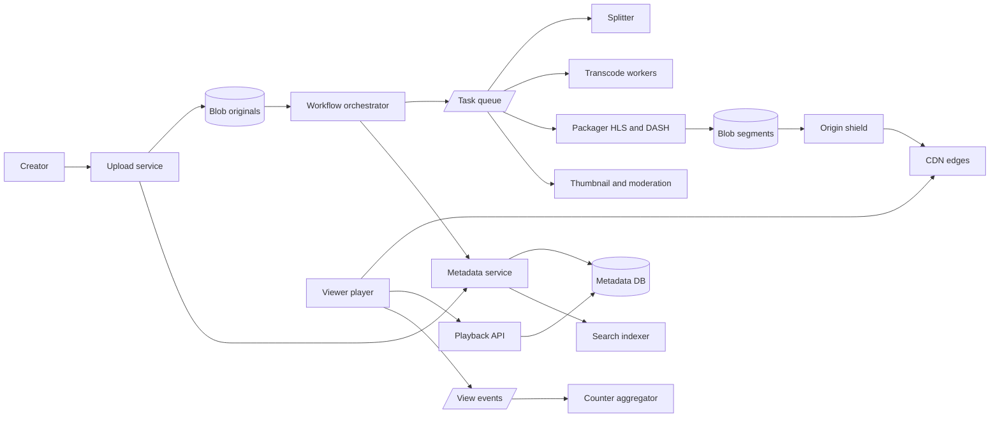
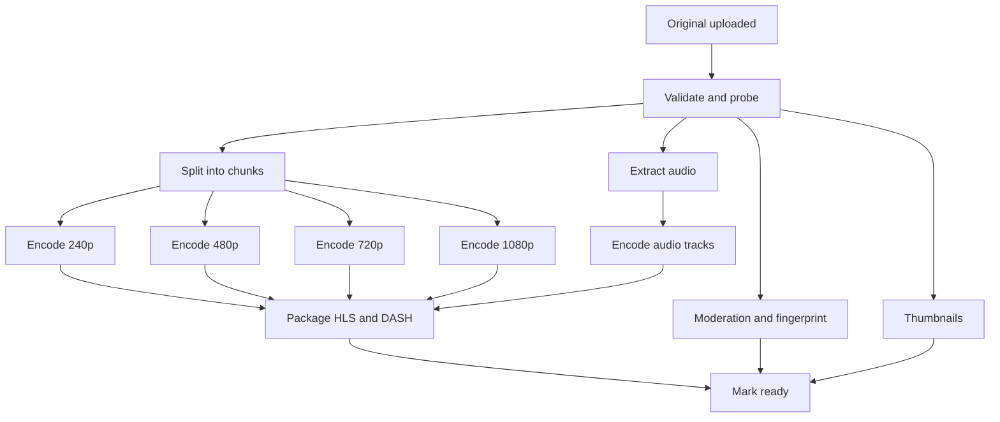
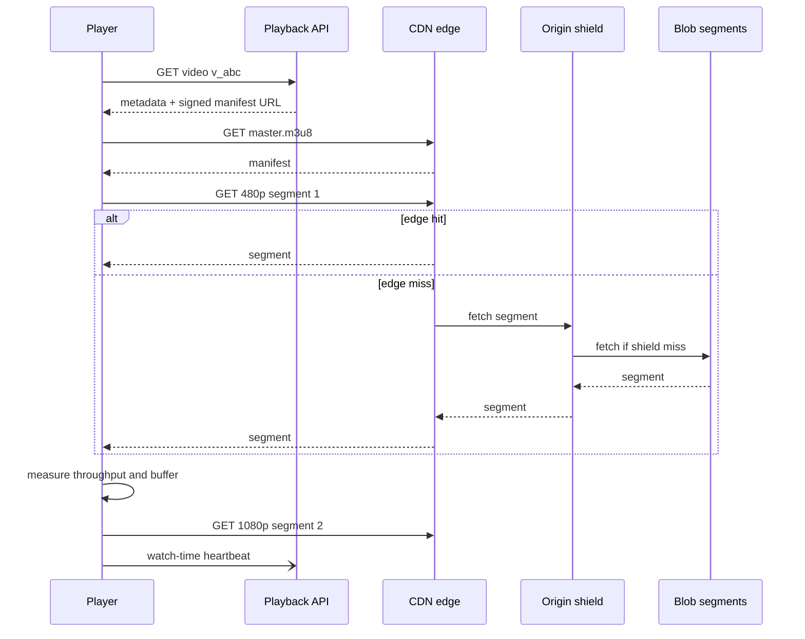

# Case Study: YouTube (Video Platform)

Two very different paths: a **write path** (upload -> transcode DAG -> storage) that is throughput- and cost-bound, and a **read path** (adaptive streaming from a CDN) that is bandwidth-bound. Back to [[System-Design-Index]].

## 1. Requirements (clarifying questions)

- Upload + watch in scope? Live streaming? (Upload + VOD watch; live out of scope.)
- Target devices? (Web, mobile, TV - varied bandwidths and codecs.)
- Max video size/length? (Assume 256 GB / 12 h.)
- Search, comments, recommendations? (Search metadata yes at a high level; recommendations out of scope.)
- Global audience? (Yes.)
- Monetization/DRM? (Out of scope; note where DRM plugs in.)

## 2. Functional requirements

- Upload videos (resumable) with title, description, tags, thumbnail.
- Transcode into multiple resolutions/bitrates/codecs.
- Stream with adaptive bitrate; seek; resume position.
- Video page metadata: views, likes, channel info.
- Search videos by title/tags.

## 3. Non-functional requirements

- Playback start time (time-to-first-frame) p90 < 2 s; rebuffer ratio minimal.
- Very high availability for playback (99.99%).
- Uploads durable once acknowledged; processing can take minutes.
- Cost-efficient storage and egress (the dominant costs).
- Eventual consistency for view counts.

## 4. Capacity estimation

Assumptions: 500 hours of video uploaded per minute, 1B views/day, avg watch 5 min at avg 2 Mbps delivered, original upload bitrate ~10 Mbps, renditions total ~1.5x original size combined.

- Upload volume: 500 h/min x 60 = 30,000 h/day = 108M seconds/day. At 10 Mbps = 1.25 MB/s -> 108M x 1.25 MB = **135 TB/day originals**.
- Renditions: 1.5 x 135 = ~200 TB/day. Total ~**335 TB/day -> ~122 PB/yr** (before replication; x3 replicas or erasure coding ~1.5x).
- Upload ingress bandwidth: 135 TB / 86,400 s = **~1.6 GB/s**.
- Views: 1B / 86,400 = **~11.6K view starts/s** avg; peak x3 ~35K/s.
- Egress: concurrent streams = 1B x 300 s / 86,400 = ~3.5M concurrent avg. x 2 Mbps = **~7 Tbps** avg - only a CDN can serve this.
- Transcode compute: 30,000 h/day of video; if one rendition ladder takes ~2x real time per core-set, that's tens of thousands of cores continuously - parallelize by chunks.
- Metadata: 30,000 h/day / avg 10 min video = ~180K videos/day x 5 KB = ~0.9 GB/day. Small.

## 5. API design

```http
POST /v1/videos
{ "title": "My trip", "description": "...", "tags": ["travel"], "visibility": "public", "size_bytes": 2147483648 }
201 { "video_id": "v_abc", "upload_url": "https://upload.example/resumable/v_abc?sig=...", "chunk_size": 8388608 }

PUT <upload_url>
Content-Range: bytes 0-8388607/2147483648
308 Resume Incomplete  (Range: bytes=0-8388607)  ...  final chunk -> 200

GET /v1/videos/v_abc
200 { "video_id": "v_abc", "status": "ready", "title": "...", "manifest_url": "https://cdn.example/v_abc/master.m3u8", "dash_url": "https://cdn.example/v_abc/manifest.mpd", "thumbnails": [...], "views": 1024 }

GET /v1/search?q=trip&cursor=...
POST /v1/videos/v_abc/views { "position_s": 120, "session_id": "..." }   -> 202 (watch-time heartbeat)
```

## 6. Data model



- **Video metadata:** sharded relational/NewSQL (strong consistency for ownership/visibility, modest size). Cached aggressively.
- **Media (originals, segments):** blob storage; segments are immutable -> perfect for CDN ([[Storage-Blob-vs-Block-vs-File]]).
- **View counts:** event stream -> aggregated counters (eventual).
- **Search:** inverted index over title/description/tags ([[Search-Systems-Inverted-Index]]).
- **Job state:** workflow engine DB for the DAG.

## 7. Architecture



## 8. Component responsibilities

| Component | Responsibility |
|---|---|
| Upload service | Resumable chunked uploads, checksum verification, write original to blob |
| Metadata service | Video records, status transitions (uploading -> processing -> ready/failed) |
| Workflow orchestrator | Builds and executes the transcode DAG, retries, tracks task state |
| Splitter | Split source at keyframes into chunks (e.g., few seconds each or GOP-aligned) for parallelism |
| Transcode workers | Encode each chunk into each ladder profile (resolution x bitrate x codec) |
| Packager | Stitch/segment into HLS (`.m3u8` + segments) and DASH (`.mpd`), optional DRM encryption |
| Thumbnail/moderation | Thumbnails, content classifiers, copyright fingerprint matching |
| Origin + origin shield | Serve segments to CDN; shield reduces origin fetches |
| CDN | Cache segments near viewers ([[CDN]]) |
| Playback API | Authorization, returns manifest URL (signed), selects CDN |

### Deep dive: upload/transcode DAG



- Each node is an idempotent task keyed `(video_id, task, chunk, profile)`; outputs written to deterministic blob keys, so retries overwrite safely ([[Idempotency]]).
- Parallelism: chunks x profiles fan out; a 1-hour video can finish in minutes.
- Progressive availability: publish low resolutions first so the video goes live sooner; high resolutions and efficient codecs (VP9/AV1) can be produced later, prioritized by popularity.
- Popular-video re-encode with more expensive codecs is a cost optimization: compute once, save egress on every view.

### Deep dive: adaptive bitrate (HLS/DASH)

- Video is cut into short segments (commonly 2-6 s), each available at every rendition in the **bitrate ladder**.
- A **master manifest** lists renditions; each rendition has a media playlist of segment URLs.
- The **player** measures throughput and buffer level and picks the rendition for the next segment (buffer-based or throughput-based ABR). Switching happens at segment boundaries (segments start on keyframes).
- **HLS** (Apple, `.m3u8`) and **DASH** (MPEG standard, `.mpd`); CMAF lets both share the same fMP4 segments, halving storage.
- Start with a low/medium rendition for fast startup, then ramp up.

### Deep dive: CDN

- Segments are immutable -> long TTLs, content-addressed URLs.
- Tiered caching: edge -> regional/origin shield -> origin blob. Popular content is highly cacheable; long-tail content causes misses served from origin/shield.
- Pre-position (push) predicted-popular videos to edges; pull for the rest.
- Signed URLs/tokens with expiry to prevent hotlinking; DNS or anycast steering to nearest healthy edge.

## 9. Data flow



## 10. Scaling strategy

- Upload service horizontally scaled; direct resumable upload to regional endpoints near creators.
- Transcode fleet autoscaled on queue depth; use spot/preemptible capacity (tasks are idempotent and retryable); GPU/ASIC encoders for efficiency.
- Metadata DB sharded by `video_id`; heavy caching of hot video pages.
- CDN absorbs the read path; origin shield collapses concurrent misses.
- View counts via stream aggregation, not per-view DB updates.
- Storage tiering: cold, rarely watched renditions moved to cheaper storage; regenerate rare renditions on demand.

## 11. Failure modes

| Failure | Impact | Mitigation |
|---|---|---|
| Upload interrupted | Creator loses progress | Resumable uploads with offset query |
| Transcode worker crash | Task incomplete | Orchestrator retries with backoff; idempotent outputs; DLQ after N attempts ([[Fault-Tolerance]]) |
| Poison video (corrupt input) | Repeated failures | Validate/probe early; mark failed and notify creator |
| CDN edge outage | Viewers in region affected | Steer to next edge; multi-CDN |
| Origin overload on viral video | Slow start/rebuffer | Origin shield, request coalescing, pre-warming |
| Metadata DB down | Can't start playback | Cache of metadata, read replicas |
| Region blob outage | Missing segments | Cross-region replication ([[Disaster-Recovery]]) |

## 12. Security

- **AuthN/Z:** OAuth for creators; visibility checks (private/unlisted) at playback API; signed, short-lived manifest/segment URLs.
- **Abuse:** copyright (fingerprint matching against reference DB), harmful content (classifiers + human review), view-count fraud (dedupe sessions, bot detection before counting), upload spam (rate limits, quotas per channel).
- **Data protection:** encrypted at rest; DRM (Widevine/FairPlay/PlayReady) for premium content via packager encryption.
- **Threats:** malicious media exploiting decoders (sandboxed transcoders, no network access), hotlinking and scraping (token auth), SSRF via "import from URL" features, account takeover of large channels (2FA, anomaly detection).

## 13. Observability

- **SLIs (client-side QoE):** time to first frame, rebuffer ratio, average delivered bitrate, playback failure rate. **Server:** CDN hit ratio, origin egress, upload success rate, time from upload to ready, queue depth.
- **SLOs:** playback start success 99.9%; p90 TTFF < 2 s; 95% of videos ready within X minutes of upload (per length bucket).
- **Alerts:** rebuffer ratio spike per ISP/region, CDN hit ratio drop, transcode backlog, error spikes for a codec/device family. See [[Observability]].

## 14. Tradeoffs

| Decision | Chosen | Rejected | Why |
|---|---|---|---|
| Streaming | Segment-based ABR over HTTP | Progressive download, custom UDP | Cacheable by CDNs, adapts to bandwidth |
| Transcoding | Chunked parallel DAG | Whole-file single encode | Latency and fault isolation |
| Codecs | H.264 baseline + VP9/AV1 for popular | AV1 for everything | Encode cost vs egress savings |
| Packaging | CMAF shared segments | Separate HLS/DASH copies | Storage savings |
| Counts | Eventual via streams | Synchronous increments | Hot rows, scale |

## 15. Interview follow-up questions

- **How do you reduce time from upload to watchable?** Parallel chunks, publish lowest renditions first.
- **Why segments of 2-6 s?** Shorter = faster adaptation and startup but more requests/manifest overhead; longer = better compression efficiency.
- **How to handle the long tail?** Keep in origin/regional tiers; don't push to edges; possibly fewer renditions.
- **How is view count deduplicated?** Session/user + time window, fraud filtering, counted asynchronously.
- **How would you add live streaming?** Ingest (RTMP/SRT) -> real-time transcoder -> low-latency HLS/DASH with short segments/partial segments; no full DAG.
- **How to support resume playback?** Periodic position heartbeats stored per user/video in a KV store.
