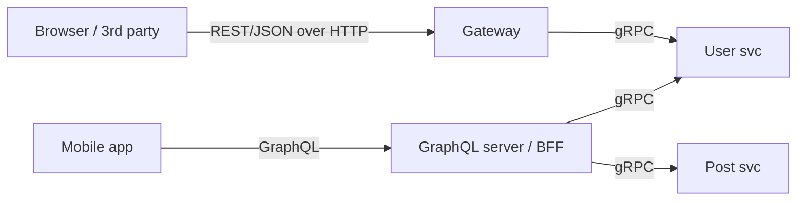

# API Design - REST, gRPC, GraphQL

## Core Idea

An API is a long-lived contract. Good APIs are predictable, evolvable without breaking clients, safe to retry, and efficient for their main consumers. Style choice follows the consumer: **REST** for public/web resources, **gRPC** for internal low-latency service-to-service, **GraphQL** for client-driven aggregation over many entities.

## Mechanism

| | REST | gRPC | GraphQL |
|---|---|---|---|
| Transport | HTTP/1.1 or 2, usually JSON | HTTP/2, Protocol Buffers | Usually HTTP POST, JSON |
| Contract | OpenAPI (optional) | `.proto` (required, codegen) | Schema (SDL, required) |
| Strengths | Ubiquitous, HTTP caching, simple tooling | Compact, fast, streaming (client/server/bidi), strong types, deadlines | Client picks fields; one round trip for nested data |
| Weaknesses | Over/under-fetching, many round trips | Browser needs gRPC-Web proxy; binary harder to debug | HTTP caching hard, N+1 resolver problem, query cost control needed |
| Best for | Public APIs, CRUD resources | Internal microservices, mobile with strict bandwidth | Aggregation for diverse frontends |

### REST design essentials
- Nouns and hierarchy: `GET /users/{id}/orders`, `POST /orders`.
- Correct verbs: GET (safe), PUT/DELETE (idempotent), POST (not idempotent -> use `Idempotency-Key`, see [[Idempotency]]), PATCH (partial).
- Status codes: 200/201/202/204, 400/401/403/404/409/422/429, 500/503. Consistent error body (RFC 9457 problem details).
- **Pagination:** cursor-based (`?after=opaque_cursor&limit=50`) beats offset for large or changing sets (offset is O(offset) and skips/duplicates on inserts).
- **Versioning:** additive changes are non-breaking; breaking changes via `/v2` or media-type/header versioning; deprecate with timelines.
- Filtering/sorting via query params; ETags for conditional GET and optimistic concurrency (`If-Match`).

### gRPC essentials
- Deadlines propagate across calls; always set them.
- Field numbers must never be reused; add fields, don't renumber.
- Streaming for real-time feeds or large transfers.

### GraphQL essentials
- Use **DataLoader**-style batching to solve N+1.
- Limit query depth/complexity; persisted queries for production clients.
- Mutations for writes; subscriptions for push.

## Example (assumptions)

Feed endpoint returns 20 posts with author and 3 comments each. REST naive: 1 + 20 + 20 calls. REST with a composite endpoint or `?include=author,comments`: 1 call. GraphQL: 1 query; resolvers batch author lookups into one `IN (...)` query with DataLoader.

## Tradeoffs

| Decision | Tradeoff |
|---|---|
| Offset vs cursor pagination | Simplicity & random page jumps vs stability and performance |
| Fine vs coarse endpoints | Reuse vs round trips |
| Public GraphQL | Flexibility vs abuse/cost control |
| gRPC externally | Performance vs client compatibility |

## Failure Modes

- Breaking changes shipped without versioning -> mobile clients in the wild break.
- Unbounded list endpoints (`GET /items` returns 5M rows).
- Non-idempotent POST retried by clients -> duplicate orders.
- GraphQL deeply nested query DoS.
- Chatty APIs over high-latency mobile links.

## Security Implications

OWASP API Security Top 10: object-level authorization (check the caller owns `/orders/{id}`), mass assignment (allowlist writable fields), excessive data exposure (don't return full objects and filter in client), rate limiting and resource limits, disable GraphQL introspection in production if the schema is not public, validate input with schemas. Use opaque IDs or check ownership — sequential IDs invite enumeration.

## Real-World Usage

- gRPC was open-sourced by Google, derived from its internal Stubby RPC system.
- GraphQL was created at Facebook and open-sourced in 2015; GitHub offers a public GraphQL API.
- Stripe's REST API is a commonly cited example of idempotency keys and date-based API versioning.

## Interview Questions

- **REST vs gRPC vs GraphQL?** External/public -> REST. Internal high-throughput typed calls -> gRPC. Many frontends needing flexible nested reads -> GraphQL (often as BFF over gRPC services).
- **Why cursor pagination?** Stable under concurrent inserts and uses an index seek instead of scanning skipped rows.
- **How do you make POST safe to retry?** Idempotency key stored with the response; repeat requests return the stored result.
- **How do you evolve an API?** Add, don't change; tolerate unknown fields; deprecate with telemetry on usage.

## Related

[[System-Design-Index]] · [[API-Gateway]] · [[Idempotency]] · [[Rate-Limiting]] · [[Microservices]] · [[Case-Study-URL-Shortener]]
