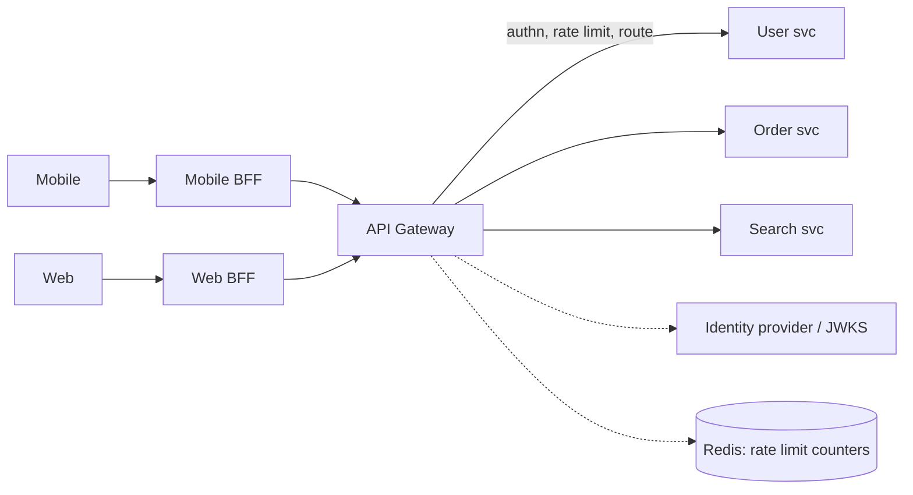

# API Gateway

## Core Idea

An API gateway is a reverse proxy that is the single entry point for external clients. It centralizes **cross-cutting concerns** — TLS, authentication, rate limiting, routing, request/response transformation, and observability — so backend services don't each reimplement them.

## Mechanism

Typical responsibilities, in request order:
1. TLS termination, WAF, request size limits.
2. Authentication (validate JWT signature/expiry, API keys, OAuth2 introspection).
3. [[Rate-Limiting]] and quotas per key/tenant.
4. Routing by host/path/version to services (via [[Service-Discovery]]).
5. Transformation: protocol translation (REST <-> gRPC), header injection (user ID, trace ID).
6. Aggregation: compose several backend calls into one response (keep light).
7. Caching of public GETs; response compression.
8. Metrics, logs, traces.

**Backend for Frontend (BFF):** a gateway layer per client type (mobile, web) tailored to its needs, owned by the frontend team.

## Example (assumptions)

Mobile home screen needs profile, 20 feed items, and unread count. Without BFF: 3 round trips on a 150 ms mobile RTT -> ~450 ms. With BFF aggregating server-side in parallel within the datacenter (~20 ms each), client sees ~1 RTT + ~20 ms ≈ 170 ms.

## Tradeoffs

| Pro | Con |
|---|---|
| One place for auth, limits, TLS | Extra hop and latency |
| Clients decoupled from service topology | Potential bottleneck/SPOF — must be HA and horizontally scaled |
| Consistent observability | Risk of becoming a "god" layer with business logic |
| API versioning and deprecation control | Team bottleneck if centrally owned |

Gateway vs load balancer: an LB distributes traffic to instances; a gateway applies API-level policy. Gateways usually sit behind an L4/L7 LB. Gateway vs service mesh: gateway handles north-south (external) traffic; mesh handles east-west (service-to-service).

## Failure Modes

- Gateway outage = total outage; run multiple instances across AZs.
- Business logic creeping into the gateway -> coupling and slow releases.
- Aggregation calls without timeouts -> one slow service stalls every response.
- Misrouted versions after config push — use staged config rollout.

## Security Implications

The gateway is the edge policy enforcement point: validate tokens (pin algorithms, check audience and expiry), strip client-supplied identity headers before injecting trusted ones, enforce schemas and size limits. **Object-level authorization must still happen in services** — broken object-level authorization (BOLA) tops the OWASP API Security Top 10 and a gateway cannot see ownership. Don't let internal-only routes be reachable externally.

## Real-World Usage

- Managed: AWS API Gateway, Google Apigee, Azure API Management.
- Self-hosted: Kong (on NGINX/OpenResty), Envoy-based gateways, NGINX, Traefik.
- Netflix Zuul was an early open-source gateway.

## Interview Questions

- **Why a gateway?** Centralize auth, rate limiting, routing, and observability; hide internal topology from clients.
- **Does the gateway do authorization?** Coarse-grained (scopes, route-level). Fine-grained object-level checks stay in services.
- **Isn't it a SPOF?** Stateless and horizontally scaled behind an LB across AZs; rate-limit state in a replicated store.
- **What is a BFF?** A client-specific API layer that aggregates and shapes data for one frontend.

## Related

[[System-Design-Index]] · [[Rate-Limiting]] · [[Load-Balancing]] · [[Service-Discovery]] · [[API-Design-REST-gRPC-GraphQL]] · [[Case-Study-Authentication-Platform]]
