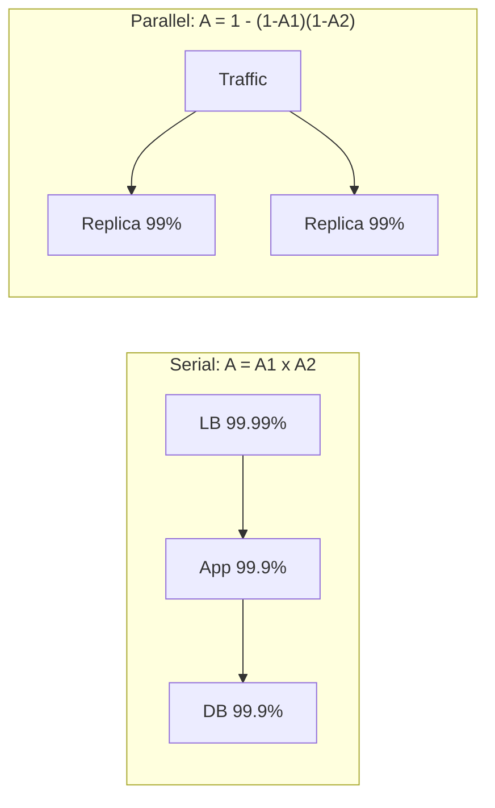

# Availability and Reliability

## Core Idea

**Availability** = fraction of time (or of requests) the system serves correctly. **Reliability** = probability it performs correctly over a period (no data loss, no wrong answers). A system can be available but unreliable (returns wrong data fast). Availability comes from **redundancy + fast detection + automatic failover**, and it is measured against an SLO (see [[Observability]]).

## Mechanism

- **Serial composition:** every dependency multiplies in. 99.99% × 99.9% × 99.9% ≈ 99.79%.
- **Parallel redundancy:** two independent 99% replicas -> 1 − 0.01² = 99.99% (only if failures are truly independent — shared power, config, or deploy breaks this).
- **MTBF/MTTR:** A = MTBF / (MTBF + MTTR). Cutting recovery time is often cheaper than preventing failures.

### Downtime budget per year (exact arithmetic)

| Availability | Downtime/year | Downtime/30 days |
|---|---|---|
| 99% | ~3.65 days | ~7.2 h |
| 99.9% | ~8.76 h | ~43.2 min |
| 99.99% | ~52.6 min | ~4.3 min |
| 99.999% | ~5.26 min | ~26 s |

## Example (assumptions)

A checkout path calls API gateway (99.99%), order service (99.95%), payment provider (99.9%), DB (99.95%). Serial ≈ 99.79% -> ~18 h/year. To raise it: make the payment call async with retries (removing it from the synchronous path), and run the order service active-active across two AZs.

## Tradeoffs

| Technique | Gain | Cost |
|---|---|---|
| Active-passive failover | Simple, no conflict resolution | Failover time, idle capacity, possible data loss on async replication |
| Active-active | No failover gap, uses all capacity | Conflict handling, harder consistency |
| Multi-AZ | Survives datacenter loss | Cross-AZ latency and transfer cost |
| Multi-region | Survives region loss | Big complexity; see [[Disaster-Recovery]] |
| Graceful degradation | Core stays up | Product decisions about what to drop |

## Failure Modes

- Correlated failures: same bad deploy/config to all replicas at once — mitigate with staged rollouts.
- Failover that was never tested fails when needed.
- Split brain: two nodes both believe they're leader -> use fencing ([[Distributed-Locks]]) or consensus ([[Consensus-Raft-Paxos]]).
- Health checks that check liveness but not correctness keep a broken node in rotation.
- Dependency with lower availability than your SLO silently caps you.

## Security Implications

DDoS is an availability attack — plan for [[Rate-Limiting]], [[CDN]] absorption and autoscale caps. Ransomware is a reliability attack — immutable backups ([[Disaster-Recovery]]). Failover paths often have weaker auth or stale certs; test them.

## Real-World Usage

- Cloud providers publish per-service SLAs (e.g. multi-AZ configurations of managed databases carry higher SLAs than single-AZ); read the actual SLA document for numbers.
- Google SRE popularized SLOs and error budgets as the operational form of availability targets.
- Netflix's Chaos Monkey randomly terminates instances to force redundancy to be real.

## Interview Questions

- **Why not target 100%?** Each nine costs roughly an order of magnitude more effort, users can't perceive beyond their own network's reliability, and it forbids change. Pick an SLO and spend the error budget on velocity.
- **How do you compute availability of a chain?** Multiply for serial dependencies; for redundant copies, 1 − product of failure probabilities, assuming independence.
- **Availability vs reliability?** Up vs correct. A cache serving stale prices is available but not reliable for that use.
- **How do you reduce MTTR?** Good alerts on symptoms, runbooks, one-click rollback, feature flags, automatic failover.

Implementation patterns (code, config, and failure handling live there; this note covers the concept and tradeoffs): [[Pattern-Circuit-Breaker]] · [[Pattern-Bulkhead]] · [[Pattern-Canary-Release]] · [[Pattern-Blue-Green-Deployment]]

## Related

[[System-Design-Index]] · [[Fault-Tolerance]] · [[Disaster-Recovery]] · [[Observability]] · [[Replication]] · [[CAP-Theorem]]
