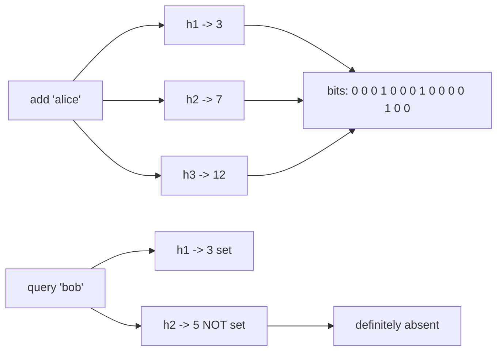

# Bloom Filters and Probabilistic Structures

## Core Idea

When exact answers need too much memory, probabilistic structures give approximate answers with **bounded, tunable error** in a fraction of the space.

| Structure | Question | Error type |
|---|---|---|
| **Bloom filter** | "Is x in the set?" | False positives possible, **no false negatives** |
| **Counting Bloom / Cuckoo filter** | Membership with deletes | False positives |
| **Count-Min Sketch** | "How often has x appeared?" | Overestimates only |
| **HyperLogLog** | "How many distinct items?" | ~1.04/√m relative std error (m registers) |
| **Top-K (heavy hitters)** | "Most frequent items?" | Approximate (CMS + heap, Space-Saving) |

## Mechanism

### Bloom filter
Bit array of m bits, k hash functions. **Add:** set bits h1(x)..hk(x). **Query:** if all k bits are set -> "probably present"; if any is 0 -> "definitely absent".

Formulas (n items, m bits, k hashes):
- False positive rate p ≈ (1 − e^(−kn/m))^k
- Optimal k = (m/n) · ln 2
- Required bits m = −n · ln p / (ln 2)²  ≈ 9.6 bits per item for 1%, ≈ 14.4 bits per item for 0.1%

### Count-Min Sketch
d rows × w counters, one hash per row. Increment one counter per row; estimate = min across rows. Error ≤ ε·N with probability 1 − δ, where w = ⌈e/ε⌉, d = ⌈ln(1/δ)⌉.

### HyperLogLog
Hash each item; use the first bits to pick one of m registers and record the max number of leading zeros seen in the rest. Harmonic mean across registers estimates cardinality. Registers are mergeable (union of sets = max per register).

## Example (assumptions)

Crawler dedup of 1B URLs. Exact set: 1B × ~80 bytes avg ≈ 80 GB. Bloom filter at 1% FP: 1B × 9.6 bits ≈ 1.2 GB, k = 7. Cost of a false positive: skipping a URL that wasn't actually crawled — acceptable for a crawler.

Unique visitors per day with HLL: Redis `PFADD`/`PFCOUNT` uses at most 12 KB per key with ~0.81% standard error — versus storing every visitor ID.

## Tradeoffs

| Choice | Tradeoff |
|---|---|
| Lower FP rate | More bits and hashes |
| Standard Bloom | No deletes (clearing a bit may remove other items) -> counting Bloom or cuckoo filter |
| Fixed size | Must estimate n up front; overfilling raises FP sharply (scalable Bloom filters grow) |
| CMS | Fast and small but biased upward for rare items in heavy streams |

## Failure Modes

- Underestimating n -> FP rate balloons.
- Using a Bloom filter where a false positive is dangerous (e.g., "is this password compromised? no" is fine, but "is this user authorized? yes" is not).
- Poor or correlated hash functions (use double hashing from two good hashes).
- Forgetting to rebuild/merge filters after data changes (deleted keys stay "present").

## Security Implications

Adversaries can craft inputs to pollute a Bloom filter (saturate bits) and raise the FP rate, or exploit predictable hashes — use keyed hashes (e.g., SipHash with secret seed) in adversarial settings. Bloom filters can leak membership information (privacy) if shared. Legit uses: known-bad URL/password lists (malware URL checks, breached-password screening), dedup of alerts.

## Real-World Usage

- **LSM-tree databases** (Cassandra, RocksDB, HBase, Bigtable) keep a Bloom filter per SSTable to skip disk reads for absent keys.
- **Redis** implements HyperLogLog natively (`PFADD`, `PFCOUNT`, `PFMERGE`); RedisBloom module adds Bloom, cuckoo, CMS, Top-K.
- Chrome historically used a Bloom filter for Safe Browsing prefix checks (later replaced with other structures).
- Stream processors and analytics databases use HLL for approximate `COUNT(DISTINCT)` (e.g., `APPROX_COUNT_DISTINCT` in BigQuery).

## Interview Questions

- **Can a Bloom filter have false negatives?** No (absent deletes/bugs). Only false positives.
- **Size a Bloom filter for 100M items at 1% FP.** ≈ 100M × 9.6 bits ≈ 120 MB, k ≈ 7.
- **Use case in a cache?** Block lookups for keys that don't exist (cache penetration) before hitting the DB.
- **Count unique users per day across servers?** HyperLogLog per server, merge registers centrally.

## Related

[[System-Design-Index]] · [[Caching]] · [[Search-Systems-Inverted-Index]] · [[Database-Selection]] · [[Case-Study-URL-Shortener]]
