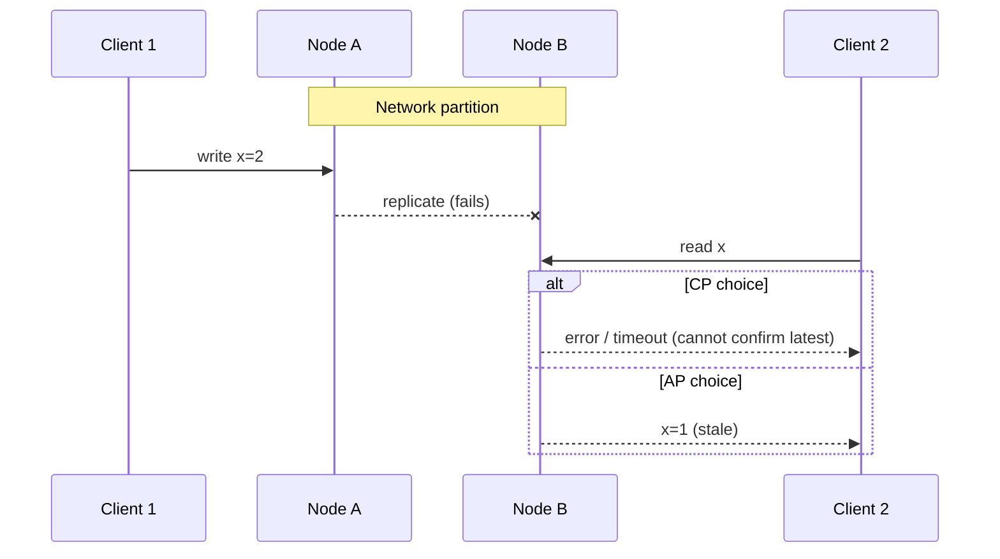

# CAP Theorem

## Core Idea

Brewer's conjecture, proven by Gilbert and Lynch (2002): a distributed data store cannot simultaneously guarantee **C**onsistency (linearizability), **A**vailability (every request to a non-failing node gets a non-error response) and **P**artition tolerance. Since partitions happen in any real network, the practical statement is: **when a partition occurs, choose C or A.** When there is no partition, you can have both — the tradeoff then is latency ([[PACELC]]).

## Mechanism

- **CP:** minority side refuses requests (e.g., no quorum) — consistent but unavailable there.
- **AP:** every node answers, possibly stale; reconcile after heal (LWW, vector clocks, CRDTs).
- "CA" is not a real option for a distributed system — it just means "we assume partitions don't happen".

## Example (assumptions)

Shopping cart across two regions; a partition lasts 2 minutes. AP (Dynamo-style): both regions accept adds; on heal, merge carts as a set union (a deleted item may reappear — the known Dynamo paper anomaly). CP: one region can't write for 2 minutes. For carts, AP is the business choice; for inventory decrement of the last unit, CP (or reservations) is.

## Tradeoffs

| | CP | AP |
|---|---|---|
| During partition | Some requests fail | All answer, maybe stale |
| After heal | Nothing to reconcile | Conflict resolution needed |
| Good for | Locks, leader election, balances, uniqueness | Carts, feeds, presence, counters, DNS |
| Examples | etcd, ZooKeeper, Spanner, HBase | Cassandra, DynamoDB (default reads), Riak, CouchDB |

## Failure Modes

- Mislabeling: many systems are neither strictly C nor A under CAP's definitions (e.g., async-replicated single-leader DBs lose writes on failover *and* are unavailable for writes during it).
- Treating CAP as a per-system label rather than per-operation choice.
- Ignoring partial partitions (A sees B, B sees C, A doesn't see C) and gray failures.

## Security Implications

An attacker who can induce partitions (e.g., BGP, targeted DoS on replication links) can exploit AP stale reads (reuse revoked credentials, double spend). CP systems become a DoS target: kill quorum and writes stop. Choose CP for security-critical state (auth revocation, key management).

## Real-World Usage

- Cassandra and DynamoDB are commonly described as AP by default with tunable consistency (quorum reads/writes move them toward C, still not fully linearizable in all cases without extra mechanisms like Cassandra LWT/Paxos).
- etcd/ZooKeeper (Raft/ZAB) are CP: without a majority, writes block.
- Spanner is CP; Google argues it is "effectively CA" because its private network makes partitions rare — still CP by definition.

## Interview Questions

- **Can you pick CA?** Not in a distributed system; partitions aren't optional. You pick behavior during a partition.
- **Is MongoDB CP or AP?** Depends on config: with majority write concern and reads from primary it behaves CP; reading from secondaries relaxes C.
- **What does "A" mean in CAP?** Every non-failing node must respond — stricter than "high availability" in SLA terms.
- **What's missing from CAP?** Latency during normal operation — that's PACELC.

## Related

[[System-Design-Index]] · [[PACELC]] · [[Consistency-Models]] · [[Replication]] · [[Consensus-Raft-Paxos]]
