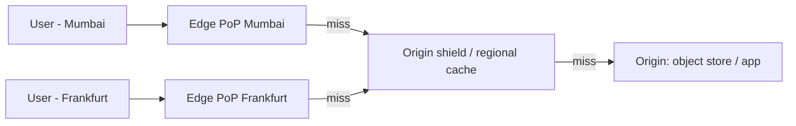

# CDN

## Core Idea

A CDN is a geographically distributed set of caching proxies (points of presence, PoPs). Users hit a nearby edge; the edge serves from cache or fetches from your origin once. Result: lower latency, less origin egress, and a shield against traffic spikes and DDoS.

## Mechanism

- **Routing to edge:** DNS-based geo/latency routing or anycast IPs.
- **Pull CDN:** edge fetches from origin on first miss and caches per `Cache-Control`. Default for most sites.
- **Push CDN:** you upload content to the CDN ahead of time. Useful for large, predictable assets.
- **Cache key:** usually host + path + selected query params/headers. Keep it minimal to maximize hit ratio.
- **Freshness:** `Cache-Control: max-age`, `s-maxage` (shared caches), `stale-while-revalidate`, `ETag` revalidation.
- **Invalidation:** purge API (by URL, tag, or prefix) or, better, **versioned URLs** (`app.3f9a1c.js`) with long max-age — no purge needed.
- **Origin shield:** an intermediate tier so N edges don't each hit origin on a miss.

## Example (assumptions)

Video thumbnails: 1B views/day × 30 KB = 30 TB/day egress. With a 95% edge hit ratio, origin serves 1.5 TB/day. Versioned object keys in object storage, `Cache-Control: public, max-age=31536000, immutable`.

## Tradeoffs

| Choice | Pro | Con |
|---|---|---|
| Long TTL + versioned URLs | Near-100% hit ratio, no purges | Need build pipeline to fingerprint assets |
| Short TTL | Fresh | More origin load |
| Caching dynamic/API responses | Big offload | Risk of leaking personalized data |
| Edge compute (workers) | Logic near user | Vendor lock-in, limited runtime |

## Failure Modes

- Purge storms: global purge causes origin thundering herd — use shields and gradual expiry.
- Misconfigured cache key includes a cookie -> hit ratio collapses.
- Origin outage: serve `stale-if-error` if configured.
- Different PoPs holding different versions during rollouts.

## Security Implications

- **Web cache deception/poisoning:** caching `/account/settings/x.css` with personal data, or poisoning via unkeyed headers. Mark private responses `no-store`, key on what varies.
- Lock origin to accept only CDN traffic (IP allowlists, secret header, or signed origin pulls), else attackers bypass CDN protections.
- **Signed URLs/cookies** for paid or private content with short expiry.
- CDNs provide DDoS absorption and WAF at the edge.

## Real-World Usage

- Netflix Open Connect places its own caching appliances inside ISP networks.
- Cloudflare uses anycast; Amazon CloudFront, Akamai, Fastly are common commercial CDNs.
- Static site assets with content hashes (webpack/Vite output) is the standard versioned-URL pattern.

## Interview Questions

- **Push or pull?** Pull by default; push for large known assets and when you need guaranteed pre-positioning.
- **How to update a cached JS file instantly?** Don't purge — ship a new fingerprinted filename and update the HTML (which has short TTL).
- **Can you CDN-cache API responses?** Yes for public, non-personalized GETs with explicit `s-maxage`; never for authenticated per-user data unless keyed and marked appropriately.

## Related

[[System-Design-Index]] · [[Caching]] · [[Storage-Blob-vs-Block-vs-File]] · [[Load-Balancing]] · [[Case-Study-YouTube]] · [[Case-Study-Netflix]]
