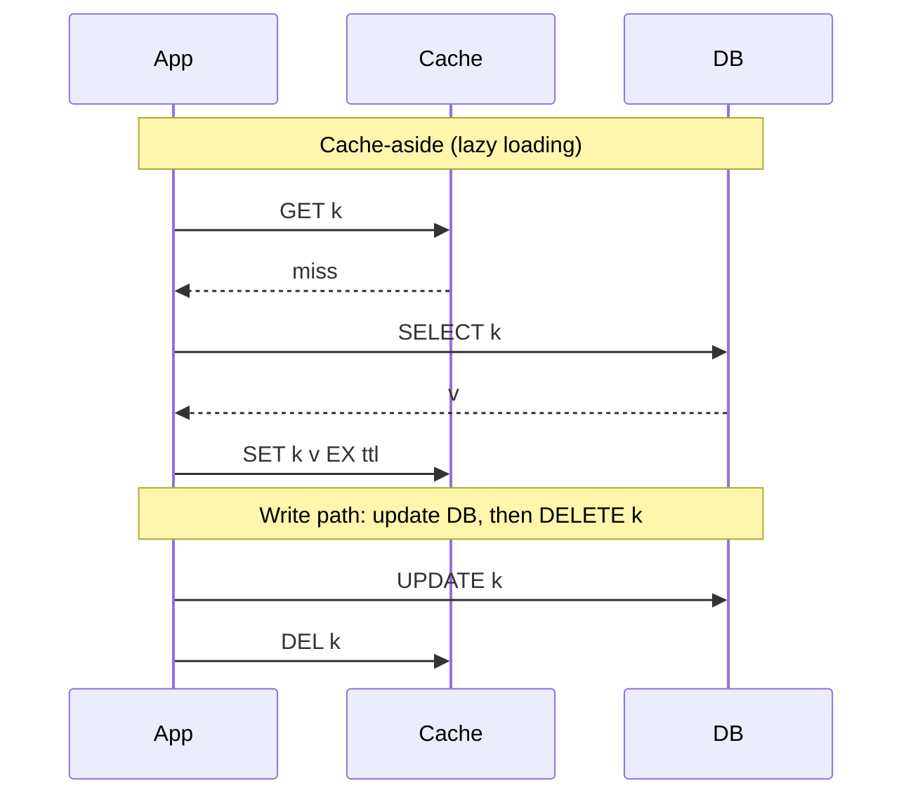

# Caching

## Core Idea

Keep a copy of expensive-to-produce data in faster storage close to the reader. A cache trades **freshness and complexity** for **latency and backend load**. Caches live at many layers: browser, [[CDN]], API gateway, application (in-process), distributed (Redis/Memcached), DB buffer pool.

## Mechanism

### Strategies

| Strategy | Read | Write | Notes |
|---|---|---|---|
| **Cache-aside** | App checks cache, on miss loads DB and populates | App writes DB, then invalidates (delete) key | Default choice; cache failure = slower, not down |
| **Read-through** | Cache itself loads from DB on miss | — | Loader logic lives in cache library/provider |
| **Write-through** | — | Write goes to cache, which synchronously writes DB | Cache always warm for written keys; write latency = both |
| **Write-back (write-behind)** | — | Write to cache, flush to DB asynchronously | Fast writes, batching; **data loss** if cache dies before flush |
| **Write-around** | — | Write DB only; cache filled on read | Avoids caching write-once data |

Prefer **delete on write** over **set on write**: two concurrent writers doing set can leave the older value in cache.

### Eviction

- **LRU** — evict least recently used; good general default.
- **LFU** — evict least frequently used; resists one-off scans. Redis offers approximated `allkeys-lru`, `allkeys-lfu`, `volatile-*`, and `noeviction`.
- **FIFO / random** — cheap, occasionally fine.
- **TTL** — bounds staleness regardless of memory pressure. Add jitter so keys don't expire together.

### Stampede (thundering herd / dog-pile)

A hot key expires; thousands of requests miss simultaneously and hammer the DB. Mitigations:
1. **Request coalescing / single-flight:** one loader per key per process; others wait.
2. **Distributed mutex:** `SET lock:k token NX PX 3000`; losers serve stale or wait briefly.
3. **Stale-while-revalidate / soft TTL:** serve stale value while one worker refreshes.
4. **Probabilistic early expiration (XFetch):** each reader refreshes early with probability rising as expiry nears.
5. **TTL jitter** to avoid synchronized mass expiry.

### Invalidation

- TTL only (simplest, bounded staleness).
- Explicit delete on write (cache-aside).
- Event-driven: DB change stream / CDC (e.g., Debezium) publishes changes; consumers invalidate — survives writers that forget.
- Versioned keys: `user:42:v7` — bump version to invalidate everything at once.

## Example (assumptions)

Product page: 20k reads/s, DB can comfortably do 2k reads/s. With a 95% hit rate, DB sees 1k reads/s. Working set: 1M products × 2 KB = 2 GB -> a small Redis cluster with a replica. TTL 10 min ± 60 s jitter; on price change, publish an event that deletes `product:{id}`.

## Tradeoffs

| Concern | Tradeoff |
|---|---|
| Hit rate vs freshness | Longer TTL -> more hits, more staleness |
| In-process vs distributed | In-process: ns latency, no network, but per-instance duplication and incoherence. Distributed: shared, one network hop |
| Write-back vs write-through | Speed vs durability |
| Cache everything vs hot set | Memory cost vs misses |

## Failure Modes

- **Cold cache after restart/failover** -> DB overload. Warm up or rate-limit the loaders.
- **Stampede** on hot key expiry (above).
- **Cache penetration:** repeated lookups for keys that don't exist bypass the cache -> cache negative results briefly, or use a [[Bloom-Filters-and-Probabilistic-Structures|Bloom filter]].
- **Inconsistency race:** reader loads old value, writer updates DB and deletes, reader then sets old value. Mitigate with short TTLs, delayed double-delete, or versioned sets.
- **Hot key** saturates one cache shard -> local L1 cache or key replication with suffixes.
- **Big values** block Redis's single command thread.

## Security Implications

- Never cache per-user data under a shared key (classic data leak: cache key missing user ID or auth context).
- Web cache poisoning/deception at CDN/proxy layers: normalize cache keys, respect `Vary`, set `Cache-Control: private, no-store` on sensitive responses.
- Redis should not be internet-exposed; require AUTH/ACLs and TLS; disable dangerous commands where possible.
- Cached authz decisions delay revocation.

## Real-World Usage

- Memcached at Facebook ("Scaling Memcache at Facebook", NSDI 2013) introduced **leases** to handle stale sets and thundering herds.
- Redis is the common default distributed cache; also used for sessions, rate limits, leaderboards.
- CDNs implement `stale-while-revalidate` and `stale-if-error` (RFC 5861).

## Interview Questions

- **Why delete instead of update the cache on write?** Avoids concurrent-writer ordering bugs and wasted work for keys nobody reads.
- **Cache goes down — what happens?** With cache-aside, requests fall through to DB; protect the DB with rate limiting/circuit breaker and warm gradually.
- **How to size a cache?** Estimate working set (hot fraction × item size), aim for a hit rate target, measure and adjust.
- **Handle a celebrity key?** Local in-process cache with short TTL, replicate the key across shards, request coalescing.
- **Write-back use case?** High-write counters where losing a few seconds is acceptable (view counts).

## Related

[[System-Design-Index]] · [[CDN]] · [[Consistency-Models]] · [[Distributed-Locks]] · [[Bloom-Filters-and-Probabilistic-Structures]] · [[Case-Study-URL-Shortener]] · [[Case-Study-Instagram]]
