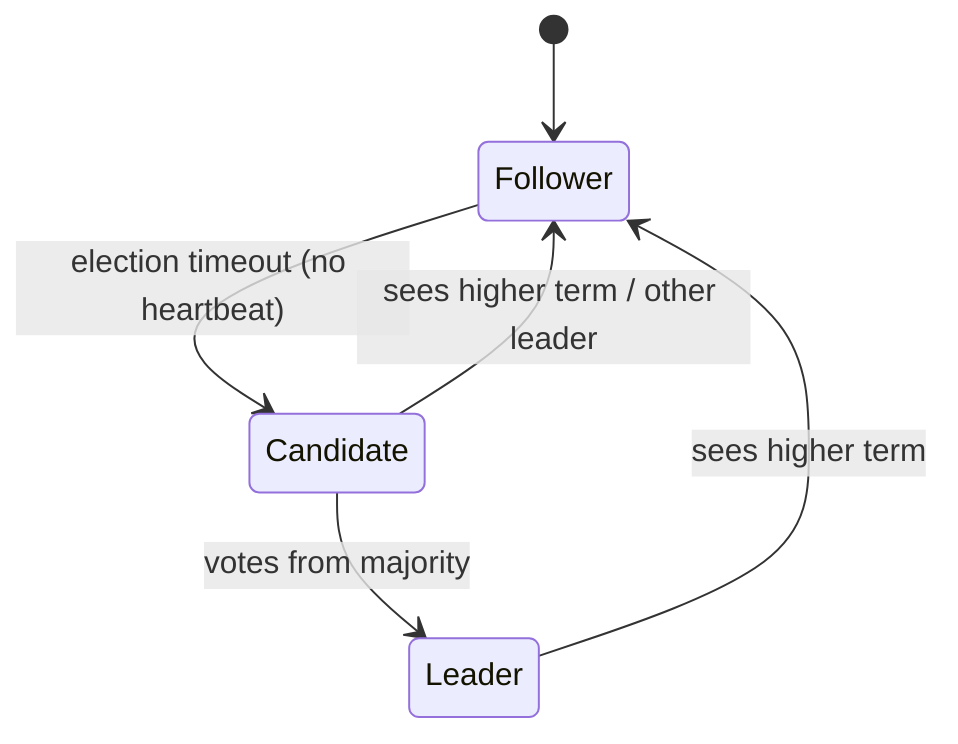
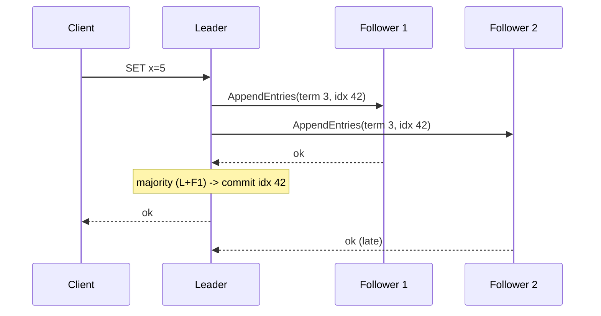

# Consensus - Raft and Paxos

## Core Idea

Consensus lets a group of nodes agree on a sequence of values (a replicated log) so they behave like one reliable machine (**state machine replication**), as long as a **majority** is alive and can communicate. With 2f + 1 nodes you tolerate f crash failures. It powers leader election, configuration stores, locks, and strongly consistent databases. (FLP impossibility: no deterministic algorithm guarantees termination in a fully asynchronous system with even one crash — real systems use timeouts for liveness while keeping safety always.)

## Mechanism

### Raft (Ongaro & Ousterhout, 2014) — designed for understandability

1. **Terms:** logical epochs; each term has at most one leader.
2. **Leader election:** follower times out (randomized, e.g., 150-300 ms in the paper) -> becomes candidate, increments term, requests votes. A node votes once per term and only for candidates whose log is at least as up-to-date as its own.
3. **Log replication:** clients send commands to the leader; leader appends and sends `AppendEntries` to followers; once a **majority** has stored the entry it is **committed** and applied to the state machine.
4. **Safety:** committed entries are never lost because any future leader must have them (election restriction). Followers with conflicting entries are overwritten by the leader's log.
5. Extras: snapshots/log compaction, membership changes (joint consensus or single-server changes), linearizable reads via leader lease or read-index.

### Paxos (Lamport) in brief
- Roles: proposers, acceptors, learners.
- **Phase 1 (prepare/promise):** proposer picks ballot n, asks acceptors to promise not to accept lower ballots; they reply with any previously accepted value.
- **Phase 2 (accept):** proposer sends value (the highest-ballot previously accepted value if any, else its own); chosen once a majority accepts.
- Single-decree Paxos decides one value; **Multi-Paxos** uses a stable leader to skip phase 1 for successive log slots — similar in practice to Raft.
- Raft vs Paxos: equivalent guarantees; Raft specifies the whole system (election, log, membership) in one design that's easier to implement correctly.

## Example (assumptions)

5-node etcd cluster across 3 AZs (2-2-1). Tolerates 2 node failures, or loss of any single AZ. Write latency ≈ 1 RTT from the leader to the *second-fastest* follower (majority of 5 = 3 = leader + 2 follower acks) plus fsync on the leader and those followers; with ~1 ms intra-region RTT and ~1-2 ms fsync on SSD (assumptions), writes take a few ms. Adding nodes (7) improves fault tolerance but slows writes (bigger majority) — it doesn't add throughput.

## Tradeoffs

| Aspect | Tradeoff |
|---|---|
| Cluster size | 3 tolerates 1, 5 tolerates 2; more nodes = slower writes, no more throughput |
| Cross-region cluster | Survives region loss vs WAN RTT on every write |
| Leader-based | Simple, fast steady state vs leader bottleneck and failover pause |
| Linearizable reads | Correctness vs extra round trip (read-index) or clock assumptions (leases) |

## Failure Modes

- Losing majority -> cluster unavailable for writes (CP by design).
- Even node counts add no tolerance (4 tolerates 1, same as 3).
- Slow disk (fsync) on leader stalls the whole cluster.
- Election storms from too-short timeouts or network jitter.
- Using consensus for high-volume data (it's for metadata/coordination; shard data into many consensus groups instead).

## Security Implications

Raft/Paxos assume crash failures, not malicious nodes; Byzantine fault tolerance (PBFT, blockchain protocols) needs 3f + 1 nodes. Protect peer traffic with mTLS and authenticate members — a rogue member can disrupt elections. Consensus stores often hold secrets and cluster state (Kubernetes etcd holds Secrets) — encrypt at rest and restrict access.

## Real-World Usage

- **Raft:** etcd (Kubernetes' store), Consul, CockroachDB and TiKV (per-range Raft groups), Kafka KRaft (controller quorum replacing ZooKeeper).
- **Paxos family:** Google Chubby and Spanner (Paxos per split), ZooKeeper uses ZAB (Paxos-like atomic broadcast).
- Cassandra LWT uses a Paxos round for compare-and-set.

## Interview Questions

- **Why an odd number of nodes?** Majority of 2f+1 tolerates f failures; adding one more node (even) increases quorum size without increasing tolerance.
- **How does Raft prevent two leaders?** At most one per term (one vote per node per term, majority required); stale leaders step down on seeing a higher term. A deposed leader may briefly think it's leader, so reads need read-index/leases.
- **When is an entry committed?** When the current term's leader has replicated it to a majority. A leader never commits entries from *earlier* terms by counting replicas (Figure 8 in the Raft paper); they become committed indirectly once an entry from its own term is committed after them — which is why a new leader appends a no-op entry at the start of its term.
- **Would you put user data in etcd?** No — it's for small, critical coordination data. For data at scale, use a DB that shards into many consensus groups.

Implementation patterns (code, config, and failure handling live there; this note covers the concept and tradeoffs): [[Pattern-Leader-Election]]

## Related

[[System-Design-Index]] · [[Replication]] · [[Distributed-Locks]] · [[Service-Discovery]] · [[CAP-Theorem]] · [[Consistency-Models]] · [[Case-Study-Distributed-Job-Scheduler]]
