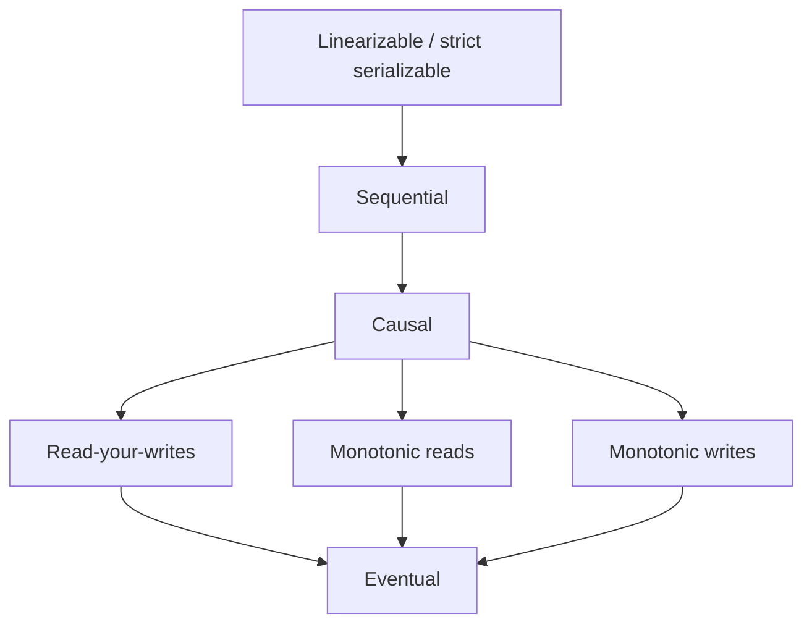

# Consistency Models

## Core Idea

A consistency model is a contract about which values a read may return when data is replicated. Stronger models are easier to reason about but require coordination (latency, reduced availability under partition). Pick per operation, not per system: account balance needs strong; like-counts can be eventual.

## Mechanism

(arrow = "is stronger than")

| Model | Guarantee |
|---|---|
| **Linearizable** | Every op appears to take effect atomically at one instant between its start and end; all clients see a single real-time order. |
| **Sequential** | All clients see the same order, consistent with each client's program order, but not necessarily real-time. |
| **Causal** | Causally related ops (A happened-before B) are seen in that order everywhere; concurrent ops may be seen in different orders. |
| **Read-your-writes** | A client always sees its own prior writes. |
| **Monotonic reads** | A client never sees data go backward in time. |
| **Eventual** | If writes stop, replicas converge. No bound on when. |

Note: **serializability** is a *transaction isolation* property (multi-object), linearizability is a *single-object recency* property; strict serializability combines both.

Implementation sketches: linearizable via single leader + consensus ([[Consensus-Raft-Paxos]]) or quorum with R + W > N plus read repair (and even then, edge cases exist); read-your-writes via sticky routing to the leader or a client-held version token; monotonic reads via pinning a client to one replica.

## Example (assumptions)

User updates profile photo, then refreshes. Writes go to leader; reads go to replicas with ~200 ms lag (assumed). Without read-your-writes, the user sees the old photo and re-uploads. Fix: for 5 s after a write (or until replica LSN ≥ the write's LSN), route that user's reads to the leader.

## Tradeoffs

| Model | Latency | Availability under partition | Programmer effort |
|---|---|---|---|
| Linearizable | Highest (coordination) | Minority side unavailable | Lowest |
| Causal | Moderate (track dependencies) | Available | Moderate |
| Eventual | Lowest | Available | Highest (conflicts, anomalies) |

## Failure Modes

- Stale reads after failover promoted a lagging replica (lost acknowledged writes under async replication).
- Write skew / lost updates when "check then act" runs on stale data.
- Clock-based last-write-wins silently drops concurrent writes when clocks skew.
- Caches layered over a strongly consistent DB make the system eventually consistent.

## Security Implications

Revocation is a consistency problem: a revoked token or permission cached/replicated eventually can still be honored for the lag window. Security-critical checks (authz, balance, rate-limit counters for abuse) need strong reads or bounded staleness. Stale-read races can enable double-spend.

## Real-World Usage

- **Google Spanner:** externally consistent (strict serializable) transactions using TrueTime.
- **DynamoDB:** eventually consistent reads by default; strongly consistent reads optional per request (within a region).
- **Cassandra:** tunable per query (ONE, QUORUM, ALL, LOCAL_QUORUM).
- **etcd/ZooKeeper:** linearizable writes; etcd offers linearizable reads by default, ZooKeeper reads may be stale unless `sync` is used.
- **MongoDB:** read/write concerns (`majority`, `linearizable`) and causally consistent sessions.

## Interview Questions

- **Linearizable vs serializable?** Linearizable: single object, real-time recency. Serializable: transactions behave as if in some serial order, not necessarily real time.
- **When is eventual fine?** Counters, feeds, recommendations, analytics — where temporary staleness has low cost and conflicts can merge.
- **How to give read-your-writes on replicas?** Sticky leader reads after writes, or pass a version/LSN token and wait for a replica that has caught up.
- **Why does strong consistency cost latency?** Every write (and linearizable read) needs a round trip to a majority, possibly cross-region.

## Related

[[System-Design-Index]] · [[CAP-Theorem]] · [[PACELC]] · [[Replication]] · [[Consensus-Raft-Paxos]] · [[Caching]]
