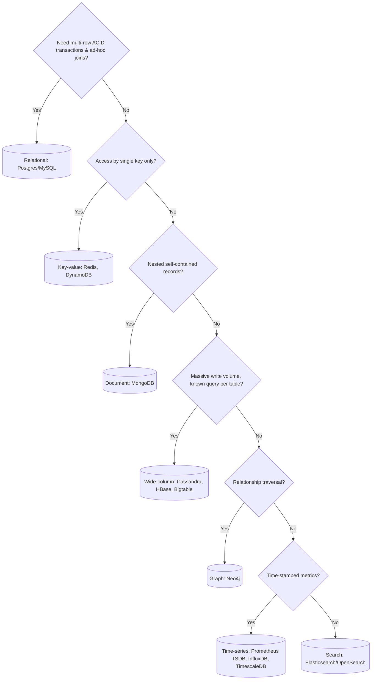

# Database Selection

## Core Idea

Choose a database from **access patterns, consistency needs, and scale**, not fashion. Start from: what are the queries, what must be transactional, what's the read/write ratio, how big does it grow. Relational is the default; move to a specialized store when a specific need (write scale, flexible schema, graph traversal, full-text) justifies it. Many systems use several (polyglot persistence).

## Mechanism

| Family | Model | Strengths | Weaknesses | Examples |
|---|---|---|---|---|
| Relational | Tables, SQL, schemas | ACID, joins, constraints, mature tooling | Horizontal write scaling needs sharding or distributed SQL | PostgreSQL, MySQL |
| Distributed SQL | SQL over sharded consensus groups | ACID + horizontal scale | Higher write latency, operational complexity | Spanner, CockroachDB, YugabyteDB |
| Key-value | key -> blob | Simple, very fast, easy to partition | No rich queries | Redis, DynamoDB, etcd |
| Document | JSON-like documents | Flexible schema, locality for aggregates | Cross-document joins weaker | MongoDB, Couchbase |
| Wide-column | Partition key + clustering columns | Huge write throughput, linear scale | Must model per query; limited ad-hoc queries | Cassandra, HBase, Bigtable |
| Graph | Nodes/edges | Multi-hop traversals | Harder to shard | Neo4j, Amazon Neptune |
| Time-series | (series, timestamp, value) | Compression, downsampling, retention | Narrow use | Prometheus, InfluxDB, TimescaleDB |
| Search | Inverted index | Full-text, relevance, facets | Not a system of record | Elasticsearch, OpenSearch |
| Object storage | key -> large blob | Cheap, durable, huge | Not a database; higher latency | S3, GCS |

## Example (assumptions)

Food delivery app:
- Orders, payments, restaurants -> PostgreSQL (transactions, relational integrity).
- Courier location pings: 100k couriers × 1 ping / 4 s = 25k writes/s -> Redis for latest position (geo commands), Cassandra or a time-series store for history.
- Menu search -> Elasticsearch fed by CDC from Postgres.
- Photos -> object storage + [[CDN]].

## Tradeoffs

| Axis | SQL | NoSQL (typical) |
|---|---|---|
| Schema | Enforced, migrations | Flexible, enforced in app |
| Transactions | Multi-row ACID | Often single-item/partition (many now offer more) |
| Scaling writes | Vertical, then sharding | Built-in partitioning |
| Query flexibility | High | Designed per access pattern |
| Consistency | Strong by default | Often tunable/eventual |

## Failure Modes

- Picking NoSQL "for scale" then reimplementing joins and transactions in app code, badly.
- Modeling Cassandra/DynamoDB like SQL -> scatter-gather queries, hot partitions.
- Using a search engine as the source of truth (lost writes on reindex).
- Unbounded document growth (arrays inside documents).

## Security Implications

- SQL injection -> parameterized queries always; NoSQL injection exists too (e.g., MongoDB operator injection via `$ne`).
- Least-privilege DB users per service; no shared admin creds.
- Encryption at rest and in transit; field-level encryption for PII.
- Many historical breaches came from DBs (Elasticsearch, MongoDB, Redis) exposed to the internet without auth.

## Real-World Usage

- Instagram (per its engineering blog) built on sharded PostgreSQL; later adopted Cassandra for some workloads.
- Discord publicly wrote about moving messages from MongoDB to Cassandra and later ScyllaDB.
- Uber published "Schemaless", a MySQL-backed store.

## Interview Questions

- **SQL or NoSQL for this?** Start with access patterns and invariants. "Orders need transactions -> Postgres; the activity feed is key-lookups at high write volume -> Cassandra."
- **When does Postgres stop being enough?** When writes or dataset exceed one primary even after vertical scaling, caching, and read replicas — often much later than people think.
- **How do you model for Cassandra?** One table per query; partition key spreads load and keeps partitions bounded; clustering key gives order within a partition.

## Related

[[System-Design-Index]] · [[Replication]] · [[Sharding-and-Partitioning]] · [[Search-Systems-Inverted-Index]] · [[Storage-Blob-vs-Block-vs-File]] · [[Case-Study-Food-Delivery]]
