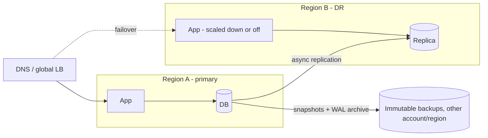

# Disaster Recovery

## Core Idea

Disaster recovery (DR) is how you restore service and data after a large failure: region outage, data corruption, ransomware, or an operator deleting production. Two numbers drive every decision:
- **RPO (Recovery Point Objective):** max acceptable data loss, measured in time ("we can lose up to 5 minutes of writes").
- **RTO (Recovery Time Objective):** max acceptable time to restore service ("back up within 1 hour").

Lower RPO/RTO = exponentially more cost and complexity.

## Mechanism

### DR strategies (commonly used tiers, e.g., in AWS's DR whitepaper)

| Strategy | RPO | RTO | Cost |
|---|---|---|---|
| Backup & restore | Hours (since last backup) | Hours+ | Low |
| Pilot light (data replicated, minimal infra running) | Minutes | Tens of minutes+ | Moderate |
| Warm standby (scaled-down full copy running) | Seconds-minutes | Minutes | Higher |
| Multi-site active-active | Near zero (sync) to seconds (async) | Near zero | Highest |

### Backups
- **Full, incremental, differential**; for databases: periodic snapshot + continuous WAL/binlog archiving enables **point-in-time recovery (PITR)**.
- **3-2-1 rule:** 3 copies, 2 different media/types, 1 off-site. Add immutability (object lock/WORM) and logical isolation (separate account) against ransomware.
- A replica is **not** a backup: it replicates deletes and corruption.
- **Test restores** regularly; an untested backup is a hope.

### Multi-region
- Active-passive: one region serves; failover via DNS/global LB; async replication -> RPO > 0.
- Active-active: both serve; needs conflict handling or per-user home region; see [[Replication]] multi-leader.
- Keep dependencies regional (auth, config, secrets) or the DR region fails on first request.

## Example (assumptions)

SaaS app: RPO 5 min, RTO 1 h. Choice: warm standby. Postgres async replica in region B (lag typically seconds), WAL archived to object storage every 60 s, nightly snapshots copied to a separate account with object lock for 35 days. App tier in B runs at 10% capacity, autoscale on failover. Quarterly game day: fail over for real and time it.

## Tradeoffs

| Choice | Tradeoff |
|---|---|
| Sync cross-region replication | RPO 0 vs every write pays cross-region RTT |
| Active-active | Instant RTO vs consistency complexity and 2× cost |
| Automated failover | Faster RTO vs risk of flapping/false failover |
| Long backup retention | Recover from latent corruption vs storage cost and compliance scope |

## Failure Modes

- Backups silently failing or unrestorable (encryption key lost, format change).
- Failover runbook out of date; DNS TTL too long; hard-coded region endpoints.
- DR region lacks capacity/quota when everyone fails over at once.
- Split brain when old primary comes back and accepts writes.
- Corruption replicated to DR before detection -> need PITR to before the event.

## Security Implications

Ransomware targets backups first — immutable, isolated backups with separate credentials. Encrypt backups and manage keys so that DR can decrypt (keys replicated to DR region). DR environments often drift in patching and access control; audit them like prod. Data residency laws may restrict where backups/replicas can live.

## Real-World Usage

- AWS whitepaper "Disaster Recovery of Workloads on AWS" describes the four strategies above.
- Managed DBs offer PITR (e.g., Amazon RDS, Cloud SQL) and cross-region read replicas.
- The 2017 GitLab.com database incident (public postmortem) is a widely cited example of multiple backup mechanisms failing and the value of tested restores.

## Interview Questions

- **RPO vs RTO?** RPO = how much data you can lose; RTO = how long you can be down.
- **How would you get RPO ≈ 0?** Synchronous replication to another site (paying latency), or a consensus-replicated DB spanning zones/regions.
- **Is a read replica a backup?** No — use snapshots + PITR stored immutably and separately.
- **How do you know DR works?** Scheduled restore tests and real failover drills with measured RPO/RTO.

## Related

[[System-Design-Index]] · [[Replication]] · [[Availability-and-Reliability]] · [[Fault-Tolerance]] · [[Storage-Blob-vs-Block-vs-File]] · [[Case-Study-File-Storage]]
