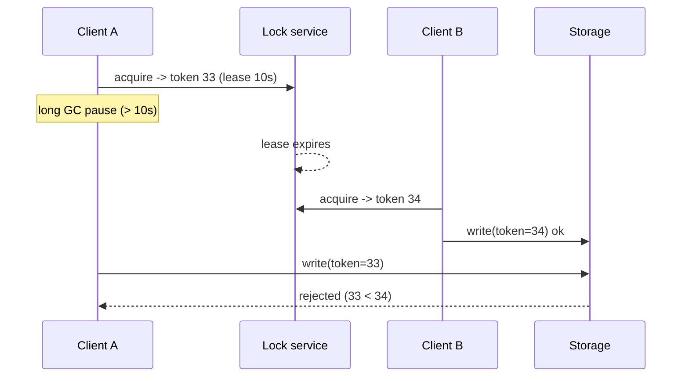

# Distributed Locks

## Core Idea

A distributed lock ensures only one process across many machines does something at a time (run a cron job, write a file, process a shard). Because processes can pause (GC, VM freeze) and networks delay messages, a lock can't be truly guaranteed from the holder's side — it must be a **lease** with expiry, and the protected resource must reject stale holders using **fencing tokens**.

First ask: can you avoid the lock? Idempotent operations, conditional writes (compare-and-set, `UPDATE ... WHERE version = ?`), or single-partition ownership often remove the need.

## Mechanism

### Efficiency vs correctness locks
- **Efficiency:** avoid doing work twice (e.g., two nodes send the same report). Occasional double-execution is acceptable -> a single Redis `SET NX PX` lock is fine.
- **Correctness:** double-execution corrupts data. Need a consensus-backed lock service **and** fencing.

### Lease + fencing token


The storage remembers the highest token seen and rejects lower ones. Tokens must be monotonically increasing — e.g., etcd revision, ZooKeeper zxid/znode version.

### Redis single-instance lock
```text
SET lock:job42 <random-uuid> NX PX 30000     # acquire
-- release only if we still own it (atomic via Lua):
if redis.call("GET", KEYS[1]) == ARGV[1] then return redis.call("DEL", KEYS[1]) else return 0 end
```
Random value prevents deleting someone else's lock after your lease expired. Failover to an async replica can lose the lock (two holders).

### Redlock and its caveats
Redlock acquires the lock on a majority of N (e.g., 5) independent Redis masters within a time bound. Martin Kleppmann's critique ("How to do distributed locking", 2016): it depends on timing assumptions (bounded pauses, clock drift, network delay), and it doesn't produce fencing tokens, so it's unsafe for correctness-critical use. Antirez (Redis author) published a rebuttal. Practical takeaway: fine for efficiency locks; for correctness use a consensus system plus fencing.

### Consensus-backed locks
- **ZooKeeper:** ephemeral sequential znodes; lowest sequence holds the lock; others watch their predecessor (no herd). Session expiry releases the lock.
- **etcd:** lease + key with `create_revision`; revision serves as fencing token; `concurrency` package provides mutexes.
- **Database:** `SELECT ... FOR UPDATE`, Postgres advisory locks, or a lock table with a version column — often the simplest when you already have a strongly consistent DB.

## Example (assumptions)

A nightly billing job runs on 3 replicas for HA; only one must charge customers. Use etcd lease (TTL 15 s, keepalive every 5 s). Each charge write to the ledger DB carries the lock key's `create_revision` (a lease ID is not monotonic, so it cannot be a fencing token); the ledger stores the highest revision seen in `job_owner(revision)` and rejects writes carrying an older one — the check and the write must be in the same DB transaction. Plus each charge uses an idempotency key, so even a double run doesn't double-charge.

## Tradeoffs

| Option | Safety | Latency/ops | Use for |
|---|---|---|---|
| Redis `SET NX PX` | Weak (failover, pauses) | Very low | Efficiency |
| Redlock | Debated; no fencing | Low; N Redis masters | Efficiency |
| ZooKeeper/etcd + fencing | Strong | Higher; run a quorum cluster | Correctness |
| DB row lock / CAS | Strong within DB | Uses existing DB | Resources in that DB |

## Failure Modes

- Process pause beyond lease -> two holders; only fencing saves you.
- Lease too short -> spurious expiry under load; too long -> slow recovery after crash.
- Releasing a lock you no longer own (no owner check).
- Clock jumps (NTP step) break TTL assumptions on some implementations.
- Lock service unavailable -> all work stops (CP by design).

## Security Implications

Anyone who can write to the lock store can seize or release locks — authenticate and ACL the lock namespace. Use unguessable owner values. Lock-based DoS: an attacker (or bug) holding a lock indefinitely — always use leases with bounded TTL.

## Real-World Usage

- Google Chubby (2006 paper) — lock service with sequencers (fencing) used by GFS/Bigtable for leader election.
- ZooKeeper and etcd lock recipes are widely used (Kafka historically used ZooKeeper for controller election; newer Kafka uses KRaft).
- Kubernetes leader election uses Lease objects in the API server (backed by etcd).

## Interview Questions

- **Why is a TTL lock not enough?** A paused holder can resume after expiry and act as if it still holds the lock.
- **What is a fencing token?** Monotonic number issued on each acquisition; resources reject operations with a token lower than the highest seen.
- **Is Redlock safe?** Not for correctness: it relies on timing assumptions and lacks fencing tokens. Fine for efficiency.
- **How to avoid locks altogether?** Partition ownership, idempotency, conditional writes/CAS, or a single-writer queue per key.

Implementation patterns (code, config, and failure handling live there; this note covers the concept and tradeoffs): [[Pattern-Leader-Election]] · [[Pattern-Optimistic-Locking]] · [[Pattern-Idempotency-Keys]]

## Related

[[System-Design-Index]] · [[Consensus-Raft-Paxos]] · [[Idempotency]] · [[Consistency-Models]] · [[Case-Study-Distributed-Job-Scheduler]]
