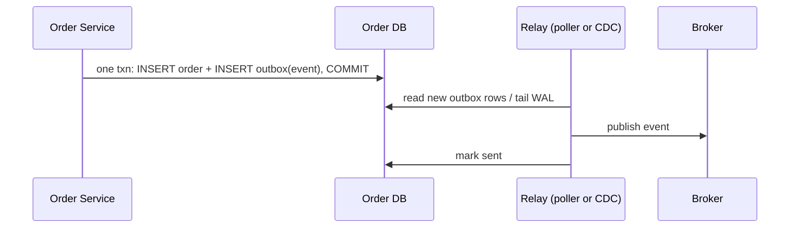
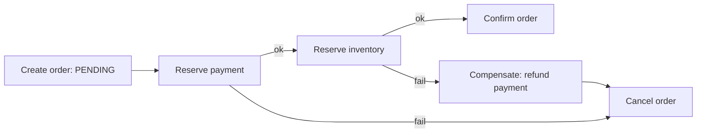

# Event-Driven Architecture

## Core Idea

Services communicate by publishing **facts that happened** ("OrderPlaced") instead of calling each other synchronously. Producers don't know consumers. This improves decoupling and resilience but moves you to eventual consistency and makes flows harder to trace.

## Mechanism

### Event sourcing
Store the **sequence of events** as the source of truth; current state = fold over events. Snapshots avoid replaying everything. Gives a full audit log, temporal queries, and the ability to rebuild new projections. Cost: schema evolution of events, complexity, eventual read models.

### CQRS
Separate the **write model** (commands, validation, invariants) from **read models** (denormalized projections optimized per query). Often paired with event sourcing but independent of it.

### Transactional outbox

Solves the **dual-write problem** (DB commit and message publish can't be atomic across two systems). Delivery is at-least-once, so consumers dedupe by event ID. The mirror pattern on the consumer side is the **inbox** (store processed event IDs).

### Sagas
A long-running business transaction across services as a sequence of local transactions, each with a **compensating action**.
- **Choreography:** each service reacts to events and emits the next. No central coordinator; hard to see the whole flow.
- **Orchestration:** a coordinator (e.g., workflow engine) tells each service what to do and tracks state. Easier to reason about and monitor.

Sagas give **ACD without I**: intermediate states are visible, so use semantic locks (status PENDING), commutative updates, or re-reads.

## Example (assumptions)

E-commerce checkout: order, payment, inventory services each own their DB. Orchestrated saga with timeouts of 30 s per step; payment compensation = refund; inventory compensation = release reservation. All steps idempotent keyed by `order_id + step`.

## Tradeoffs

| Pattern | Pro | Con |
|---|---|---|
| Events vs sync calls | Decoupled, resilient to downstream outages | Eventual consistency, debugging via traces only |
| Event sourcing | Audit, replay, time travel | Event versioning, snapshots, steep learning curve |
| CQRS | Independent read scaling, tailored views | Stale reads, more moving parts |
| Choreography | Loose coupling | Implicit flow, cyclic dependencies |
| Orchestration | Explicit, observable | Coordinator becomes central dependency |
| 2PC instead of saga | Atomic | Blocking on coordinator failure, poor availability |

## Failure Modes

- Lost events from dual writes without outbox.
- Duplicate or out-of-order events — consumers need idempotency and versioning.
- Compensation that can't truly undo (email sent) — design "semantic" compensations.
- Event schema changes break consumers — use schema registry and compatible evolution.
- Projection lag makes UI look broken (user doesn't see own write) — read-your-writes tricks.

## Security Implications

Events broadcast data widely — minimize PII in payloads (send IDs, let authorized consumers fetch). Immutable event stores conflict with right-to-erasure; use crypto-shredding (per-subject keys you can delete). Authenticate publishers so no one can forge "PaymentSucceeded". Event logs are valuable audit trails for security investigations.

## Real-World Usage

- Debezium implements CDC-based outbox relays from Postgres/MySQL into Kafka.
- Temporal and AWS Step Functions are common saga orchestrators.
- Event sourcing is common in ledgers/banking-style systems where an append-only log of transactions is natural.

## Interview Questions

- **What's the dual-write problem?** Writing to DB and broker separately can leave them inconsistent on partial failure; outbox fixes it with one local transaction plus async relay.
- **Saga vs 2PC?** 2PC gives atomicity but blocks and couples availability; sagas stay available with compensations and eventual consistency.
- **Do you need event sourcing for CQRS?** No. CQRS can use CDC or dual models from a normal DB.
- **Choreography or orchestration?** Choreography for simple, few-step flows; orchestration once you have many steps, timeouts, and need visibility.

Implementation patterns (code, config, and failure handling live there; this note covers the concept and tradeoffs): [[Pattern-Transactional-Outbox]] · [[Pattern-Saga]] · [[Pattern-CQRS]] · [[Pattern-Idempotency-Keys]]

## Related

[[System-Design-Index]] · [[Message-Queues]] · [[Microservices]] · [[Idempotency]] · [[Consistency-Models]] · [[Case-Study-Payment-System]] · [[Case-Study-Food-Delivery]]
