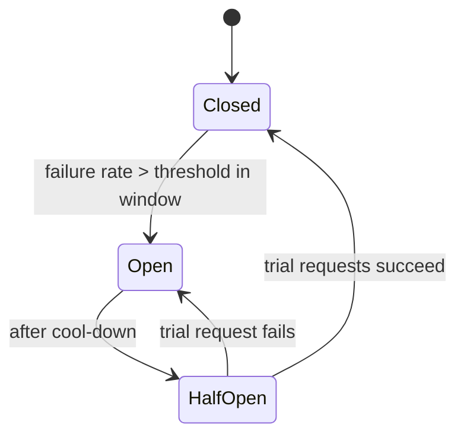

# Fault Tolerance

## Core Idea

Components will fail; a fault-tolerant system keeps a failure in one dependency from becoming a failure of everything (**cascading failure**). The toolkit: bound waiting (timeouts), retry wisely (backoff + jitter, only idempotent ops), stop calling broken things (circuit breaker), isolate resources (bulkheads), reject excess work early (load shedding), and degrade gracefully.

## Mechanism

### Timeouts
Every network call gets a timeout, derived from the dependency's latency (e.g., slightly above its p99) and the caller's own deadline. Propagate **deadlines** downstream (gRPC does this) so work stops when the caller has already given up.

### Retries with exponential backoff and jitter
```python
import random, time

def call_with_retry(fn, attempts=4, base=0.1, cap=2.0):
    for i in range(attempts):
        try:
            return fn()
        except TransientError:
            if i == attempts - 1:
                raise
            # "full jitter": sleep uniformly in [0, min(cap, base * 2^i)]
            time.sleep(random.uniform(0, min(cap, base * (2 ** i))))
```
- Retry only transient errors (timeouts, 503, connection reset) and only **idempotent** operations ([[Idempotency]]).
- Jitter de-synchronizes clients so retries don't arrive in waves.
- **Retry budgets:** cap retries to a % of normal traffic (e.g., 10%) so retries can't multiply load. Retry at one layer only — retries at every layer of a 4-deep stack multiply (3 attempts each -> 3^4 = 81 calls).

### Circuit breaker


Open = fail fast (return fallback/cached/default) without calling the dependency, giving it room to recover.

### Bulkhead
Separate resource pools per dependency or tenant (thread pools, connection pools, semaphores, even separate instances/cells), so one slow dependency can't exhaust all threads.

### Load shedding and backpressure
When overloaded, reject early (503/429) rather than accept and time out. Prioritize (health checks and paid traffic over batch). Bound queues. Adaptive concurrency limits (e.g., based on observed latency).

### Graceful degradation
Serve cached/stale data, hide non-critical widgets (recommendations), switch to read-only mode.

## Example (assumptions)

Product page calls pricing (critical), reviews and recommendations (non-critical). Recommendations p99 = 80 ms -> timeout 100 ms, 1 retry with jitter, breaker opens at 50% failures over 20 requests, fallback = "popular items" from cache. Separate connection pools: pricing 50, reviews 20, recs 20. When recs hangs, each page pays at most the 100 ms timeout (plus the retry) until the breaker opens, then ~0 ms because calls fast-fail to the fallback. Without the timeout, a hung recs call would hold the page until some library default (often tens of seconds or infinite) and exhaust the shared thread pool.

## Tradeoffs

| Mechanism | Pro | Con |
|---|---|---|
| Short timeouts | Frees resources fast | False failures under load spikes |
| Retries | Masks transient faults | Amplifies overload; duplicates |
| Circuit breaker | Stops cascades, speeds failure | Tuning; may block during partial recovery |
| Bulkhead | Isolation | Fragmented, under-utilized capacity |
| Load shedding | Protects core | Some users get errors by design |

## Failure Modes

- No timeout (library default infinite) -> thread pool exhaustion -> cascading outage.
- Synchronized retries (no jitter) -> retry storm after a blip, "metastable failure" where the system can't recover even after the trigger is gone.
- Fallback path never tested, itself broken.
- Health checks depending on downstreams -> whole fleet marked unhealthy.
- Timeout at caller shorter than callee's -> callee keeps working on abandoned requests.

## Security Implications

Resilience features double as DoS defenses (shedding, bulkheads per tenant). But fallbacks must not **fail open** on security checks — if the authz service is down, deny rather than allow. Retry logic can re-send sensitive requests; ensure idempotency and that retries don't bypass rate limits.

## Real-World Usage

- AWS Architecture Blog "Exponential Backoff and Jitter" (Marc Brooker) popularized full jitter; AWS SDKs implement backoff with jitter.
- Netflix Hystrix (now in maintenance) popularized circuit breakers and bulkheads; Resilience4j is a common successor for the JVM.
- Envoy/Istio provide timeouts, retries with budgets, outlier detection, and circuit breaking at the proxy layer.
- Michael Nygard's *Release It!* catalogs these stability patterns.

## Interview Questions

- **Why jitter?** Without it, all clients retry at the same instants and re-overload the recovering service.
- **When should you not retry?** Non-idempotent operations without keys, 4xx client errors, when the retry budget is exhausted, or when the caller's deadline has passed.
- **Circuit breaker vs retry?** Retries handle brief transient faults; breakers handle sustained failure by stopping calls. Use both, breaker outside retries.
- **What's a bulkhead?** Resource partitioning so one failing dependency can only exhaust its own pool.

Implementation patterns (code, config, and failure handling live there; this note covers the concept and tradeoffs): [[Pattern-Circuit-Breaker]] · [[Pattern-Bulkhead]] · [[Pattern-Retry-with-Backoff]] · [[Pattern-Idempotency-Keys]]

## Related

[[System-Design-Index]] · [[Availability-and-Reliability]] · [[Idempotency]] · [[Rate-Limiting]] · [[Microservices]] · [[Disaster-Recovery]] · [[Observability]]
