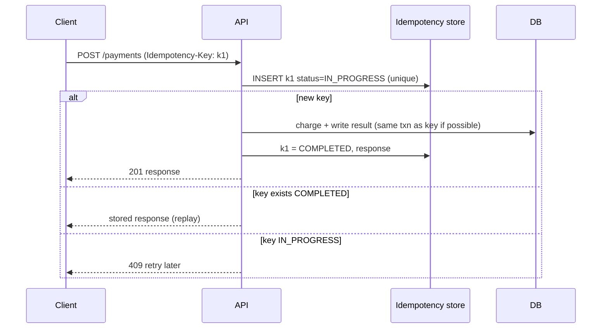

# Idempotency

## Core Idea

An operation is idempotent if doing it multiple times has the same effect as doing it once. Networks lose responses, clients time out and retry, brokers redeliver — so **retries are inevitable** and duplicates will happen. Idempotency turns at-least-once delivery into effectively-once outcomes.

## Mechanism

- **Naturally idempotent:** `SET balance = 100`, `PUT /users/7 {...}`, `DELETE /x/7`, upserts keyed by a natural ID.
- **Not idempotent:** `balance = balance + 10`, `POST /orders`, "send email".
- Make it idempotent by attaching a unique **idempotency key** and recording that it was processed.

### Design details
- Key generated by the **client** (UUIDv4) per logical operation, reused on retries.
- Store `key, request_hash, status, response, created_at` with a unique constraint. If the same key arrives with a different request body -> 422 (misuse).
- Best: write the key row **in the same DB transaction** as the business effect; then there's no window where the effect happened but the key didn't record it.
- Expire keys after a window longer than any client retry horizon (e.g., 24 h — an assumption; choose per product).
- For consumers: dedupe by message/event ID (inbox table) or make the effect conditional: `UPDATE accounts SET ... WHERE last_event_seq < :seq`.
- For external side effects (payment provider), pass your idempotency key through if the provider supports it.

### Exactly-once myths
- Networks can't deliver exactly once: the sender can't distinguish "message lost" from "ack lost" (Two Generals).
- Kafka's exactly-once semantics apply to read-process-write **within Kafka** (idempotent producer + transactions). Once you call an external API or send an email, you're back to at-least-once + idempotency.
- "Exactly-once processing" = at-least-once delivery + idempotent/transactional effect.

## Example (assumptions)

Mobile checkout on a flaky network: the client times out after 10 s and retries 3 times with the same key. Without idempotency, a slow-but-successful first attempt plus one retry = double charge. With keys: the retry finds `COMPLETED` and returns the original receipt. Storage: 5M payments/day × 1 KB = 5 GB/day; with 24 h expiry, ~5 GB live.

## Tradeoffs

| Choice | Tradeoff |
|---|---|
| Key in same DB txn | Strongest; couples idempotency store to service DB |
| Separate store (Redis) | Fast; failure between effect and key write leaves a gap |
| Long retention | Safer against late retries vs storage |
| Storing full response | Exact replay vs storage and PII |

## Failure Modes

- Key checked but not atomically claimed -> two concurrent requests both proceed. Use unique insert or `SET NX`.
- Crash after effect, before key marked complete -> retry re-executes (fix: same transaction, or record effect ID).
- Client generates a new key per retry (bug) -> no protection.
- Key reused for a different operation -> wrong replay; hash and compare request body.
- Dedup window shorter than redelivery delay (e.g., SQS FIFO's 5-minute dedup window).

## Security Implications

Scope keys per authenticated principal (`tenant:user:key`) — otherwise one user could replay or probe another's response. Stored responses may contain sensitive data; encrypt and expire. Idempotency also defends against replay-based double-spend, but it is not a substitute for request signing and nonces in security protocols.

## Real-World Usage

- Stripe API: `Idempotency-Key` header on POST requests; results saved and replayed for retries.
- IETF draft "The Idempotency-Key HTTP Header Field" standardizes the header.
- AWS APIs use `ClientToken` parameters (e.g., EC2 RunInstances) for idempotent creates.
- SQS FIFO: `MessageDeduplicationId` with a 5-minute dedup interval.

## Interview Questions

- **Is PUT idempotent? POST?** PUT and DELETE are defined idempotent by HTTP semantics; POST isn't — add keys.
- **Where do you store keys?** Ideally in the same transactional DB as the effect; unique constraint on the key.
- **Can Kafka give exactly-once to my DB?** Not by itself; use transactional outbox/inbox or idempotent writes keyed by offset/event ID.
- **What's the response for a concurrent duplicate?** 409 or wait-and-return once the first completes.

Implementation patterns (code, config, and failure handling live there; this note covers the concept and tradeoffs): [[Pattern-Idempotency-Keys]] · [[Pattern-Transactional-Outbox]] · [[Pattern-Retry-with-Backoff]]

## Related

[[System-Design-Index]] · [[Message-Queues]] · [[Event-Driven-Architecture]] · [[Fault-Tolerance]] · [[API-Design-REST-gRPC-GraphQL]] · [[Distributed-Locks]] · [[Case-Study-Payment-System]]
