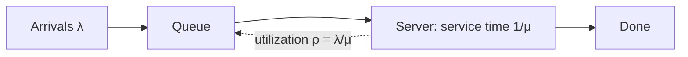

# Latency and Throughput

## Core Idea

**Latency** is how long one request takes; **throughput** is how many complete per unit time. They interact through queueing: as utilization approaches 100%, queues grow and latency explodes. Measure latency in **percentiles** (p50/p99/p999), never averages — the tail is what users on fan-out requests feel.

## Mechanism

- **Little's Law:** L = λ × W (items in system = arrival rate × time in system). Holds for any stable system.
- **M/M/1 intuition:** mean time in system ∝ 1/(1 − ρ). At ρ = 0.5 time in system (queueing + service) is 2× the service time; at 0.9 it is 10×; at 0.99 it is 100×. Hence run at ~50-70% utilization for latency-sensitive services.
- **Tail amplification:** if a request fans out to 100 backends and each has a 1% chance of being slow, P(at least one slow) = 1 − 0.99^100 ≈ 63%.

## Example (assumptions)

A service with 20 ms mean service time, 8 worker threads: max throughput ≈ 8 / 0.02 = 400 RPS. Little's Law at 300 RPS with W = 30 ms: L = 300 × 0.03 = 9 requests in the system, but only 300 × 0.02 = 6 are being served (ρ = 6/8 = 75%) — the other ~3 are waiting, which is why W (30 ms) already exceeds the service time (20 ms). Pushing toward 400 RPS makes W grow sharply, not linearly. Either add workers/instances or cut service time (cache the 12 ms DB call).

## Tradeoffs

| Lever | Latency effect | Throughput effect |
|---|---|---|
| Batching | Worse (wait to fill batch) | Better (amortize overhead) |
| Caching | Better | Better |
| Compression | CPU cost vs fewer bytes on wire | Better on bandwidth-bound links |
| Hedged requests | Better tail | Extra load (bounded, e.g. send 2nd after p95) |
| Async queue | Faster ack, slower completion | Smooths bursts |
| Higher utilization | Worse | Better, up to collapse |

## Failure Modes

- Reporting averages hides p99 regressions.
- Coordinated omission: load generators that wait for responses under-report latency during stalls.
- GC pauses, noisy neighbors, and cold caches dominate tails.
- Unbounded queues turn overload into huge latency plus OOM — bound them and shed load ([[Fault-Tolerance]]).

## Security Implications

Latency differences leak information (timing attacks on string compare, user-enumeration via login timing) — use constant-time comparison. Slowloris-style attacks consume connections, not bandwidth — enforce header/body timeouts at the LB.

## Real-World Usage

- The "tail at scale" work from Google (Dean & Barroso) popularized hedged and tied requests to cut fan-out tail latency.
- Kafka producers trade latency for throughput via `linger.ms` and `batch.size`.
- HTTP/2 and gRPC multiplex requests over one connection to reduce handshake latency.

## Interview Questions

- **Why p99 not mean?** A user session makes many requests; many will hit the tail. Mean hides bimodal distributions.
- **What's Little's Law useful for?** Sizing thread pools and connection pools: concurrency needed = RPS × latency.
- **How do you cut tail latency?** Remove fan-out, hedge requests, set timeouts, isolate noisy workloads, keep utilization below the knee.
- **Throughput up, latency flat — how?** Add parallel capacity (horizontal scale) rather than pushing utilization of existing nodes.

## Related

[[System-Design-Index]] · [[Caching]] · [[CDN]] · [[Load-Balancing]] · [[Observability]] · [[Fault-Tolerance]]
