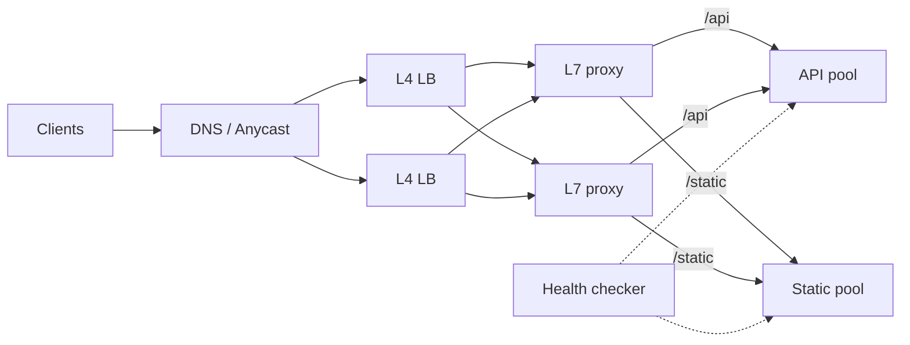

# Load Balancing

## Core Idea

A load balancer spreads requests across a pool of backends, removes unhealthy ones, and gives clients one stable address. It enables horizontal scaling and zero-downtime deploys.

## Mechanism

### L4 vs L7

| | L4 (transport) | L7 (application) |
|---|---|---|
| Sees | IP, port, TCP/UDP | HTTP method, path, headers, cookies, gRPC |
| Can do | Forward connections, very fast, protocol-agnostic | Path/host routing, TLS termination, retries, header rewrite, auth, per-request balancing of multiplexed HTTP/2 |
| Cost | Low CPU | Parses every request; more CPU |
| Examples | AWS NLB, Linux IPVS, Maglev | AWS ALB, NGINX, Envoy, HAProxy (can do both) |

Note: with HTTP/2 or gRPC, one long-lived connection carries many requests — an L4 balancer pins all of them to one backend. Use L7 for per-request balancing.

### Algorithms

- **Round robin / weighted round robin** — simple, assumes similar request cost.
- **Least connections / least outstanding requests** — adapts to uneven request cost.
- **Power of two choices** — pick 2 random backends, send to the less loaded; near-optimal with little state (used in Envoy, and described in Mitzenmacher's work).
- **Hash-based (IP hash, consistent hashing / ring hash, Maglev)** — stickiness for caches or sessions; see [[Sharding-and-Partitioning]].
- **Latency-aware (EWMA)** — prefer consistently fast backends.

### Health checks

- **Active:** LB probes `/healthz` every N seconds; mark down after K failures, up after M successes.
- **Passive (outlier detection):** eject backends returning 5xx/timeouts on real traffic.
- Separate **liveness** (process alive) from **readiness** (can serve: DB connected, warmed up).
- **Connection draining:** stop new requests, let in-flight finish before removing an instance.

## Example (assumptions)

3 app servers, one with 2× CPU. Weighted round robin 2:1:1. A deploy restarts server B: readiness fails -> LB stops sending new requests, drains for 30 s, B restarts, warms cache, readiness passes, traffic resumes. No user errors.

## Tradeoffs

| Choice | Pro | Con |
|---|---|---|
| Sticky sessions | Local session cache works | Uneven load, lost sessions on node death |
| Client-side LB (gRPC, service mesh) | No extra hop | Every client needs discovery + logic |
| Central LB | Simple clients | Extra hop, must itself be HA |
| DNS LB | Global, cheap | TTL caching makes failover slow and coarse |

## Failure Modes

- LB as SPOF -> run pairs (VRRP/keepalived), managed LBs, or anycast.
- Health check too shallow (returns 200 while DB is down) or too deep (DB blip marks all nodes unhealthy -> total outage). Fail open when all backends look unhealthy.
- Retry storms at LB amplify overload; cap retries and use budgets.
- Uneven load from long-lived connections (WebSockets) after scale-out — rebalance by periodically closing connections.

## Security Implications

L7 LBs are the natural place for TLS termination, WAF, request size limits, header normalization, and [[Rate-Limiting]]. Re-encrypt to backends (mTLS) if the internal network is untrusted. Preserve client IP via PROXY protocol or `X-Forwarded-For`, and only trust that header from your own proxies (spoofing risk).

## Real-World Usage

- Google Maglev: software L4 LB using consistent hashing across ECMP routers.
- Envoy: L7 proxy with least-request (power of two choices), outlier detection, retries — the data plane of many service meshes.
- AWS: NLB for L4, ALB for L7 HTTP routing.

## Interview Questions

- **L4 or L7?** L7 when you need content routing, TLS termination, gRPC per-request balancing; L4 for raw throughput or non-HTTP protocols.
- **How does the LB know a server is down?** Active probes plus passive outlier detection with thresholds.
- **Stateful WebSocket servers?** Consistent hashing on user/room ID, or a pub/sub backplane so any server can deliver.
- **Is the LB a SPOF?** Only if single; use redundant pairs, managed LBs, DNS with multiple IPs, or anycast.

## Related

[[System-Design-Index]] · [[API-Gateway]] · [[Service-Discovery]] · [[Fault-Tolerance]] · [[CDN]] · [[Sharding-and-Partitioning]]
