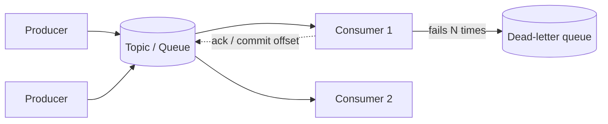

# Message Queues

## Core Idea

A message broker sits between producers and consumers so they don't need to be up, fast, or scaled together. It gives **decoupling, buffering of spikes, async processing, and fan-out**. Two families: **queues** (message consumed and removed; work distribution) and **logs** (append-only, retained, consumers track offsets; replay and multiple independent readers).

## Mechanism

### Delivery semantics
- **At-most-once:** ack before processing; crash = message lost.
- **At-least-once:** process then ack; crash between = redelivery -> **consumers must be idempotent** ([[Idempotency]]). The practical default.
- **Exactly-once:** only within a closed system (e.g., Kafka transactions for read-process-write from Kafka to Kafka). With external side effects (email, charge), you get "effectively once" = at-least-once + idempotent processing.

### Ordering
- Global ordering doesn't scale. Order is typically per partition (Kafka), per message group (SQS FIFO `MessageGroupId`), or per queue with a single consumer (RabbitMQ).
- Pick a key (e.g., `order_id`) so related events go to the same partition.
- Retries and parallel consumers can reorder; handle with version numbers or sequence checks.

### Dead-letter queue (DLQ)
After N failed attempts (poison message), move to a DLQ for inspection and redrive, rather than blocking the partition or looping forever. Alert on DLQ depth.

### Backpressure
- Consumer lag grows when consumers are slower than producers. Monitor lag.
- Options: scale consumers (up to partition count for Kafka), bound queue size and reject/slow producers, shed low-priority work, batch processing.
- Pull-based consumers (Kafka, SQS) naturally apply backpressure; push-based (RabbitMQ) use **prefetch** limits.

## Kafka vs RabbitMQ vs SQS

| | Apache Kafka | RabbitMQ | Amazon SQS |
|---|---|---|---|
| Model | Distributed partitioned log | Broker with exchanges -> queues (AMQP 0-9-1); also streams | Managed queue |
| Retention | Time/size-based; messages stay after consumption; replay by resetting offsets | Removed on ack (classic/quorum queues) | Removed on delete; retention configurable up to 14 days |
| Ordering | Per partition | Per queue (with single consumer) | Standard: best-effort; FIFO: per message group |
| Delivery | At-least-once default; idempotent producer + transactions for exactly-once within Kafka | At-least-once with acks; at-most-once with auto-ack | Standard: at-least-once (occasional duplicates); FIFO: dedup within 5-minute window |
| Consumer scaling | Consumer group; max parallelism = #partitions | Competing consumers on a queue | Any number of pollers |
| Routing | Topic + key | Rich: direct, topic, fanout, headers exchanges | None built-in (pair with SNS/EventBridge for fan-out) |
| Ops | Self-managed or managed (MSK, Confluent) | Self-managed or managed | Fully managed, serverless |
| Best for | Event streaming, logs, CDC, replay, high throughput | Task queues, complex routing, RPC-ish patterns | Simple decoupling on AWS with zero ops |

## Example (assumptions)

Image upload service: 200 uploads/s peak, thumbnail generation takes 2 s each -> need 400 concurrent workers at peak, or accept a backlog. Upload API writes to object storage, enqueues `{image_id}`, returns 202. Workers autoscale on queue depth; 3 failures -> DLQ. Processing is idempotent: output key `thumbs/{image_id}_{size}` so a duplicate just overwrites.

## Tradeoffs

| Choice | Pro | Con |
|---|---|---|
| Async via queue | Resilience, spike absorption | Eventual consistency, harder tracing |
| More partitions | More parallelism | More open files/metadata, rebalances, ordering scope shrinks |
| Long retention | Replay, new consumers backfill | Storage cost |
| FIFO/ordering | Correctness | Lower throughput, head-of-line blocking |

## Failure Modes

- Poison message blocks an ordered partition — DLQ or skip with record.
- Duplicate processing from redelivery or consumer rebalance.
- Visibility timeout (SQS) shorter than processing time -> duplicates.
- Consumer rebalances storms in Kafka pause consumption.
- Unbounded lag -> data ages out of retention before processing (data loss).
- Dual-write problem: DB commit succeeds, publish fails -> use the outbox pattern ([[Event-Driven-Architecture]]).

## Security Implications

Authenticate producers/consumers (SASL/mTLS for Kafka, IAM for SQS), authorize per topic, encrypt in transit and at rest. Treat messages as untrusted input — validate schemas (schema registry). Sensitive data in retained logs persists for the retention period; consider field encryption and crypto-shredding for erasure requests.

## Real-World Usage

- Kafka originated at LinkedIn for activity streams and log aggregation; now common for CDC (Debezium) and stream processing.
- SQS + SNS fan-out is a standard AWS decoupling pattern.
- RabbitMQ is widely used for background job queues (e.g., with Celery).

## Interview Questions

- **Kafka or SQS?** Kafka for high-throughput streams, replay, multiple independent consumers, per-key ordering. SQS for simple task queues without ops burden.
- **Can you get exactly-once?** End-to-end with external side effects, no; you build at-least-once + idempotent consumers. Kafka's EOS covers Kafka-to-Kafka pipelines.
- **How do you preserve order per user?** Partition by user ID; one consumer per partition; handle retries without reordering (retry in place or per-key retry topic with care).
- **What's a DLQ for?** Isolate poison messages so the pipeline keeps flowing and humans can inspect/redrive.

## Related

[[System-Design-Index]] · [[Event-Driven-Architecture]] · [[Idempotency]] · [[Fault-Tolerance]] · [[Sharding-and-Partitioning]] · [[Case-Study-Notification-System]] · [[Case-Study-Log-Aggregation]]
