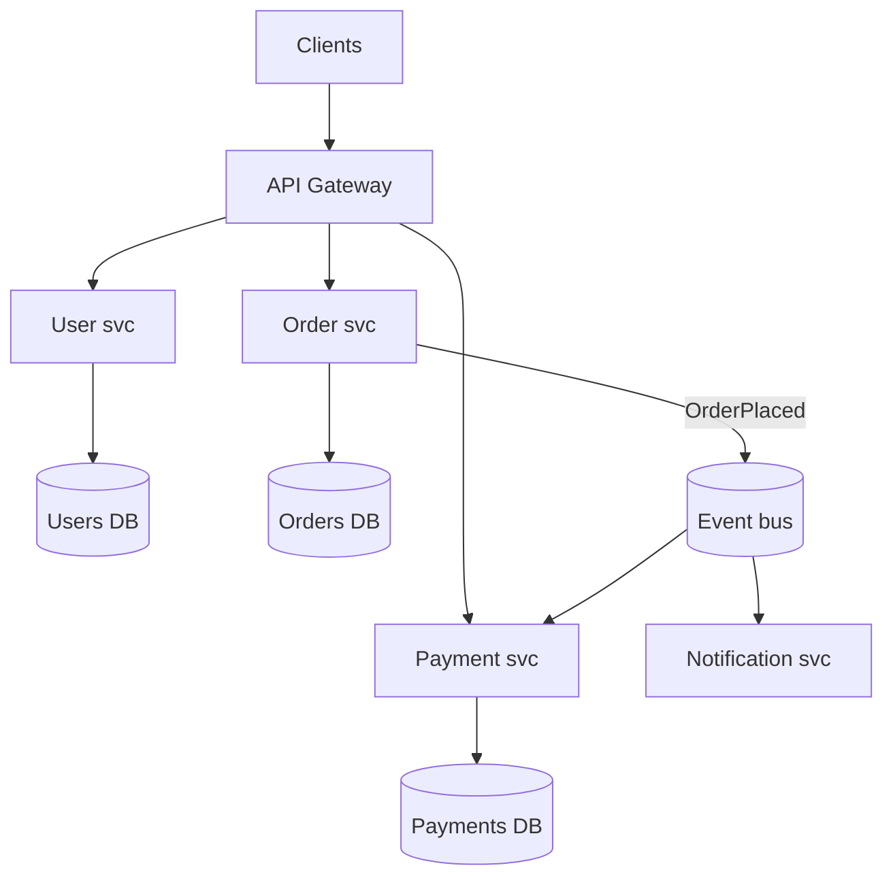

# Microservices

## Core Idea

Microservices split a system into independently deployable services, each owning a business capability and **its own data**. The main benefit is organizational: teams deploy and scale independently. The price is distributed-systems complexity: network failures, eventual consistency, observability, and ops overhead. Microservices solve people-scaling problems more than performance problems.

## Mechanism

### Monolith vs modular monolith vs microservices

| | Monolith | Modular monolith | Microservices |
|---|---|---|---|
| Deploy unit | One | One | Many |
| Boundaries | Often blurry | Enforced modules in-process | Network |
| Transactions | Local ACID | Local ACID | Sagas / eventual |
| Ops cost | Low | Low | High (CI/CD, discovery, tracing, on-call per service) |
| Team scaling | Contention past some size | Better | Best, if boundaries are right |
| Failure isolation | Poor | Poor | Good, if you add timeouts/bulkheads |

### Drawing boundaries
- Use **Domain-Driven Design bounded contexts**: a boundary where a term has one meaning (e.g., "Product" in Catalog vs Shipping).
- Align with teams (Conway's law); each service owned by one team.
- **Database per service**; no shared tables. Integrate via APIs or events.
- High cohesion inside, low chattiness across. If two services always change together or call each other on every request, merge them.
- Extract incrementally from a monolith using the **strangler fig** pattern.

## Example (assumptions)

A startup with 8 engineers: modular monolith with clear packages (users, orders, payments) and one Postgres with separate schemas. At 60 engineers across 7 teams, deploy contention hurts; extract payments first (distinct compliance needs, different scaling), then notifications (async, easy to isolate).

## Tradeoffs

| Benefit | Cost |
|---|---|
| Independent deploy/scale | Network latency and partial failures on every call |
| Tech heterogeneity | Platform sprawl, harder hiring/tooling |
| Fault isolation | Requires timeouts, retries, circuit breakers everywhere |
| Team autonomy | Cross-service changes need coordination and versioning |
| Smaller codebases | Distributed debugging needs tracing |

## Failure Modes

- **Distributed monolith:** services must deploy together, share a DB, or synchronously chain 6 calls deep.
- Cascading failures from missing timeouts ([[Fault-Tolerance]]).
- Too fine-grained ("nano-services") -> chatty, slow, costly.
- Data consistency bugs across service DBs without outbox/sagas.
- Version skew between services without backward-compatible APIs.

## Security Implications

Every hop is an attack surface: use **mTLS** between services (service mesh), propagate end-user identity via signed tokens (JWT) and re-check authorization at each service (zero trust). Secrets per service with least privilege. Larger inventory = more to patch; keep an SBOM. East-west traffic needs network policies, not just a perimeter.

## Real-World Usage

- Amazon's move to service-oriented architecture and "two-pizza teams" is a widely cited origin story.
- Netflix open-sourced much of its microservice tooling (Eureka, Hystrix, Zuul).
- Segment and Amazon Prime Video have publicly written about consolidating some microservices back into fewer services when overhead outweighed benefits.

## Interview Questions

- **Monolith or microservices for a new product?** Modular monolith; extract services when a module has distinct scaling, reliability, compliance, or team-ownership needs.
- **How do you split?** By bounded context and data ownership, not by technical layer.
- **How do you handle transactions across services?** Avoid them via boundaries; otherwise sagas with outbox and idempotent steps.
- **What infra do microservices require?** CI/CD per service, discovery, gateway, centralized logs/metrics/traces, config and secrets management.

Implementation patterns (code, config, and failure handling live there; this note covers the concept and tradeoffs): [[Pattern-Saga]] · [[Pattern-Circuit-Breaker]] · [[Pattern-Bulkhead]] · [[Pattern-Strangler-Fig]] · [[Pattern-Transactional-Outbox]] · [[Pattern-Backend-for-Frontend]]

## Related

[[System-Design-Index]] · [[Service-Discovery]] · [[API-Gateway]] · [[Event-Driven-Architecture]] · [[Observability]] · [[Fault-Tolerance]] · [[API-Design-REST-gRPC-GraphQL]]
