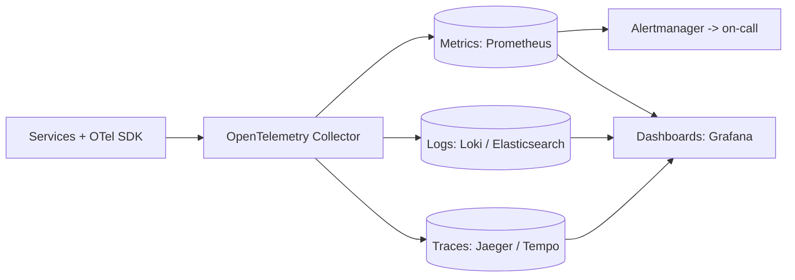

# Observability

## Core Idea

Observability is the ability to answer new questions about a running system from its outputs, without shipping new code. The three main signals are **metrics** (cheap aggregates, alerting), **logs** (discrete events with detail), and **traces** (a request's path across services). Tie them together with shared IDs (trace ID in every log line) and measure what users feel through **SLIs/SLOs**.

## Mechanism

### Signals

| Signal | Good for | Cost/gotcha |
|---|---|---|
| Metrics | Trends, alerting, SLOs | High-cardinality labels (user_id) explode storage |
| Logs | Debugging specific events | Volume/cost; use structured JSON, sampling, retention tiers |
| Traces | Latency breakdown across services | Need context propagation (W3C `traceparent`); sampling (head vs tail) |
| Profiles | CPU/memory hotspots | Continuous profiling overhead |

### Methods
- **RED** (per service/endpoint): **R**ate, **E**rrors, **D**uration. For request-driven services.
- **USE** (per resource): **U**tilization, **S**aturation, **E**rrors. For CPUs, disks, pools, queues.
- **Four golden signals** (Google SRE book): latency, traffic, errors, saturation.

### SLI / SLO / SLA / error budget
- **SLI:** a measured ratio, e.g. `good requests / valid requests` where good = status < 500 and latency < 300 ms.
- **SLO:** target for the SLI over a window, e.g. 99.9% over 28 days.
- **SLA:** contractual promise with penalties; set looser than the SLO.
- **Error budget:** 1 − SLO. At 99.9% over 28 days, 0.1% of requests may fail (~40 min of full outage equivalent). Budget left -> ship faster; budget burned -> freeze risky changes, fix reliability.
- **Burn-rate alerts:** alert when budget is consumed fast (e.g., multi-window: 1 h and 5 min windows both above a high burn rate) rather than on raw thresholds.

## Example (assumptions)

Checkout API: 1M requests/day, SLO 99.9% -> error budget 1,000 bad requests/day (~28k per 28 days). A bad deploy causes 2% errors: burns 20k requests/day of budget, i.e., the 28-day budget is gone in under 2 days -> page immediately; a 0.15% error rate is a ticket, not a page.

## Tradeoffs

| Choice | Tradeoff |
|---|---|
| Head sampling | Cheap, but may drop the interesting slow/error traces |
| Tail sampling | Keeps errors/slow traces; needs buffering in collector |
| Log everything | Full detail vs cost and PII risk |
| Alert on causes (CPU) | Noisy; alert on symptoms (SLO burn) instead |

## Failure Modes

- Alert fatigue from threshold alerts on causes -> ignored pages.
- Monitoring shares fate with the system (same cluster/region) and dies with it.
- Cardinality explosion takes down the metrics backend.
- Missing trace context propagation across async boundaries (queues).
- Dashboards nobody reads; no runbooks linked from alerts.

## Security Implications

Logs are a top source of accidental secret and PII leakage — redact tokens, passwords, card numbers at the SDK/collector. Restrict log access; logs are also forensic evidence, so ship security-relevant logs to tamper-resistant storage with retention policies (feeds a SIEM). Log injection (CRLF, forged entries) — use structured logging. Audit logs for admin actions are a compliance requirement in many regimes.

## Real-World Usage

- OpenTelemetry (CNCF) is the vendor-neutral standard for instrumentation.
- Prometheus (pull-based metrics) + Grafana is a common open-source stack; Jaeger and Grafana Tempo for tracing.
- Google's SRE books define SLOs, error budgets, and burn-rate alerting.
- Dapper (Google, 2010) is the paper that popularized distributed tracing.

## Interview Questions

- **Metrics vs logs vs traces?** Metrics tell you something's wrong; traces tell you where; logs tell you why.
- **What would you alert on?** SLO burn rate for user-facing symptoms; saturation signals as warnings; never page on something that needs no action.
- **Define an SLI for a feed.** Proportion of feed loads returning successfully within 500 ms, measured at the load balancer.
- **What's an error budget used for?** A shared, objective rule balancing release velocity against reliability.

## Related

[[System-Design-Index]] · [[Availability-and-Reliability]] · [[Fault-Tolerance]] · [[Microservices]] · [[Latency-and-Throughput]] · [[Case-Study-Log-Aggregation]] · [[Case-Study-SIEM]]
