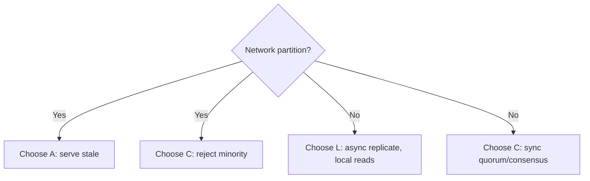

# PACELC

## Core Idea

Proposed by Daniel Abadi (2010/2012): **if Partition (P), trade Availability vs Consistency (A/C); Else (E), trade Latency vs Consistency (L/C).** CAP only describes the rare partition case; PACELC captures the everyday cost of consistency — synchronous coordination adds latency on every request.

## Mechanism

| Class | Meaning | Typical examples |
|---|---|---|
| PA/EL | Available in partition, low latency normally | Cassandra, DynamoDB default config, Riak |
| PC/EC | Consistent always, pays latency | Spanner, etcd, ZooKeeper, CockroachDB |
| PA/EC | Available in partition but consistent normally | Abadi cites MongoDB of that era (config-dependent) |
| PC/EL | Consistent in partition, low latency normally | PNUTS (Yahoo) per Abadi's paper |

Classifications depend heavily on configuration; treat them as defaults, not laws.

## Example (assumptions)

Two regions 80 ms RTT apart. EC: each write waits for the remote ack -> +80 ms minimum per write. EL: acknowledge locally in ~2 ms, replicate asynchronously, accept a window where the other region reads stale data and a region failure may lose the last few hundred ms of writes.

## Tradeoffs

| Choice (no partition) | Gain | Cost |
|---|---|---|
| EL | Fast, local writes and reads | Staleness, possible data loss on failover, conflicts |
| EC | Correctness, simpler app logic | RTT on each write; throughput bound by coordination |

## Failure Modes

- Assuming "no partition = strong consistency for free" — it still costs RTTs.
- Configuring quorum reads but async writes (inconsistent intent).
- Cross-region EC with a far-away leader: every write pays the worst RTT.

## Security Implications

EL systems propagate revocations and ACL changes lazily; bound staleness for security state or keep it in an EC store. Latency pressure tempts teams to skip synchronous checks — don't cache authz decisions longer than you can tolerate.

## Real-World Usage

- Cassandra lets you pick per query (ONE vs QUORUM vs LOCAL_QUORUM) — you literally choose L vs C per operation.
- DynamoDB global tables replicate asynchronously across regions (EL across regions); newer multi-region strong consistency options exist — check current AWS docs for specifics.
- Spanner pays commit wait (TrueTime uncertainty) plus Paxos round trips to stay EC.

## Interview Questions

- **Why PACELC over CAP?** CAP says nothing when the network is healthy, which is almost always; PACELC names the latency tax.
- **Classify your design.** "Timeline: PA/EL — stale for seconds is fine. Payments ledger: PC/EC — correctness beats 50 ms."
- **How to reduce EC latency?** Place the leader/quorum near writers, use regional quorums (LOCAL_QUORUM), or partition data by home region.

## Related

[[System-Design-Index]] · [[CAP-Theorem]] · [[Consistency-Models]] · [[Replication]] · [[Latency-and-Throughput]]
